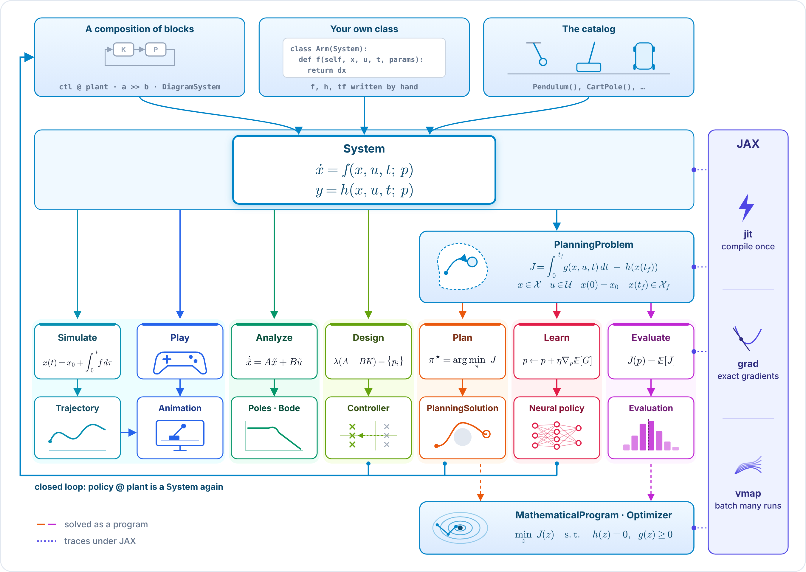
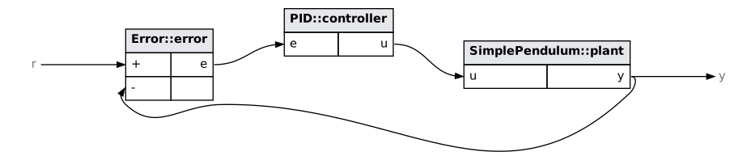
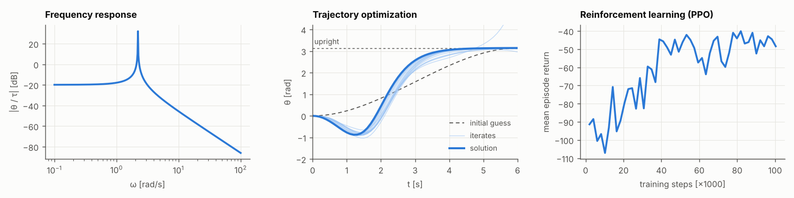
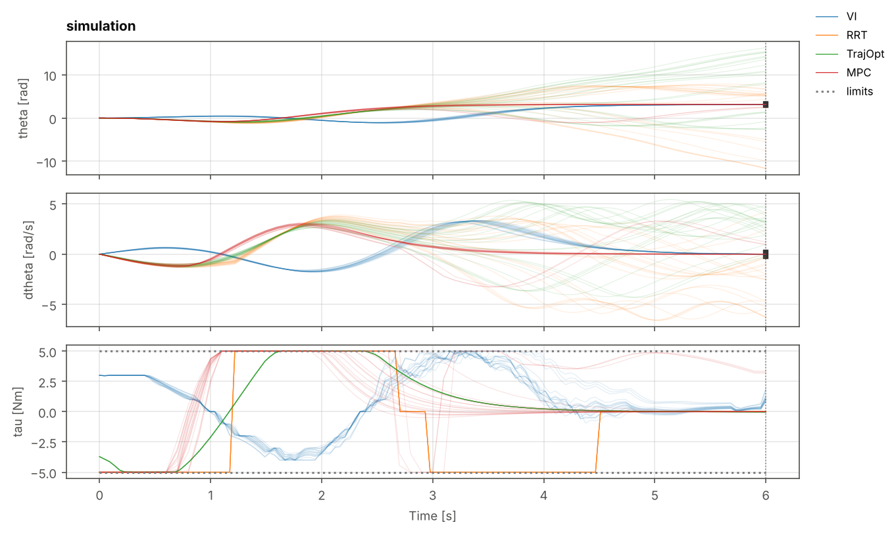

# minilink

**Write the equations once. Simulate, analyze, control, plan, optimize, learn.**

[](https://colab.research.google.com/github/alx87grd/minilink/blob/main/examples/tutorial/showcase_minilink.ipynb)
[](https://github.com/alx87grd/minilink/tree/main/examples/tutorial)
[](https://pypi.org/project/minilink/)
[](https://alx87grd.github.io/minilink/)
[](https://github.com/alx87grd/minilink/blob/main/LICENSE)

<table>
  <tr>
<td width="25%" align="center" valign="bottom"></td>
<td width="25%" align="center" valign="bottom"></td>
<td width="25%" align="center" valign="bottom"></td>
<td width="25%" align="center" valign="bottom"></td>
  </tr>
  <tr>
<td width="25%" align="center" valign="top">Cart-pole swing-up, trajectory optimization</td>
<td width="25%" align="center" valign="top">UR5 arm, task-space impedance control<br/><a href="https://alx87grd.github.io/minilink/_static/showcase/ur5_impedance.html">interactive 3-D</a></td>
<td width="25%" align="center" valign="top"><a href="#3-one-problem-every-planner-one-score">Racecar, model predictive control</a><br/><a href="https://alx87grd.github.io/minilink/_static/showcase/racecar_mpc.html">interactive 3-D</a></td>
<td width="25%" align="center" valign="top">Rocket landing, reinforcement learning</td>
  </tr>
</table>

Minilink is an open-source Python framework for dynamical systems, control, optimization, and learning.
Write a physical model once in pure textbook ODE equations as the core object in Minilink: a `System`. Compose models and blocks into block diagrams, which are also just new Systems. This unified `System` is the standard interface to all tools: classical and modern control, optimal control (MPC, MPPI), machine learning (neural networks, reinforcement learning), and parameter optimization.
All core equation paths are pure functions—arrays in, arrays out—allowing the exact same code to work with either a minimalist NumPy/SciPy/Matplotlib setup or a JAX backend to compile, batch, and autodifferentiate the same equations.

## The Minilink backbone

Three mathematical foundations hold the framework together:
1. **The model (`System`):** continuous differential equations $\dot{x} = f(x, u, t; p)$ and observations $y = h(x, u, t; p)$.
2. **The task (`PlanningProblem`):** the model paired with boundary sets $\mathcal{X}, \mathcal{U}, \mathcal{X}_f$, cost $J$, and time horizon $t_f$.
3. **The solver boundary (`MathematicalProgram` & `Optimizer`):** a standard nonlinear program $\min_z J(z)$ s.t. $g(z) \ge 0,\ h(z) = 0$ connecting problems to plug-and-play numerical solvers.

One differentiable path connects modeling, analytical control, trajectory optimization, and learning:



*Full pipeline reference: [docs/pipelines.md](https://github.com/alx87grd/minilink/blob/main/docs/pipelines.md).*

## Install

Python 3.10+. **pip**:
- `pip install minilink` runs simulation, plots, LQR, and value iteration on standard NumPy, SciPy, and Matplotlib.
- `pip install "minilink[full]"` adds JAX, Plotly, MeshCat, Pygame, SymPy, and Gymnasium.

**Conda**, everything included (JAX, Graphviz, Ipopt, 3-D animation, Jupyter):

```bash
git clone https://github.com/alx87grd/minilink.git && cd minilink
conda env create -f environment.yml && conda activate minilink
conda env config vars set PYTHONPATH="$PWD" && conda deactivate && conda activate minilink
```

**Colab**: open any notebook with "Open in Colab", or start yours with
`!git clone https://github.com/alx87grd/minilink` and `import sys; sys.path.insert(0, "/content/minilink")`.

*Optional system dependencies:* `plot_diagram()` requires Graphviz ([download](https://graphviz.org/download/), then `pip install graphviz`); the Ipopt solver is `conda install -c conda-forge cyipopt` (trajectory optimization runs on SciPy without it).

## 1. Block diagrams as code

```python
from minilink import PID, SingleMass

plant = SingleMass()
pid = PID(Kp=10.0, Ki=1.0, Kd=2.0)
diagram = pid @ plant
diagram.plot_diagram()
```



Code is the single source of truth:

- **Algebraic shortcuts:** `ctrl @ plant` (feedback loop, with the error $e = r - y$ the PID reads), `a >> b` (series), `a + b` (side by side), `sys % Δ` (zero-order hold digital clock sampling).
- **Explicit wiring:** `diag.connect("controller", "u", "plant", "u")` connects arbitrary multi-loop networks with immediate port checks.
- **Closed loops are systems:** `diagram.compute_trajectory()`, `diagram.transfer_function()`, `diagram.plot_bode()`: every tool works identically on a closed loop.

## 2. One equation, many tools

A physical model is defined by three pure mathematical mappings:

$$\dot{x} = f(x, u, t; p) \quad \text{(dynamics)}$$
$$y = h(x, u, t; p) \quad \text{(outputs, default } y = x\text{)}$$
$$T = \mathrm{tf}(x, u, t; p) \quad \text{(body poses for 3D animation)}$$

**Functional purity** means equations are stateless: arrays in, arrays out. No simulation time or state is mutated on `self`.
This purity allows precise numerical integration, reproducible experiments, exact linear analysis, arbitrary composition into nested systems, parallel GPU rollouts, and automatic differentiation.
So the same pendulum goes from a Bode plot to a neural policy, one line each:

```python
import numpy as np
from minilink import (
    BallSet, Pendulum, PlanningProblem, QuadraticCost, Uniform,
    ReinforcementLearningPlanner, TrajectoryOptimizationPlanner,
)

plant = Pendulum()
up = np.array([np.pi, 0.0])
plant.plot_bode()

cost = QuadraticCost.from_system(plant, x_bar=up, S=100 * np.eye(2))
swing_up = PlanningProblem(
    plant,
    x0=[0.0, 0.0],
    Xf=BallSet(up, 0.2),
    horizon=6.0,
    cost=cost,
    X=plant.state.box,
    U=plant.input_box,
)
opt = TrajectoryOptimizationPlanner(swing_up, n_steps=60).solve(live_plot=True)

start = Uniform([np.pi - 0.5, -1.0], [np.pi + 0.5, 1.0])
balance = PlanningProblem(plant, x0=start, cost=cost, horizon=5.0, U=plant.input_box)
ppo = ReinforcementLearningPlanner(balance, dt=0.05)
ppo.solve(n_timesteps=100_000)
ppo.plot_learning_curve()
```



The same plant takes `lqr`, `kalman`, value iteration, RRT, MPC, and the rest: each is one more line.

## 3. One problem, every planner, one score

The identical problem definition is handed to completely different solver paradigms, and every planner returns a `PlanningSolution` whose controller is itself a `System`: a feedback law closes the loop via `controller @ plant`, an open-loop plan drives it via `controller >> plant`. `compare` scores every controller on the same problem: the same model, cost, sets, and draws. Here the swing-up of section 2, with the pendulum's mass uncertain by ±20 %:

```python
from minilink import DynamicProgrammingPlanner, RRTPlanner, compare
from minilink.control import ModelPredictiveController

vi_planner = DynamicProgrammingPlanner(swing_up, x_grid=(101, 101), u_grid=(11,), dt=0.05)
vi = vi_planner.solve()
rrt = RRTPlanner(swing_up, seed=0).solve()

look_ahead = swing_up.replace(horizon=2.0, Xf=None)
mpc_planner = TrajectoryOptimizationPlanner(look_ahead, n_steps=20, backend="jax")
mpc = ModelPredictiveController(mpc_planner) % 0.1

mass = Uniform(0.8, 1.2)
uncertain = swing_up.replace(distributions={"plant": {"m": mass}})
comparison = compare(uncertain, VI=vi, RRT=rrt, TrajOpt=opt, MPC=mpc, n_trials=20)
comparison.plot_simulated_trajectory()
```



The two open-loop plans reach the goal on the nominal model and miss it when the mass changes (0 of 20 draws); the two feedback laws reach it on most draws (value iteration 20 of 20, MPC 17 of 20).

## 4. From score to controller

All transcriptions lower late to a single, canonical mathematical program:

$$\min_z J(z; p) \quad \text{s.t.} \quad g(z; p) \ge 0, \quad h(z; p) = 0$$

The score of section 3 is such a $J$: a function of every parameter in the diagram, the controller's gains and the plant's numbers alike, named by its path (`"controller.Kp"`, `"plant.m"`). The exact same equation traces under JAX without rewriting physics, so its gradient runs through the whole simulation, and the `Optimizer` tunes the controller on it. Here an impedance law brings the pendulum to rest over the uncertain mass:

```python
import jax
from minilink import Impedance, Optimizer

rest_cost = QuadraticCost.from_system(plant, R=0.1 * np.eye(1))
rest = PlanningProblem(plant, x0=[2.0, 0.0], horizon=5.0, cost=rest_cost)
task = rest.replace(distributions={"plant": {"m": mass}})
evaluator = task.compile(Impedance(Kp=1.0, Kd=1.0), backend="jax")

score = lambda params: evaluator.evaluate(params, n_trials=20).objective
gradient = jax.grad(score)(evaluator.params)

gains = ["controller.Kp", "controller.Kd"]
bounds = {"controller.Kp": (0.0, 50.0), "controller.Kd": (0.0, 20.0)}
program = evaluator.program(gains, bounds=bounds, n_trials=20)
best = Optimizer(program).solve()  # Kp = 0.78, Kd = 3.54: the score falls from 19.3 to 11.0
```

- **Pluggable solvers:** `method=` picks one: `l-bfgs`, `slsqp`, `trust-constr` (SciPy), `gd`, `adam` (first-order), `ipopt`.
- **Opt-in acceleration:** pure NumPy remains the default classroom engine; JAX is activated with a single flag (`backend="jax"`), and batches 1,000 rollouts in 0.4 s on a cloud CPU against about 50 s in a NumPy loop.

## What Minilink is not

1. **Not a heavy multibody contact engine:** for complex contact or high-DoF meshes, wrap an external multibody simulator as a `System` leaf.
2. **Not a sparse NLP modeling language:** Minilink programs and solvers do not exploit sparse Jacobian structure.
3. **Continuous time is primary:** dynamics $f$ represent instantaneous rates ($\dot{x} = dx/dt$), not discrete next-step maps; a clock is applied from outside with `%`.

## Learn more and tutorials

- [Showcase notebook](https://github.com/alx87grd/minilink/blob/main/examples/tutorial/showcase_minilink.ipynb): this page run end to end, with the plots and animations; about a minute to run.
- [Tutorials](https://github.com/alx87grd/minilink/tree/main/examples/tutorial): three layers: `basics/` (model, connect, simulate; start with `01_minilink`), `core/` (the foundation objects and the problem pipeline), `advanced/` (discrete and hybrid loops, optimal control, MPC, RL, differentiable loops).
- [Teaching notebooks](https://github.com/alx87grd/teaching): course and topic notebooks in their own repository: control, dynamic programming, LQR, MPC, reinforcement learning.
- **Interactive play and 3-D:** `plant.game()` drives plants with keyboard or gamepad; `animate(traj, renderer="meshcat")` plays a trajectory in an interactive 3-D viewer ([UR-5 impedance control](https://alx87grd.github.io/minilink/_static/showcase/ur5_impedance.html) • [racecar MPC](https://alx87grd.github.io/minilink/_static/showcase/racecar_mpc.html)).
- [Interactive pitch deck](https://alx87grd.github.io/minilink/presentation.html) · [API reference](https://alx87grd.github.io/minilink/).

Minilink is the successor of [pyro](https://github.com/SherbyRobotics/pyro).
