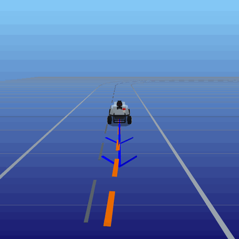

# minilink

**Write the equations once. Simulate, analyze, control, plan, optimize, learn.**

[](https://colab.research.google.com/github/alx87grd/minilink/blob/main/examples/tutorial/showcase_minilink.ipynb)
[](https://github.com/alx87grd/minilink/tree/main/examples/tutorial)
[](https://pypi.org/project/minilink/)
[](https://alx87grd.github.io/minilink/)
[](https://github.com/alx87grd/minilink/blob/main/LICENSE)

<table>
  <tr>
<td width="25%" align="center" valign="bottom"></td>
<td width="25%" align="center" valign="bottom"></td>
<td width="25%" align="center" valign="bottom"></td>
<td width="25%" align="center" valign="bottom"></td>
  </tr>
  <tr>
<td width="25%" align="center" valign="top">Cart-pole swing-up, trajectory optimization</td>
<td width="25%" align="center" valign="top">UR5 arm, task-space impedance control<br/><a href="https://alx87grd.github.io/minilink/_static/showcase/ur5_impedance.html">interactive 3-D</a></td>
<td width="25%" align="center" valign="top"><a href="#3-one-problem-every-planner-one-evaluation">Racecar, model predictive control</a><br/><a href="https://alx87grd.github.io/minilink/_static/showcase/racecar_mpc.html">interactive 3-D</a></td>
<td width="25%" align="center" valign="top">Rocket landing, reinforcement learning</td>
  </tr>
</table>

Minilink is an open-source Python framework for dynamical systems, control, optimization, and learning.
Write a physical model once in pure textbook ODE equations as the core object in Minilink: a `System`. Compose models and blocks into block diagrams, which are also just new Systems. This unified `System` is the standard interface to all tools: classical and modern control, optimal control (MPC, MPPI), machine learning (neural networks, reinforcement learning), and parameter optimization.
All core equation paths are pure functions—arrays in, arrays out—allowing the exact same code to work with either a minimalist NumPy/SciPy/Matplotlib setup or a JAX backend to compile, batch, and autodifferentiate the same equations.

## Install

Recommended, everything included (JAX, Graphviz, Ipopt, 3-D animation, Jupyter):

```bash
git clone https://github.com/alx87grd/minilink.git && cd minilink
conda env create -f environment.yml && conda activate minilink
conda env config vars set PYTHONPATH="$PWD" && conda deactivate && conda activate minilink
```

Or with pip: `pip install "minilink[full]"`, or `pip install minilink` for NumPy only.

## 1. Block diagrams as code

```python
from minilink import PID, SimplePendulum

plant = SimplePendulum()
pid = PID(Kp=10.0, Ki=1.0, Kd=2.0)
diagram = pid @ plant
diagram.plot_diagram()
```


**Custom block:** just define `f` and `h`.

```python
import numpy as np
from minilink import DynamicSystem


class MyPendulum(DynamicSystem):
    def __init__(self):
        super().__init__(state_dim=2, input_dim=1, output_dim=1)

    def f(self, x, u, t=0, params=None):
        theta, dtheta = x
        return np.array([dtheta, u[0] - 9.81 * np.sin(theta)])

    def h(self, x, u, t=0, params=None):
        return x[:1]


diagram = pid @ MyPendulum()
```

## 2. One equation, many tools

A model is three pure functions:

$$\dot{x} = f(x, u, t; p), \qquad y = h(x, u, t; p), \qquad T = \mathrm{tf}(x, u, t; p)$$

dynamics, outputs and body poses. Stateless, arrays in and arrays out, so every tool can integrate, linearize, batch and differentiate them:

```python
import numpy as np
from minilink import (
    BallSet, Pendulum, PlanningProblem, QuadraticCost,
    ReinforcementLearningPlanner, TrajectoryOptimizationPlanner,
)

plant = Pendulum()  # measures its full state
up = np.array([np.pi, 0.0])
plant.plot_bode()

cost = QuadraticCost.from_system(plant, x_bar=up, S=100 * np.eye(2))
swing_up = PlanningProblem(
    plant,
    x0=[0.0, 0.0],
    Xf=BallSet(up, 0.2),
    horizon=6.0,
    cost=cost,
    X=plant.state.box,
    U=plant.input_box,
)
opt = TrajectoryOptimizationPlanner(swing_up, n_steps=60).solve(live_plot=True)

ppo = ReinforcementLearningPlanner(swing_up, dt=0.05, gamma=0.99)
ppo.solve(n_timesteps=100_000)
ppo.plot_learning_curve()
```


## 3. One problem, every planner, one evaluation

Every planner takes the same problem and returns a controller that is itself a `System`. `compare` evaluates them on the same draws, here with the mass uncertain by ±20 %:

```python
from minilink import DynamicProgrammingPlanner, RRTPlanner, Uniform, compare
from minilink.control import ModelPredictiveController

vi_planner = DynamicProgrammingPlanner(swing_up, x_grid=(101, 101), u_grid=(11,), dt=0.05)
vi = vi_planner.solve()
rrt = RRTPlanner(swing_up, seed=0).solve()

look_ahead = swing_up.replace(horizon=2.0, Xf=None)
mpc_planner = TrajectoryOptimizationPlanner(look_ahead, n_steps=20, backend="jax")
mpc = ModelPredictiveController(mpc_planner) % 0.1

mass = Uniform(0.8, 1.2)
uncertain = swing_up.replace(distributions={"plant": {"m": mass}})
comparison = compare(uncertain, VI=vi, RRT=rrt, TrajOpt=opt, MPC=mpc, n_trials=20)
comparison.plot_simulated_trajectory()
```


The open-loop plans miss the goal once the mass changes (0 of 20); the feedback laws reach it (value iteration 20 of 20, MPC 17 of 20).

## 4. From evaluation to controller

The expected cost is a differentiable function of every parameter in the loop, named by its path, so an `Optimizer` tunes a controller on its gradient. Here an impedance law brings the pendulum to rest under the uncertain mass:

```python
import jax
from minilink import Impedance, Optimizer

rest_cost = QuadraticCost.from_system(plant, R=0.1 * np.eye(1))
rest = PlanningProblem(plant, x0=[2.0, 0.0], horizon=5.0, cost=rest_cost)
task = rest.replace(distributions={"plant": {"m": mass}})
evaluator = task.compile(Impedance(Kp=1.0, Kd=1.0), backend="jax")

expected_cost = lambda params: evaluator.evaluate(params, n_trials=20).objective
gradient = jax.grad(expected_cost)(evaluator.params)  # through the whole simulation

gains = ["controller.Kp", "controller.Kd"]
bounds = {"controller.Kp": (0.0, 50.0), "controller.Kd": (0.0, 20.0)}
program = evaluator.program(gains, bounds=bounds, n_trials=20)
best = Optimizer(program).solve()  # Kp = 0.78, Kd = 3.54; expected cost 19.3 → 11.0
```

## The Minilink backbone

Three objects hold it together: the model (`System`), the task (`PlanningProblem`) and the solver (`MathematicalProgram` and `Optimizer`).


## What Minilink is not

- Not a multibody contact engine: wrap one as a `System` leaf.
- Not a sparse NLP modeling language.
- Continuous time first: `f` is a rate, and `%` puts a block on a clock.

## Learn more

- [Showcase notebook](https://github.com/alx87grd/minilink/blob/main/examples/tutorial/showcase_minilink.ipynb): this page with its plots and animations.
- [Tutorials](https://github.com/alx87grd/minilink/tree/main/examples/tutorial): `basics/`, `core/`, `advanced/`.
- [Teaching notebooks](https://github.com/alx87grd/teaching): control, dynamic programming, LQR, MPC, reinforcement learning.
- [Pitch deck](https://alx87grd.github.io/minilink/presentation.html) · [API reference](https://alx87grd.github.io/minilink/) · [Pipelines](https://github.com/alx87grd/minilink/blob/main/docs/pipelines.md)

Minilink is the successor of [pyro](https://github.com/SherbyRobotics/pyro).
