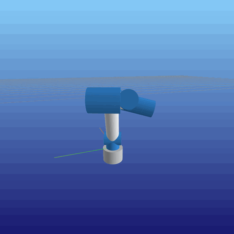
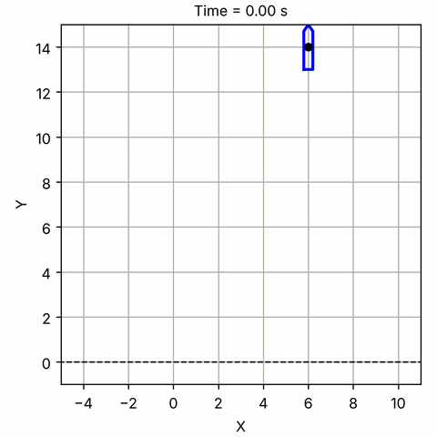

# minilink

**Write the equations once. Simulate, analyze, control, plan, optimize, learn.**

[](https://colab.research.google.com/github/alx87grd/minilink/blob/main/examples/tutorial/showcase_minilink.ipynb)
[](https://github.com/alx87grd/minilink/tree/main/examples/tutorial)
[](https://pypi.org/project/minilink/)
[](https://alx87grd.github.io/minilink/)
[](https://github.com/alx87grd/minilink/blob/main/LICENSE)

<table>
  <tr>
<td width="25%" align="center" valign="bottom"></td>
<td width="25%" align="center" valign="bottom"></td>
<td width="25%" align="center" valign="bottom"></td>
<td width="25%" align="center" valign="bottom"></td>
  </tr>
  <tr>
<td width="25%" align="center" valign="top">Cart-pole swing-up, trajectory optimization</td>
<td width="25%" align="center" valign="top"><a href="#7-the-same-lines-on-a-robot">UR5 arm, task-space impedance control</a><br/><a href="https://alx87grd.github.io/minilink/_static/showcase/ur5_impedance.html">interactive 3-D</a></td>
<td width="25%" align="center" valign="top"><a href="#4-one-problem-every-planner">Racecar, model predictive control</a><br/><a href="https://alx87grd.github.io/minilink/_static/showcase/racecar_mpc.html">interactive 3-D</a></td>
<td width="25%" align="center" valign="top">Rocket landing, reinforcement learning</td>
  </tr>
</table>

Minilink is a Python library for dynamical systems, control, optimization and learning.
A model is written as its equations, $\dot{x} = f(x, u, t; p)$. Models and controllers connect
into block diagrams, and a diagram is again a model.
The equations are pure functions, so JAX can compile them, run them in batches and
differentiate them with respect to the state, the input and the parameters.
A planning problem is stated once and solved by dynamic programming, LQR, tree search,
trajectory optimization, MPC or reinforcement learning; each returns a controller that connects
to the plant, and `compare` scores them on the same problem.
The library runs on NumPy, SciPy and Matplotlib; JAX is optional.

## Install

```bash
pip install minilink            # NumPy, SciPy, Matplotlib
pip install "minilink[full]"    # adds JAX, Plotly, MeshCat, Pygame, SymPy, Gymnasium
```

Conda, with everything (JAX, Graphviz for `plot_diagram`, Ipopt, Jupyter):

```bash
git clone https://github.com/alx87grd/minilink.git && cd minilink
conda env create -f environment.yml && conda activate minilink
conda env config vars set PYTHONPATH="$PWD" && conda deactivate && conda activate minilink
```

In Colab: `!git clone https://github.com/alx87grd/minilink`, then
`import sys; sys.path.insert(0, "/content/minilink")`. The snippets below are one session on one
pendulum; sections 3, 4 (MPC) and 6 use JAX.

## 1. A closed loop

```python
from minilink import Impedance, Pendulum

plant = Pendulum()
plant.x0 = [2.0, 0.0]

loop = Impedance(Kp=100.0, Kd=20.0) @ plant
loop.compute_trajectory(tf=6.0)
loop.plot_trajectory()
loop.animate()
```

`@` closes a feedback loop. The loop is a system like the plant.

## 2. Diagrams in code

`>>` connects in series, `+` places blocks side by side, `@` in feedback, and `% Δ` runs a block on a clock
of period `Δ`. Every result is a system, so the same calls simulate, analyze and plot it.

```python
from minilink import Step

reference = Step(final_value=[1.0], step_time=1.0)
digital = reference >> (Impedance(Kp=100.0, Kd=20.0) % 0.1) @ plant

digital.compute_trajectory(tf=6.0)
digital.plot_diagram()
```


The classical tools read any system, a loop included: `linearize`, `transfer_function`,
`plot_bode`, `plot_root_locus`, `plot_pzmap`, `plot_nyquist`, `plot_step_response`. And `lqr`
designs a state feedback on the linear model at a point (`kalman` and `lqg` are its duals for
estimation):

```python
import numpy as np
from minilink import lqr

loop.transfer_function()     # G(s) = 50 / (s² + 10 s + 54.91)
loop.plot_bode()
loop.plot_root_locus()

up = np.array([np.pi, 0.0])
balance = lqr(plant, Q=np.eye(2), R=np.eye(1), x_bar=up) @ plant
balance.compute_trajectory(tf=4.0, x0=[np.pi - 0.5, 0.0])
balance.animate()
```

A model of your own is its `f` (and `h` when the sensor does not read the whole state):

```python
from minilink import DynamicSystem


class MyPendulum(DynamicSystem):
    def __init__(self):
        super().__init__(state_dim=2, input_dim=1, output_dim=2)

    def f(self, x, u, t=0.0, params=None):
        m, l, g = 1.0, 1.0, 9.81
        theta, dtheta = x
        torque = u[0]

        # m l² θ̈ = τ − m g l sin θ
        ddtheta = (torque - m * g * l * np.sin(theta)) / (m * l**2)

        return np.array([dtheta, ddtheta])


(Impedance(Kp=100.0, Kd=20.0) @ MyPendulum()).compute_trajectory(tf=6.0)
```

The wiring carries the numbers as well as the signals: `loop.params` is one tree,
`{'controller': {'Kp': ..., 'Kd': ...}, 'plant': {'m': ..., 'l': ...}}`, and a path such as
`"plant.l"` names any number in any block. Sections 3, 5 and 6 act on this tree.

## 3. One `f`: derivatives and batches

`f` is a pure function of `(x, u, t; p)`. Under JAX its Jacobians are exact, in the state,
the input or the parameters, and the same `f`, compiled once, runs a thousand rod lengths in
one call.

```python
x = np.array([1.0, 0.0])
A = plant.jacobian("f", "x", x)
dfdp = plant.jacobian("f", "params", x)

lengths = np.linspace(0.5, 2.0, 1000)
starts = np.full((1000, 2), [1.0, 0.0])
swings = plant.compile(backend="jax").rollout_batch(
    starts, n_steps=1000, dt=0.005, params=dict(plant.params, l=lengths)
)
```

## 4. One problem, every planner

A `PlanningProblem` states the task and nothing about how to solve it: the system, a cost,
the allowed states and inputs, the start, the goal and the horizon. The cost
$J = \int (\tilde{x}^T Q \tilde{x} + u^T R u)\,dt + \tilde{x}(t_f)^T S\, \tilde{x}(t_f)$,
$\tilde{x} = x - x_{up}$, weighs the distance to the upright, the torque, and where the swing ends. Here, swing the pendulum
up with a motor too weak to lift it directly.

```python
from minilink import (
    BallSet, DynamicProgrammingPlanner, PlanningProblem, QuadraticCost,
    RRTPlanner, TrajectoryOptimizationPlanner,
)
from minilink.control import ModelPredictiveController

problem = PlanningProblem(
    plant, x0=[0.0, 0.0], Xf=BallSet(up, 0.2), horizon=6.0,
    cost=QuadraticCost.from_system(plant, x_bar=up, S=100 * np.eye(2)),
    X=plant.state.box, U=plant.input_box,
)

vi = DynamicProgrammingPlanner(problem, x_grid=(101, 101), u_grid=(11,), dt=0.05).solve()
rrt = RRTPlanner(problem, seed=0).solve()
opt = TrajectoryOptimizationPlanner(problem, n_steps=60).solve()

look_ahead = problem.replace(horizon=2.0, Xf=None)
mpc = ModelPredictiveController(TrajectoryOptimizationPlanner(look_ahead, n_steps=20, backend="jax")) % 0.1

swing_up = vi.controller @ plant
swing_up.compute_trajectory(tf=6.0, x0=[0.0, 0.0])
swing_up.animate()
```

The three planners return a `PlanningSolution` whose controller is a system: value
iteration's is a feedback law on a grid, RRT's and trajectory optimization's are open-loop
plans. MPC is a controller built on a planner and run on a clock: every 0.1 s it solves a 2 s
look-ahead again from the measured state.
Reinforcement learning is one more planner; the
[showcase notebook](https://github.com/alx87grd/minilink/blob/main/examples/tutorial/showcase_minilink.ipynb) trains one on the same pendulum.

## 5. One score

`compare` runs every answer on the same problem: the same model, cost, sets and draws. Here
the mass is uncertain by ±20 %, and each controller runs on the same twenty draws.

```python
from minilink import Uniform, compare

uncertain = problem.replace(distributions={"plant": {"m": Uniform(0.8, 1.2)}})
print(compare(uncertain, VI=vi, RRT=rrt, TrajOpt=opt, MPC=mpc, n_trials=20))
```

```
===================================================================================
Comparison, Pendulum, horizon=6, criterion=expectation, 20 draws
===================================================================================
        │ nominal trajectory          │ simulation
        │     J  goal     constraints │  E[J]   σ(J)      max J  goal   constraints
────────┼─────────────────────────────┼────────────────────────────────────────────
VI      │ -                           │ 91.07  7.708      109.6  20/20  20/20
RRT     │ 149.2  reached  ok          │  7419   9385  2.641e+04  0/20   4/20
TrajOpt │  90.5  reached  ok          │  8018   5924  1.881e+04  0/20   7/20
MPC     │ -                           │ 130.3  95.56      403.2  17/20  20/20
===================================================================================
```

The two plans reach the goal on the model they were computed for; once the mass changes they
miss it and leave the state or torque limits on most draws. The two feedback laws reach it on
most draws and stay within the limits.

## 6. Tune through the loop

Every optimization, a trajectory, a set of gains, a network's weights, is lowered to one
program, $\min_z J(z)$ s.t. $g(z) \ge 0,\ h(z) = 0$, and an `Optimizer` solves it.
Here the task is to bring the pendulum, released at 2 rad, to rest. $z$ is three paths of the
parameter tree, the two gains and the rod length, each within bounds; $J$ is the cost of the
closed-loop run, with its gradient through the whole simulation.

```python
from minilink import Optimizer

task = PlanningProblem(plant, x0=[2.0, 0.0], horizon=5.0, cost=QuadraticCost.from_system(plant, R=0.1 * np.eye(1)))
evaluator = task.compile(Impedance(Kp=1.0, Kd=1.0), backend="jax")
program = evaluator.program(
    ["controller.Kp", "controller.Kd", "plant.l"],
    bounds={"controller.Kp": (0.0, 50.0), "controller.Kd": (0.0, 20.0), "plant.l": (0.5, 2.0)},
)
best = Optimizer(program).solve()   # Kp = 1.47, Kd = 3.80, l = 0.5
```

The shortest rod wins: the cost puts no price on it. `method=` picks the solver: `l-bfgs`,
`slsqp`, `trust-constr` (SciPy), `gd`, `adam` (first-order), `ipopt`; a program with
constraints takes `slsqp`, `trust-constr` or `ipopt`.

## 7. The same lines on a robot

Nothing above is special to the pendulum. A six-axis arm with its rigid-body dynamics is the
same kind of system, and a task-space impedance law moves its hand to a target with the same
`>>` and `@`:

```python
from minilink import TaskImpedance, UR5Manipulator

robot = UR5Manipulator()
target = Step(initial_value=[-0.8, -0.2, 0.0], final_value=[-0.5, 0.0, 0.5], step_time=1.0)
arm_loop = target >> TaskImpedance(robot, gravity_comp=True) @ robot
arm_loop.animate(arm_loop.compute_trajectory(tf=5.0), renderer="meshcat")
```

The catalog also holds carts and pendulums, cars from the kinematic bicycle to the 3-D car, planes, drones
and a rocket. `plant.game()` puts the keyboard or a gamepad on a system's input in real time.

## How it fits together

Three objects hold the library together: the model (`System`), the task (`PlanningProblem`) and
the solver boundary (`MathematicalProgram` and `Optimizer`). Every tool is a path between them:


Minilink is not a multibody contact engine (an external simulator can be wrapped as a `System`),
and not a sparse modeling language for large NLPs. Its time is continuous: `f` is a rate;
discrete-time systems are a sibling family, and `%` puts a block on a clock from outside.

## Learn more

- [Showcase notebook](https://github.com/alx87grd/minilink/blob/main/examples/tutorial/showcase_minilink.ipynb): this page run end to end, with the plots and animations, and a learned law.
- [Tutorials](https://github.com/alx87grd/minilink/tree/main/examples/tutorial): `basics/`, `core/`, `advanced/`.
- [Teaching notebooks](https://github.com/alx87grd/teaching): the course notebooks.
- [API reference](https://alx87grd.github.io/minilink/) · [Pipelines](https://github.com/alx87grd/minilink/blob/main/docs/pipelines.md)

Minilink is the successor of [pyro](https://github.com/SherbyRobotics/pyro).
