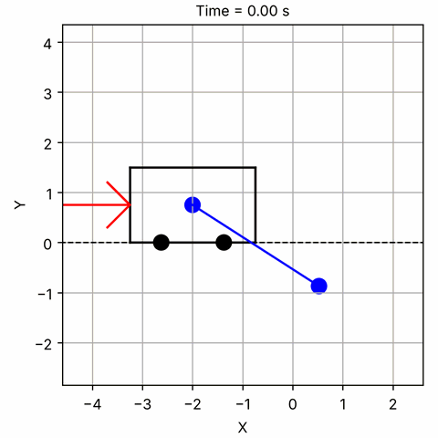
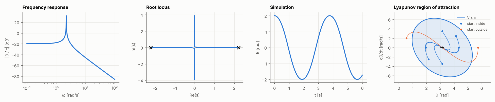
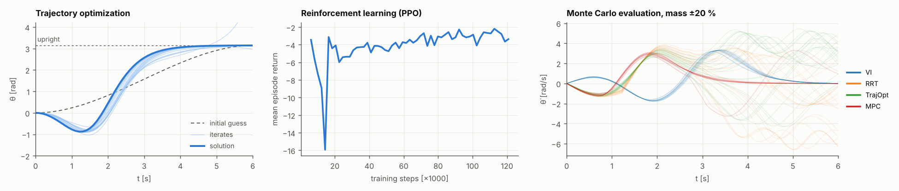

# minilink

**Write the equations once. Simulate, analyze, control, plan, optimize, learn.**

[](https://colab.research.google.com/github/alx87grd/minilink/blob/main/examples/tutorial/showcase_minilink.ipynb)
[](https://github.com/alx87grd/minilink/tree/main/examples/tutorial)
[](https://pypi.org/project/minilink/)
[](https://alx87grd.github.io/minilink/)
[](https://github.com/alx87grd/minilink/blob/main/LICENSE)

<table>
  <tr>
<td width="25%" align="center" valign="bottom"></td>
<td width="25%" align="center" valign="bottom"></td>
<td width="25%" align="center" valign="bottom"></td>
<td width="25%" align="center" valign="bottom"></td>
  </tr>
  <tr>
<td width="25%" align="center" valign="top">Cart-pole swing-up, trajectory optimization</td>
<td width="25%" align="center" valign="top">UR5 arm, task-space impedance control<br/><a href="https://alx87grd.github.io/minilink/_static/showcase/ur5_impedance.html">interactive 3-D</a></td>
<td width="25%" align="center" valign="top">Racecar, model predictive control<br/><a href="https://alx87grd.github.io/minilink/_static/showcase/racecar_mpc.html">interactive 3-D</a></td>
<td width="25%" align="center" valign="top">Rocket landing, reinforcement learning</td>
  </tr>
</table>

Minilink is an open-source Python framework for dynamical systems, control, optimization, and learning.
Write a physical model once in pure textbook ODE equations as the core object in Minilink: a `System`. Compose models and blocks into block diagrams, which are also just new Systems. This unified `System` is the standard interface to all tools: classical and modern control, optimal control (MPC, MPPI), machine learning (neural networks, reinforcement learning), and parameter optimization.
All core equation paths are pure functions—arrays in, arrays out—allowing the exact same code to work with either a minimalist NumPy/SciPy/Matplotlib setup or a JAX backend to compile, batch, and autodifferentiate the same equations.

## Install

```bash
pip install minilink          # core: NumPy, SciPy, Matplotlib
pip install "minilink[full]"  # + JAX, Plotly, Meshcat, Pygame, SymPy, Gymnasium
```

Conda is recommended to also install binaries for Graphviz and Ipopt.

```bash
git clone https://github.com/alx87grd/minilink.git && cd minilink
conda env create -f environment.yml && conda activate minilink
conda env config vars set PYTHONPATH="$PWD" && conda deactivate && conda activate minilink
```

## 1. Block diagrams as code

A block is its equations:

$$
\dot{x} = f(x, u, t; p)
$$

$$
y = h(x, u, t; p)
$$

Pure functions, arrays in and arrays out. Define `f` and `h`, and `@` closes the loop.

```python
import numpy as np
from minilink import PID, DynamicSystem


class SimplePendulum(DynamicSystem):
    def __init__(self):
        super().__init__(state_dim=2, input_dim=1, output_dim=1)

    def f(self, x, u, t=0, params=None):
        theta, dtheta = x
        return np.array([dtheta, u[0] - 9.81 * np.sin(theta)])

    def h(self, x, u, t=0, params=None):
        return x[:1]  # the sensor reads the angle


pid = PID(Kp=10.0, Ki=1.0, Kd=2.0)
diagram = pid @ SimplePendulum()
diagram.plot_diagram()
```


## 2. Simulation, design and analysis from the same code

Example with a pendulum: its frequency response, the root locus of $u = -k\,(\theta - \pi)$ at the upright, and a simulation.

```python
from minilink import Pendulum

plant = Pendulum()
up = np.array([np.pi, 0.0])

plant.plot_bode()
plant.plot_root_locus(x_bar=up)
plant.compute_trajectory(tf=6.0, x0=[2.0, 0.0])
plant.plot_trajectory()
```

Here an LQR designs a controller that balances it at the upright, and its Lyapunov function bounds a region of attraction, $V(x) = (x - \bar{x})^\top P (x - \bar{x}) \le c$.

```python
from minilink import lqr
from minilink.analysis import plot_region_of_attraction, region_of_attraction

balance = lqr(plant, Q=np.eye(2), R=np.eye(1), x_bar=up) @ plant
region = region_of_attraction(balance, x_bar=up)
plot_region_of_attraction(balance, region)
```

Each tool either works directly on the nonlinear `f` or linearizes it around a nominal point.



## 3. A unified planning pipeline, from MPC to RL

All planning tools (LQR, MPC, VI, RRT, RL) work from a unified task description: the plant, constraint sets and a cost function over the horizon $t_f$,

$$J = \int_0^{t_f} g(x, u, t)\, dt + h\big(x(t_f), t_f\big)$$

$$\dot{x} = f(x, u, t), \qquad x(0) = x_0, \qquad x(t) \in \mathcal{X}, \qquad u(t) \in \mathcal{U}, \qquad x(t_f) \in \mathcal{X}_f$$

```python
from minilink import BallSet, PlanningProblem, QuadraticCost

cost = QuadraticCost.from_system(plant, x_bar=up, S=100 * np.eye(2))
swing_up = PlanningProblem(
    plant,
    x0=[0.0, 0.0],
    Xf=BallSet(up, 0.2),
    horizon=6.0,
    cost=cost,
    X=plant.state_box,
    U=plant.input_box,
)
```

Every planner returns a `PlanningSolution` whose `.controller` is a `System` block ready to drop into a block diagram.

```python
from minilink import (
    DynamicProgrammingPlanner,
    RRTPlanner,
    ReinforcementLearningPlanner,
    TrajectoryOptimizationPlanner,
)

opt = TrajectoryOptimizationPlanner(swing_up, n_steps=60).solve(live_plot=True)
vi = DynamicProgrammingPlanner(swing_up, x_grid=(101, 101), u_grid=(11,), dt=0.05).solve()
rrt = RRTPlanner(swing_up, seed=0).solve()
ppo = ReinforcementLearningPlanner(swing_up, dt=0.05, gamma=0.99).solve(n_timesteps=100_000)
```

MPC runs on a receding-horizon version of the problem: every 0.1 s it solves a 2 s look-ahead again from the measured state.

```python
from minilink.control import ModelPredictiveController

look_ahead = swing_up.replace(horizon=2.0, Xf=None)
mpc_planner = TrajectoryOptimizationPlanner(look_ahead, n_steps=20, backend="jax")
mpc = ModelPredictiveController(mpc_planner) % 0.1
```

The task description can be stochastic, with parameters drawn from a distribution.
`problem.compare` evaluates multiple controllers on the same task; if the problem is stochastic, the trials run in parallel with JAX (`jax.vmap`).

$$\mathbb{E}_{p \sim \mathcal{P}}\big[J(p)\big]$$

```python
from minilink import Uniform

uncertain = swing_up.replace(distributions={"plant": {"m": Uniform(0.8, 1.2)}})
comparison = uncertain.compare(VI=vi, RRT=rrt, TrajOpt=opt, MPC=mpc, n_trials=20)
comparison.plot_simulated_trajectory()
```



## 4. Optimization with respect to any parameter

Evaluating a controller on a task defines a function $J(p)$ of the whole parameter tree—plant, controller, and cost—that can be differentiated through the simulation. For example, an impedance law bringing the pendulum to rest under an uncertain mass $m$:

$$\dot{x} = f(x, u, t; p), \qquad u = -K_p\, \theta - K_d\, \dot{\theta}$$

$$J(p) = \int_0^{t_f} \left(x^\top Q\, x + u^\top R\, u\right) dt$$

Compiled on JAX, `J` is that function: `J(p)` is the expected cost over 20 draws of the mass, and `jax.grad` gives its gradient with respect to every parameter in the tree:

$$\mathbb{E}_m\big[J(p)\big], \qquad \nabla_p\, \mathbb{E}_m\big[J(p)\big]$$

```python
import jax
from minilink import Impedance

rest_cost = QuadraticCost.from_system(plant, R=0.1 * np.eye(1))
rest = PlanningProblem(plant, x0=[2.0, 0.0], horizon=5.0, cost=rest_cost)
task = rest.replace(distributions={"plant": {"m": Uniform(0.8, 1.2)}})
J = task.compile(Impedance(Kp=1.0, Kd=1.0), n_trials=20, backend="jax")  # J(p) of the closed loop

gradient = jax.grad(J)(J.params)
```

The gains, named by their paths in the tree, become the decision variables $z = (K_p, K_d)$ of a program; an `Optimizer` solves it:

$$\min_{z = (K_p,\, K_d)} \ \mathbb{E}_m\big[J(z; p)\big] \quad \text{s.t.} \quad z_{\text{lower}} \le z \le z_{\text{upper}}$$

```python
from minilink import Optimizer

gains = ["controller.Kp", "controller.Kd"]
bounds = {"controller.Kp": (0.0, 50.0), "controller.Kd": (0.0, 20.0)}
program = J.program(gains, bounds=bounds)
best = Optimizer(program).solve()  # Kp = 0.78, Kd = 3.54; expected cost 19.3 → 11.0
```

This program is a `MathematicalProgram`, the one shape every transcription lowers to (collocation, a tuning task, a policy search); the `Optimizer` solves it with the chosen method (`l-bfgs`, `gd`, `adam`; with constraints, `slsqp`, `trust-constr`, or `ipopt`):

$$\min_{z} \ J(z; p) \quad \text{s.t.} \quad h(z; p) = 0, \quad g(z; p) \ge 0, \quad z_{\text{lower}} \le z \le z_{\text{upper}}$$

## 5. Compiled, differentiated, batched

With `backend="jax"`, catalog plants—and any custom `f` written with `array_module(x, u)` (`from minilink.core import array_module`)—compile to pure JAX functions: `jax.jit`, `jax.grad`, and `jax.vmap` apply directly, and the tools above use them under the hood. A thousand pendulums, released from a thousand angles, in one call:

```python
starts = np.column_stack([np.linspace(-3.0, 3.0, 1000), np.zeros(1000)])
t, swings = plant.rollout_batch(starts, tf=5.0, dt=0.005, backend="jax")  # 1000 runs × 1000 RK4 steps
```

Each call compiles the batch first; for repeated batches, hold the compiled form, `ev = plant.compile(backend="jax")`, and call `ev.rollout_batch(starts, dt=0.005, n_steps=1000)`.

## The Minilink backbone

Three objects hold it together: the model (`System`), the task (`PlanningProblem`) and the solver (`MathematicalProgram` and `Optimizer`).


## What Minilink is not

- Not a multibody contact engine: wrap one as a `System` leaf.
- Not a sparse NLP modeling language.
- Not discrete-time first: `f` is a rate, and `%` puts a block on a clock.

## Learn more

- [Showcase notebook](https://github.com/alx87grd/minilink/blob/main/examples/tutorial/showcase_minilink.ipynb): this page with its plots and animations.
- [Tutorials](https://github.com/alx87grd/minilink/tree/main/examples/tutorial): `basics/`, `core/`, `advanced/`.
- [Teaching notebooks](https://github.com/alx87grd/teaching): control, dynamic programming, LQR, MPC, reinforcement learning.
- [Pitch deck](https://alx87grd.github.io/minilink/presentation.html) · [API reference](https://alx87grd.github.io/minilink/) · [Pipelines](https://github.com/alx87grd/minilink/blob/main/docs/pipelines.md)

Minilink is the successor of [pyro](https://github.com/SherbyRobotics/pyro).
