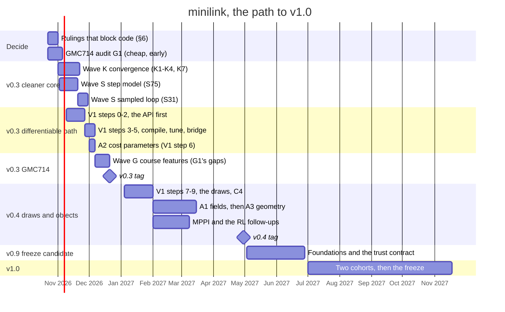

# Minilink Roadmap

Maturity and priorities, the **plan of record**; the steps themselves are the workboard,
[docs/plans/TODO.md](../plans/TODO.md), and the doc map is [AGENTS.md](../../AGENTS.md).

## 1. Releases

Identity: [CONSTITUTION.md](CONSTITUTION.md).

| Release | Milestone | When |
| --- | --- | --- |
| **v0.1** | **GRO860 end to end**, plus a working **`pip install minilink` on PyPI**. Every topic of the running optimal-control & RL course runs on the teaching surface, in Colab (git-clone cell) and in the conda env: value iteration / DP on a grid · LQR + linearization · trajectory optimization · RL via native `ReinforcementLearningPlanner` (with `Sys2Gym` + SB3 as an optional bridge). See §4.1. | Fall 2026 — `0.1.0` on PyPI (2026-09-16); `0.1.1` (2026-09-26) is the first release a GitHub tag published. Conda from `environment.yml` is the recommended install. The course notebooks' names are frozen until v1.0, with the freeze paused between terms (§4.1 gate 7). |
| **v0.2** | **GRO501 end to end** (the classical-control course: multi-physics modelling · root locus / Bode / margins · PID to spec · digital implementation · state feedback, pole placement, LQR, observers — see §4.2). Conda stays the recommended install. | `0.2.0` on PyPI (2026-10-17), from the GitHub tag; every §4.2 row green |
| **v0.3** | **A cleaner core and the differentiable path, then GMC714 end to end** (§5.3): first, in November, **the convergence pass** (the core kept, side features to the experimental tier), **the sampled spine** (one step model under every sampled tool, the sampled loop as a tool) and **the full differentiable path to the cost behind a clean API** (`problem.compile(controller)`, `tune`, the program bridge, cost parameters); then, in December, the features GMC714 is missing — robust control · robotic arm · trajectory optimization · MPC · vehicle models · nonlinear control (§4.3), with **pyro parity**. | December 2026 |
| **v0.4** | **The draws and the textbook objects** (§5.4): the mean over the problem's draws through the same differentiable path (the Monte Carlo evaluator one path, its numbers changing once), identification as its first data consumer; fields and workspace geometry; MPPI on the sampled kernel. | Winter 2027, between cohorts |
| **v0.9** | **Freeze candidate** (§5.5): the foundation questions that could still break a public name are decided (derived `x0`, the integrators' home, the glyph/solid rename, the frozen surface); the trust contract is in place (deprecation policy, pinned export list, CHANGELOG, pinned installs); the standard-syllabus holes close (estimation, discrete time); the docs site renders the tutorials. | Spring 2027 |
| **v1.0** | **A colleague can build a course on it and trust it for three years** (§5.6): the API frozen under the deprecation policy, the standard control syllabus covered and checked against textbook worked examples, course-neutral labs an instructor adopts outside UdeS, green on Windows, macOS and Linux; after two cohorts. Two Stable-Baselines3 teaching notebooks retire (S49) and the GRO860 name freeze becomes the general one. | 2027 |

## 2. Two lanes

Philosophy: [CONSTITUTION.md](CONSTITUTION.md) §3 (the student syntax never
breaks). Placement shorthand: [RULES.md](RULES.md) §3.3. The operating
contract is the table below — not a pointer.

Minilink serves two audiences with one codebase. The boundary between them is
a **contract**, not a documentation convention.

| Lane | What it is | Rules |
| --- | --- | --- |
| **Teaching surface** | The names students meet: root prelude (`from minilink import …`) and the band facades (`minilink.catalog`, `.blocks`, `.control`, `.analysis`, `.simulation`, `.planning`). Registered in one place, tested as a set. | *Soft rule:* nothing enters without a demo or notebook, a both-backends test where it defines dynamics, and a docstring. Names and semantics change only with a deprecation note. Student-facing examples and notebooks import **only** through it (CI-checked). |
| **Research lane** | Everything else: the provisional bands (hybrid, MPC, realtime), the `minilink/experimental/` tier (symbolic mechanics, contact engines, C export), `examples/projects/`, `examples/experimental/`. | No stability promise, no entry requirements, out of the release contract. The provisional bands ship in the wheel; `minilink/experimental/` and the research examples stay **out of the wheel** and run from a git checkout. Deep imports always remain valid. |

**Provisional teaching names:** the spatial names the planning facade exports (`Scene`,
`bind`, `ReferenceTrack`, `car_outline`, `plot_track`, …) sit in the teaching lane under
`planning.spatial`, checked like every band-facade name (a docstring, a teaching-lane home)
but outside the registry, and stay provisional until A3 moves them to `core/geometry/`.

**Wheel scope:** the published wheel is the `minilink` package without
`minilink/experimental/`: the teaching surface, the provisional bands with no stability
promise, and the provisional spatial names. `minilink/experimental/` and the research
examples (`examples/projects/`, `examples/experimental/`) are repo-only.

**Breaking changes so far** (each migrated every course notebook in the same commit; from
v0.9 they go to `CHANGELOG.md`, step V5):
- 2026-09-15: every planner returns a `PlanningSolution` (`policy`, `solver`, `trajectory`,
  `evaluation`, `cost_to_go`) and the evaluator an `Evaluation`; `TrajectoryPlan`,
  `PolicyPlan`, `SolveMetadata` and `MonteCarloReport` are gone. `PlanningProblem.on_exit`
  is gone, `exit_cost` is `infeasible_cost`, and `X` is unconstrained unless declared.
- 2026-09-30: `WhiteNoise(p, *, psd, sample_period, seed, hold)` is a pure block; its
  `var`, `mean`, `t0`, `tf` and `refresh()` are gone (an old variance reads as
  `psd = var × sample_period`), and seeded realizations changed once.
- 2026-10-14: the state-feedback designs live in `control/design.py` (`lqr`, `place`,
  `lqr_finite_horizon`, `lqg`, `trajectory_lqr`); the modules `control/lqr.py`, `place.py`
  and `output.py` are gone, their names unchanged on the teaching surface.
- 2026-10-17 (`0.2.0`): a block's default `name` is its class name and a shortcut is named
  as the expression it builds, so diagram labels and plot titles changed; the pip extras are
  `full` and `dev` only (`[jax]`, `[plotting]`, `[visualization]`, `[diagrams]`,
  `[symbolic]`, `[rl]`, `[ipopt]` are gone); `install.md` and `environment-basic.yml` are
  gone, the install story is the README's.

## 3. Maturity (TRL)

Readiness levels are an internal maturity scale for planning and review — not
a release process by themselves.

| Level | Name | Description |
| --- | --- | --- |
| **TRL 1** | Agent MVP | Initial code exists and works |
| **TRL 2** | User-check MVP | User performs a high-level functional review |
| **TRL 3** | Architecture Validated | High-level architecture is approved |
| **TRL 4** | Integration Proposed | Final integration/refactor is proposed |
| **TRL 5** | Integration Validated | User approves main-codebase integration |
| **TRL 6** | Automated Tests Pass | Final pytest coverage exists and passes |
| **TRL 7** | Details Validated | Naming and implementation details are approved |
| **TRL 8** | Demo Released | Demo script is created and validated |
| **TRL 9** | Mission Complete | Tests, demo, and user approval are all complete |

Step ids (`S29`, `P4`, `T2`, …) are the rows of
[docs/plans/TODO.md](../plans/TODO.md).

| Area | Lane | TRL | State | Next |
| --- | --- | --- | --- | --- |
| Core + diagrams | teaching | 7 | Public API and diagram API stable; compile-vs-reference parity tested; wrong-shape `f` / `h` fails at `compile()`. | Automation by convention (P10, v0.2); derived `x0` (S29, v0.9). |
| Compile (`core/compile/`) | teaching (frozen subset) | 4 | Integrated; the frozen evaluator subset is named in DESIGN §5, the stable-internal helper grid kept by ruling. Speed lives in batches (1000 rollouts × 1000 RK4 steps in 27 ms); float64 on JAX by default. | the step model under every sampled tool (S75, v0.3); `rollout_batch` with a `params` family (S53); the differentiable closed-loop cost (V1: the deterministic path v0.3, the draws v0.4); the integrators' move (S37, v0.9). |
| Simulation | teaching | 7 | Mature; fixed 10 001-point default grid; `verbose` names unified. | One owner per rule (S65). |
| Dynamics (abstraction + catalog) | teaching | 7 | Plants QA'd; `MechanicalSystem` / `Manipulator`; UR5 ABA/RNEA; **every catalog plant compiles on both backends** (contract test); four-rung vehicle ladder; UdeS racecar (kinematic, dynamic, 3-D). | Catalog hygiene (S64); the general serial chain (C6, v0.3); mechanical-base unification (S32, after v1.0). |
| Control | teaching | 6 | Linear, LQR (infinite horizon, finite horizon, along a trajectory), pole placement, reference scaling (`N`), `P` / `PI` / `PD` / `PID` and the rate-measured `ImpedanceController` / `ImpedanceIntegralController` as one family (what is measured decides the derivative; limits with infinite defaults, anti-windup once a limit is declared; the shared pieces three pure functions), model-based SMC and computed torque, robotic impedance and kinematic laws, neural policy block; a controller is a plain `System`. | P10's resolver and composition steps. |
| Analysis | teaching | 6 | Jacobians, linearize, structural, equilibria, modal; one-channel Bode with grid-free margins, pole-zero, root locus, Nyquist, the linear step response on matplotlib and plotly; the sensitivity functions `S` / `T` / `PS` / `CS`. Every verb takes any `System`, the linear model as is, the rest linearized at the operating point (2026-10-15). | Nichols and overlays later; Bode, poles and margins traceable for sensitivity to params (idea to review, S73). |
| Blocks | teaching | 5 | Routing, nonlinear, filters, sources (with `Sine`), TF, 1-layer NN. | `Ramp` / `Chirp` / `Delay` / `Switch` (C3, v0.3). |
| Planning / policy synthesis (DP) | teaching (GRO860) | 6 | Grid + value iteration (`loop` / `numpy` / `jax`), lookup controller, `PolicyEvaluator`, `LQRPlanner`; every planner returns a `PlanningSolution`; `compare()` reads solutions side by side; `dp.py` is the textbook reference of the style. | cost-to-go as a `Field` (A1); policy iteration (S51). |
| Planning / trajopt | teaching (GRO860) | 5 | Collocation, shooting, multiple shooting; live plot; `success` means defects satisfied to `feasibility_tol`; float64 by default on JAX. | Harden SciPy/Ipopt before TRL 6. |
| Optimization | teaching (via trajopt) | 5 | `MathematicalProgram` + `Optimizer`, SciPy/Ipopt. | Harden SciPy/Ipopt before TRL 6. |
| Interfaces / RL bridge | research lane (bridge) | 4 | `Sys2Gym` + `SB3Controller`; the env step is one compiled RK4 call. | Keep for external interop; courses solve with the native planner. |
| Analysis / Lyapunov certificates | provisional (research) | 4 | `region_of_attraction` → `LyapunovCertificate` (quadratic `V`, sampled level, `verify`, `plot`, `contains`); demo and showcase §11. | Cohort validation; `V` as a `QuadraticField` (A1); SOS and discrete time later. |
| Planning / RL planner | teaching (GRO860) | 6 | `ReinforcementLearningPlanner` (REINFORCE, actor-critic, PPO, SAC in pure JAX), `TabularLearningPlanner` (Q-learning, SARSA, Monte Carlo control), `StochasticPlanningProblem`, `MonteCarloEvaluator`; on the root prelude; canonical demos in `examples/demos/rl/`, chapter 11 and the native teaching notebooks. | SAC actor step (S50); deep Q-learning (S52); automatic reward scaling ([rl-reward-scaling.md](../plans/rl-reward-scaling.md)). |
| Planning / search (RRT) | provisional | 5 | RRT / RRT*; `RRTPlanner(problem)` works from the input bounds alone (bang-bang extender); returns a `PlanningSolution`. | RRT-Connect later. |
| Planning / path integral (MPPI) | research lane (planned) | 1 | Two standalone scripts (`examples/experimental/mppi/`): the pendulum swings up; the kinematic racecar laps the cone circuit at a lower closed-loop cost than the collocation MPC. Design: [mppi.md](../plans/mppi.md). | The planner (S72, v0.4) on the sampled kernel, after RN-4 / RN-5. |
| Geometry / spatial | provisional (teaching) | 4 | SDF + `Scene` / fields / bodies under `planning/spatial/`, JAX twins tested; the planning facade's spatial names are provisional teaching names (§2). Home designed: `core/geometry/`. | Package move and course catalog (A3); bicubic SDF and CBF filter (research). |
| Graphics / animation | teaching | 5 | Frame-keyed `tf` / geometry / overlays; four renderers; auto-fit camera. | Camera and plot defaults from roles (P10); constructor-derived camera hints (S43); glyph/solid rename (S30, v0.9). |
| Hybrid / step / MPC | provisional (research) | 4 | `StepSystem`, `Computer`, `HybridDiagram`, `HybridSimulator`, MPC with parametric JAX. A side helper for MPC simulation; the sampled loop is the one thing that is not a `System`. | Keeps in step with the core rules (P10); no new hybrid features before S31 (v0.3, recommended: the loop as a tool on one sampled kernel). |
| Realtime simulation | provisional | 2 | `RealtimeSimulator` + pygame I/O. | Architectural review (v1.0); later the human-demonstration recorder of the behavior-cloning pipeline (after v1.0). |
| Estimation | teaching (GRO501) | 6 | `StateObserver` (innovation form, operating point on the block, hat labels), `luenberger` and `kalman` on arrays, a linear model or the plant (the duals of `place` and `lqr`, 2026-10-14); `lqg` returns the observer + gain box; an observer is refused as a controller; `closed_loop(gain, plant, observer=obs)` wires the LQG loop by role (AC-4, 2026-10-14). | the trajectory observer and the finite-horizon filter, the EKF, the estimation problem and its tools (v0.9, [the plan](../plans/estimation-and-state-feedback.md)). |
| Identification | planned | 2 | Parametric-tier prototype only. | V1's `tune` with a data cost (C4, v0.4). |
| C export (`experimental/c_export`) | research | 1 | JAX→C transpiler; two demos; flagship smoke in the JAX regression job. | Keep isolated; repo-only. |
| Experimental tier (`experimental/symbolic`, `experimental/engines`) | research | 1 | Not on the teaching path nor the API site. | Keep isolated; repo-only. |
| External multibody leaf (MJX) | research | 0 | Not started. | Spike later. |
| Pyro 2.0 overall | v0.3 | 3 | Catalog + core + search/DP/trajopt done; many demos unported. | Remaining rows in [pyro-port-remaining.md](../plans/pyro-port-remaining.md). |

## 4. Course objectives

Three courses drive the release contract: GRO860 (§4.1, v0.1, running now),
GRO501 (§4.2, v0.2) and GMC714 (§4.3, v0.3). A course is
"end to end" when every topic row is green on the teaching surface — in Colab
(git-clone cell) and in the conda env — and the cross-cutting gates hold.

### 4.1 v0.1 — GRO860 end to end

| Topic | Surface | Material | Gate |
| --- | --- | --- | --- |
| Value iteration / DP | `PlanningProblem`, `StateSpaceGrid`, `DynamicProgrammingPlanner`, `LookupTableController`, `plot_cost2go` / `plot_policy` | `pendulum_value_iteration`, `pendulum_value_iteration_vs_lqr`, `demos/value_iteration/` | `final_time` reads `problem.tf`; `success` reports convergence; notebooks wire with `vi_ctl @ plant` |
| LQR + linearization | `linearize`, `lqr` (on arrays, a linear model or the plant), `plot_control_law` | `03_control`, `04_analysis`, `demos/control/` | — (green today) |
| Trajectory optimization | `PlanningProblem`, `TrajectoryOptimizationPlanner` (`direct_collocation`, `shooting`), `QuadraticCost` | `09_planning`, `demos/trajopt/` | float64 by default on JAX; `success` means defects satisfied; canonical problems succeed with default optimizer |
| Reinforcement Learning (tabular on the grid, neural in native JAX) | `TabularLearningPlanner` (Q-learning, SARSA, Monte Carlo control; `EpsilonGreedy`, `UCB`), `StochasticPlanningProblem`, `ReinforcementLearningPlanner` (REINFORCE / actor-critic / PPO / SAC), `NeuralPolicyController`, `MonteCarloEvaluator` | `11_reinforcement_learning.ipynb`, `pendulum_value_iteration_vs_lqr_vs_rl.ipynb`, `drone_ppo.ipynb`, `gymnasium_interface.ipynb`, `showcase_from_rl_to_bode.ipynb`, `demos/rl/` (pendulum, cart-pole, drone, rocket) | pure-JAX training on compiled plant (pendulum swing-up, 120k steps in 12.5 s on CPU, 0% failure over 50 trials); neural policy closed loop linearizes, simulates, and plots Bode; those names (plus `Evaluation`, `Gaussian` / `Uniform`) are on the root prelude. Notebooks solve with the native planner; Gymnasium stays taught as the domain standard and `Sys2Gym` + SB3 stay as the external bridge |

**Cross-cutting gates**

1. Wrong-shape `f` / `h` / port computes fail at `compile()` on both backends;
   a forgotten `super().__init__()` gives a named error; the README custom
   plant composes with `@`.
2. Default `compute_trajectory` returns a fixed output count (10 001, the fine
   reporting grid) and never selects a solver from the point count.
3. Every GRO860 notebook and every `examples/tutorial/`, `examples/teaching/`, and `examples/demos/`
   file imports only through the teaching surface (CI test).
4. The Basic tier (NumPy + SciPy + Matplotlib, nothing else) runs
   sim / plot / phase plane / animate / linearize / LQR / VI in a clean
   environment (CI test).
5. The Colab cell (git clone + path) and the conda environment from
   `environment.yml` both run every GRO860 notebook top to bottom.
6. `ruff` + `pytest` + notebook smoke green; nightly full demo sweep green.
7. No name a GRO860 notebook imports changes before v1.0. **Paused 2026-10-10**
   (maintainer): between terms the teaching design is unfrozen; a rename migrates every
   course notebook that uses the name in the same commit, with no alias. The freeze
   resumes when the next term's notebooks are pinned.
8. `pip install minilink` installs the teaching surface, published from a GitHub tag
   (Trusted Publishing in `.github/workflows/publish.yml`, the version read from the
   tag); extras (`[jax]`, `[visualization]`, …) match `pyproject.toml`. Conda remains
   the Full local stack (JAX, Ipopt, notebooks).

Out of the v0.1 checklist by decision: MPC/hybrid (provisional, lesson keeps
shipping), estimation, identification, frequency-domain tools (gated by §4.2).

### 4.2 v0.2 — GRO501 end to end

The classical-control course (*Systèmes asservis*, BSc Génie Robotique):
an APP problem on the UdeS-Racecar. APP2 is multi-physics modelling of the
DC-motor propulsion plus SISO speed and position loops designed to time- and
frequency-domain specifications and implemented as difference equations on an
Arduino; APP4 is the bicycle-model MIMO plant with LQR, nested loops, pole
placement and a Kalman observer. Student guide: `GRO501_Guide.pdf`
(maintainer's copy); references Dorf & Bishop and Åström & Murray.

Baseline audit:
[docs/reviews/2026-09-07-gro501-coverage.md](../reviews/2026-09-07-gro501-coverage.md).
Step-level work:
the plan doc retired 2026-10-17, its steps landed; the baseline audit is
[docs/reviews/2026-09-07-gro501-coverage.md](../reviews/2026-09-07-gro501-coverage.md).

| Topic | Surface | Status | Gate |
| --- | --- | --- | --- |
| Multi-physics modelling — nonlinear `f`/`h`, block diagram, linearize, `H(s)` | custom `DynamicSystem`, `plot_diagram`, `linearize`, `transfer_function` | green | a longitudinal-vehicle plant in the catalog (met: `LongitudinalFrontWheelDriveCarWithTorqueInput` on `minilink.catalog`; a DC-motor plant is off the critical path, S71); pole/zero cancellation by default; order reduction by fast-mode neglect is out of v0.2 |
| Closed-loop analysis — poles, root locus, Bode, margins, step specs | `pzmap`, `root_locus`, `bode`, `margins`, `step_info`, `P` / `PI` / `PD` / `PID` | green | every compensator form reports the poles and zeros of the hand calculation, and margins are found wherever the crossover sits |
| Design to specification — rise time, overshoot, final error, phase margin | `PI`, `PD`, `PID`, `Lead`, `Lag`, `step_info`, `margins` | green | the Table 2 specs of the guide are checkable in one notebook |
| Loop-shaping specs — disturbance and measurement-noise sensitivity in dB at a frequency | `sensitivity`, `complementary_sensitivity`, `load_sensitivity`, `noise_sensitivity` | green (2026-10-10) | the `sensitivity_functions` teaching notebook |
| Digital implementation — difference equations on the Arduino | `discretize` (Euler / RK4 step models) | green (2026-10-17) | the law is designed in continuous time, discretized, and the sampled loop validated by simulation; no z-domain analysis family (ruled 2026-10-17, [the record](../reviews/2026-10-17-z-tier-dropped.md)) |
| State-space MIMO — bicycle model, controllability at every nominal speed | `KinematicBicycle`, `controllability`, `observability` | green | — |
| Optimal control — LQR on the guide's cost, closed-loop poles, nonlinear check | `lqr(plant, Q, R, x_bar=)`, `StateFeedbackController` | green | — |
| Pole placement — `K_sta` for a prescribed pole set | `place` (on a linear model or the plant; `place_gain` on arrays) | green | — |
| Nested loops — inner speed loop, outer position loop | `@` composition | green for error-driven compensators (`PID @ (PID @ G)`); an outer `r, y` or state controller is refused today | P10 ([automation-by-convention.md](../plans/automation-by-convention.md)) nests the inner loop as the outer loop's `plant`; stays green with the observer in the loop |
| State estimation — Luenberger observer and Kalman filter | `StateObserver`, `luenberger`, `kalman`, `lqg` | green (2026-10-14) | the observer closes the loop as a standard diagram block: by role with `closed_loop(gain, plant, observer=obs)`, in the `lqg` box, or by hand |
| Reference scaling — the `N` matrix giving `y = r` at steady state | `OutputReferenceController(K, N)` | green (2026-10-10) | the student writes `N = -(C (A - B K)⁻¹ B)⁻¹`; the block takes the output reference |

**Cross-cutting gates**

1. Every topic row above is green, with a demo or a notebook.
2. No APP notebook in the repository: the students write the APP work themselves (ruled
   2026-10-15). The demos and notebooks of gate 1 run Colab-first on the Basic tier
   (NumPy + SciPy + Matplotlib) — no JAX on the GRO501 path.
3. Every tool agrees with the hand calculation for the guide's §9 exercises;
   the closed-loop analysis exercises (§9.6, §9.7) are the acceptance test.
4. Student-facing GRO501 material imports only through the teaching surface.

Out of the GRO501 checklist by decision: hardware, ROS, and the Arduino
firmware itself (the course owns those); system identification from logged
runs beyond what `identification/` already offers.

### 4.3 v0.3 — GMC714 end to end

The robotics course: the teaching layer solidified for GMC714, December 2026.
No baseline audit yet — step G1 of the workboard runs it, as the GRO501 audit
did, and turns this table into the release contract.

| Topic | Surface today (to confirm in G1) | Status | Gate |
| --- | --- | --- | --- |
| Vehicle models — the four-rung ladder, kinematic to dynamic with tires | `dynamics.catalog` vehicles, `KinematicBicycle` | audit pending | the ladder runs as one lesson (C2) |
| Robotic arm — kinematics, dynamics, joint and task-space control | `manipulators`, `UR5Manipulator`, `control.robotic`, `control.impedance` | audit pending | robotic PID wrappers (C2) |
| Nonlinear control — feedback linearization, computed torque, sliding mode, Lyapunov | `control.modelbased`, `control.geometric`, `analysis.lyapunov` | audit pending | set by G1 |
| Robust control — uncertainty, margins, robust design | `analysis` frequency tools | audit pending | set by G1 |
| Trajectory optimization — direct collocation, shooting | `planning.trajectory_optimization` | audit pending | set by G1 |
| MPC — receding horizon on the vehicle and the arm | `control.mpc` (provisional, research lane) | audit pending | MPC joins the teaching surface, or stays a lesson on the research lane, decided in G1; the sampling flavour (MPPI, [mppi.md](../plans/mppi.md), S72) is on the table for that audit (planned for v0.4 on the sampled kernel; the audit can only ask for it as a research-lane lesson) |

**Cross-cutting gates** (as for GRO501): every topic row green with a demo
or a notebook; one `examples/teaching/` notebook per topic, Colab-first;
student-facing GMC714 material imports only through the teaching surface.

## 5. The path to v1.0

Each rung names its open steps, one line each. The steps themselves, with files, order and
"done when", are the rows of [docs/plans/TODO.md](../plans/TODO.md). A rung is done when
every step in it is landed or explicitly dropped by the maintainer. Landed work leaves this
section; its history is in git and in [docs/reviews/](../reviews/).

**The shape the rungs build** (proposed, the first ask of K7, maintainer-owned:
[core-consolidation.md](../plans/core-consolidation.md) §2). One spine every approach is a
special case of: a `System`, compiled, rolled out to a `Trajectory`, scored by a cost,
lowered to a `MathematicalProgram`, solved by the `Optimizer`. Two step paths on it: the
continuous one (`Simulator`, the differentiable evaluator) and the sampled one (the step
model and the sampled loop, [sampled-path.md](../plans/sampled-path.md)). Six pillars on the
spine: classical and modern control, nonlinear control, trajectory optimization and MPC,
reinforcement learning, identification and imitation, estimation. v0.3 converges the library,
builds the sampled path and the deterministic differentiable path to the cost, then adds what
GMC714 is missing; v0.4 adds the draws and the textbook objects; v0.9 decides what can still break a name; v1.0 freezes.

**At a glance** (indicative dates; the order is the commitment, the dates are not):

### 5.1 v0.1 — close-out

The GRO860 path is green (§4.1) and `0.1.1` is published; nothing is open.

### 5.2 v0.2 — shipped; the carry-over

`0.2.0` was tagged on 2026-10-17 with every §4.2 row green. The steps below were planned for
v0.2 and not needed for the tag; they carry into v0.3 and v0.4, each in the slot the order of
TODO §4 and §5 gives it, wave D standing.

**Wave A — the textbook objects finish speaking.**
- **A6** Short catalog names (RULES 2.6): compact public class names, the long explicit display
  names dropped, one ruled table of renames migrating the notebooks in the same commit (between terms,
  with wave K's between-terms moves, while the name freeze is paused). **[ask — public
  names]**
- **A5** The later nouns, each with its first consumer: `log_prob`, sets and distributions
  over parameter dictionaries, `UnionSet`, `PlanningProblem.hamiltonian()` only if a course
  teaches Pontryagin (sets reading `params` with A2 in wave V, `Set.as_cost` with V1's step 8
  in v0.4).
- **RN-2** of [randomness.md](../plans/randomness.md): distributions read `params`,
  `Gaussian(cov=)`, every `sample` takes a key (before V1's step 7, the draws, in v0.4).

**Wave B — GRO501 end to end** (§4.2; plan
the plan doc retired 2026-10-17, its steps landed).
- **P10** Automation by convention ([automation-by-convention.md](../plans/automation-by-convention.md),
  decided 2026-10-11): standard port names drive the wiring, three reserved names (`plant`,
  `controller`, `observer`) are the roles every tool reads, and the cost is scored on the
  plant. Its composition steps land in this wave; the order is in TODO §2 and the plan's
  §7.

**Wave D — the code reads like the textbook, and the demos like the API.** Standing work,
behaviour-preserving, one module per step.
- The textbook pass landed 2026-10-16/17 ([record](../reviews/2026-10-16-textbook-pass.md),
  [rulings](../reviews/2026-10-17-textbook-pass-follow-up-rulings.md)); its behaviour and API
  leftovers are TODO §3's T rows.
- **D1** Demos and notebooks to the minimal rule (RULES 6.1 / 6.10 / 6.11). **[ask per
  file]**
- **D2** Consolidation picks still open from the 2026-09-05 inventory.
- **D3** Hardening rows carried over (research lane).
- **S65** One owner per rule (the automatic `dt`, the backend fallback, the input-hold
  model, the Monte Carlo defaults); **S66** wiring mistakes fail at wiring time **[ask —
  core]**; **S67** one plot vocabulary; **S68** contracts as tests.

### 5.3 v0.3 — a cleaner core and the differentiable path, then GMC714 (December 2026)

Reorganized 2026-10-21 ([record](../reviews/2026-10-21-roadmap-reorganization.md)); the
steps, in order, are TODO §4. **First, November: a cleaner core and the full differentiable
path to the cost behind a clean API** (wave K, wave S, wave V). **Then, December: the
features GMC714 is missing** (wave G's rows, ordered by the audit G1, which runs early because
it is cheap and fixes what December must contain).

**Rulings first**: the asks that block code, listed in §6 "Blocking code now" (the shape of
the framework, S75, S31, the differentiable problem's blocking asks and its names). One
decision session; no foundation code before it.

**The audit, early** (in parallel with the rulings):
- **G1** GMC714 baseline audit: every §4.3 topic run on the teaching surface, the gaps
  written as the release contract. **[ask — course scope]**

**Wave K — convergence** (November, first, so everything after lands in a smaller library):
- **K1** The inventory: every public name and every demo with its callers and a maturity
  label; [core-consolidation.md](../plans/core-consolidation.md) §3–§4 is most of it.
- **K2** Unused features removed and **K3** prototypes moved to `minilink/experimental/`,
  from one ruling pass: K7's tiers. **[ask — removals, public names]**
- **K4** One demo per feature, before D1.3 sweeps the rest. **[ask per group]**
- **K7** The convergence pass: the spine, the six pillars and the named content stay; side
  features leave for the experimental tier or the example that motivated them; the first
  tier any time, the between-terms moves after GMC714 (§6). **[ask — core, public names]**

**Wave S — the sampled spine** (November; [sampled-path.md](../plans/sampled-path.md)):
- **S75** The step model: `discretize` on one compiled step, `params` always an argument,
  for every sampled consumer; byte-identical steps SM-0 to SM-6, the `discretize` follow-ups
  as SM-2, S37's one scannable step as SM-1. **[ask — core]**
- **S31** The sampled loop: a tool on one sampled rollout kernel in two faces, after S75;
  with P10's AC-8b. **[ask — core]**

**Wave V — the differentiable path to the cost** (November into early December, beside wave
S: steps 0–2 need neither S75 nor S31, step 3 meets the sampled seam;
[differentiable-problem.md](../plans/differentiable-problem.md), its asks in §9):
- **V1, the deterministic path** (steps 0–5 of the plan): the API first, a names
  brainstorm with the maintainer (step 0); then the native `Trajectory`, one scoring kernel,
  the whole run out of the compiled scan, `problem.compile(controller)` with the deterministic
  verbs (the trajectory, the cost, the smallest margin) and `tune`, and the program bridge
  with the optimizer's program classes and first-order backend (S74, with OPW-1–OPW-5 of
  [optimizer-parametric-wiring.md](../plans/optimizer-parametric-wiring.md)).
  **[ask — core, the names]**
- **A2** Cost parameters ([cost-params.md](../plans/cost-params.md)), the plan's step 6, so the
  path reaches the cost's own weights: every library cost reads `params`, composite costs nest
  them like a diagram's, and every planner passes `problem.params.cost` through, so
  `jax.grad` reaches `Q` and `R`. **[ask — core]**

**Wave G — the GMC714 features** (December, after waves K, S and V, in the order G1 sets):
- **C1** Pyro parity open rows ([pyro-port-remaining.md](../plans/pyro-port-remaining.md))
  and the pyro → minilink migration guide in README.
- **C2** GMC714 modelling ladder: manipulators and the vehicle ladder as a `02_dynamics`
  lesson; robotic PID wrappers.
- **C3** Blocks: `Ramp` / `Chirp` / `Delay` / `Switch`.
- **C6** General serial chain: one mechanism description (DH or URDF) feeding RNEA / ABA, the
  GMC714 arm topic's modelling rung; design first. **[ask — core]**
- **S63** DP reads a finite horizon from `problem.tf`; **S64** catalog hygiene. **[ask]**
- The gaps G1 writes.

### 5.4 v0.4 — the draws and the textbook objects (winter 2027)

Between cohorts, after the GMC714 term; the steps, in order, are TODO §5.

**The draws on the path** ([differentiable-problem.md](../plans/differentiable-problem.md)):
- **V1, the draws** (steps 7–9): `realize`, `evaluate`, `value`, the Monte Carlo evaluator a
  thin facade, as one row with **RN-3 / RN-4 / RN-5** of
  [randomness.md](../plans/randomness.md) and **AC-7** (the cost scored on the plant); the
  sets as costs; the material. Between cohorts because the evaluator's numbers change once.
  Research lane until GMC714 or GRO860 has run it. **[ask — core]**
- **C4** Identification as the path's first data consumer: V1's `tune` with a data-mismatch
  cost; trajectory generation and experiment design beside it.
- **LQGPlanner** with RN-4.

**The textbook objects:**
- **A1** `core/fields.py` ([fields.md](../plans/fields.md)): the Lyapunov `V` and the
  value-function approximators become fields. **[ask — core]**
- **A3** Workspace geometry, `core/geometry/` ([geometry-module.md](../plans/geometry-module.md)),
  `PurePursuit` on a `Track`. **[ask — core]**

**On the spine:**
- **S72** The path-integral planner (MPPI) on the sampled kernel, after RN-4 / RN-5
  ([mppi.md](../plans/mppi.md)). **[ask — name, the MPC block contract]**
- **C5** RL follow-ups: **S50** SAC actor step, **S51** policy iteration on the grid,
  **S52** deep Q-learning.
- **S73** Traceable linear analysis, any time, self-contained.

### 5.5 v0.9 — freeze candidate (spring 2027)

What v1.0 asks is adoption, not architecture: a colleague builds a course on minilink and
trusts it for three years. The
[adoption review of 2026-09-26](../reviews/2026-09-26-adoption-review.md) found the
engine ready and three things missing around it: a stability promise, the two syllabus
holes every course hits (estimation, discrete time), and material packaged for an
instructor. v0.9 closes the first two and settles every question that could still break a
public name; v1.0 (§5.6) freezes.

**The foundations that can break names** — decided before the freeze:
- **S29** `DiagramSystem.x0` / `n` / `state` as derived properties. **[ask — core]**
- **S37** Evaluator / solver re-layering, what remains after S75 (the integrators move to
  `simulation/solvers/`); **S27** Diffrax as an optional JAX solve.
  **[ask — core]**
- **S30** The glyph / solid rename; **S44** one posed-geometry hook. **[ask]**
- **V3** The frozen surface: which names the freeze covers. **[ask — public names]**

**The repository's shape** — between terms, after GMC714 and before the freeze:
- **K5** Course material and/or the research projects in their own repositories
  (§6). **[ask — student-facing]**
- **K6** The move, if K5 says so: history kept, the citing course documents updated, the new
  repositories pinned on a minilink release. **[ask — student-facing]**

**The trust contract:**
- **V4** Deprecation policy from v1.0: one minor release with a `DeprecationWarning` shim;
  a snapshot test pins the teaching-surface export list. The renames held back to v1.0
  (`xbar` / `ubar`, `plot_cost2go`, `JaxMechanicalSystem`) are on its list. **[ask]**
- **V5** `CHANGELOG.md` for users; every release from v0.9 carries its entry.
- **V6** The Colab cell installs a pinned release (the install story itself landed
  2026-10-17: conda recommended, `pip install minilink` plus one `full` extra, no
  `install.md`).
- **S70** A `MinilinkError` family (wiring, shape, solver) under the plain
  `ValueError` / `TypeError`. **[ask — core]**
- **V11** A light history: the notebook outputs committed before `nbstripout` leave the
  git history, once, in December 2026 after the v0.3 tag. **[ask]**

**The syllabus holes** (beyond GRO501's P4):
- **`discretize` follow-ups**: moved to S75 in v0.3 (its step SM-2).
- **Estimation follow-ups** after P4: EKF, time-varying and discrete Kalman; online parameter
  estimators (recursive least squares, gradient laws).
- **C4** Identification: moved to v0.4 (V1's `tune` with a data cost).
- **S71** The classic first plants (DC motor, tank / thermal process, ball and beam,
  differential drive, 3-D quadrotor); LQI beside the `N` matrix.

**The reference site:**
- **V7** The docs site renders the tutorials, a plant gallery with pictures, and a short
  concept guide.

### 5.6 v1.0 — a colleague can build a course on it (2027)

After two cohorts have run on v0.2 and the freeze candidate has held a term:
- **V8** A textbook-validation suite: Dorf / Ogata / Franklin worked examples asserted
  numerically; GRO501 gate 3 is its seed.
- **V9** Course-neutral labs (10–15 in `examples/teaching/topics/`) and a "For
  instructors" page. **[maintainer]**
- **V10** The public face: a teaching quickstart in the README; no internal vocabulary in
  user-facing files; `CONTRIBUTING.md`, issue templates, a code of conduct. **[ask]**
- **V2** Release hygiene: Zenodo archive and DOI, `CITATION.cff`; the JOSS decision.
- **S49** The four Stable-Baselines3 notebooks of GRO860: `drone_ppo_sb3` and
  `pendulum_value_iteration_vs_lqr_vs_ppo_sb3` retire; `particle_gymnasium_sb3` and
  `gymnasium_interface` are decided then. **[ask]**
- The realtime band's architectural review (`RealtimeSimulator`, the pygame I/O). **[ask —
  core]**
- The freeze: the V3 surface under the V4 policy; the GRO860 name freeze becomes the
  general one.

**After v1.0 (1.x features, additive by construction):** **S32** one mechanical base, if it
lands without breaking a name **[ask — core]**; **S36** iLQR from parts (research lane); a
**behavior-cloning pipeline** end to end:
a game mode on `RealtimeSimulator` that records human demonstrations (keyboard or joystick
driving the plant live) as trajectory datasets, a planner that fits a policy to them
(imitation beside the RL planner, the neural policy block as its output), and the cloned
controller closed on the plant and compared against the demonstrator **[ask]**. How the
current proposals carry it, and diffusion policy after it:
[future-policies.md](../plans/future-policies.md).

**Simplify and consolidate — a standing principle, not a rung.** The repo must stay
manageable by one maintainer, so every rung carries consolidation work, and the target is
*maintenance cost*, never features: text edited twice when code changes, dead API,
boilerplate a flag would replace, twins one `xp` body covers, research scenarios inside the
teaching tree, plan docs already self-marked complete. A deliberate ladder of
implementations (the DP planner's three backends) is not duplication. The maintainer picks
each item; agents execute only what was picked.

## 6. Decisions

Open decisions only, by the rung they block; each needs the maintainer. A decision leaves
this section when it is taken: its ruling goes to the plan doc it shapes and to a dated
record in [docs/reviews/](../reviews/), and its contract to DESIGN when the code lands.
The automation-by-convention rulings (2026-10-11) are in
[their record](../reviews/2026-10-11-automation-by-convention.md); the disturbance
convention in [randomness.md](../plans/randomness.md); the docs-consistency rulings
(2026-10-12) in [theirs](../reviews/2026-10-12-docs-consistency-rulings.md); the
state-space design rulings (2026-10-14: the nominal state, the model-taking verbs, the
observer, `lqg`, the role name) in
[theirs](../reviews/2026-10-14-state-space-design-rulings.md); the linear analysis band
rulings (2026-10-15: the step response linearized and labelled, the structural verbs on a
system, the command port as the default channel) in
[theirs](../reviews/2026-10-15-linear-analysis-rulings.md); the classical control
family rulings (2026-10-15: `P`, the impedance pair on the family's grammar, matrix
stiffness and damping, the shared pure functions) in
[theirs](../reviews/2026-10-15-classical-control-family.md); the z tier dropped (2026-10-17) in
[its record](../reviews/2026-10-17-z-tier-dropped.md); the one install story (2026-10-17) in
[its record](../reviews/2026-10-17-one-install-story.md); the root layout (2026-10-17) in
[its record](../reviews/2026-10-17-root-layout.md); the roadmap reorganization (2026-10-21:
v0.4 added, the course audit G1 now, the sampled spine before the differentiable one) in
[its record](../reviews/2026-10-21-roadmap-reorganization.md).

**Blocking code now** (waves S and V of v0.3)

- **The terminal cost `h(x_f, t_f)`, one rule for every tool.** `h` is charged exactly when
  `tf` is finite; still to settle whether an infinite-horizon cost with a nonzero `h` warns
  or raises, and that exits are priced only by `infeasible_cost` (the scoring kernel, V1's step 2).
- **The shape of the framework** (K7's first ask): one differentiable spine and six pillars
  (classical and modern, nonlinear, trajectory and MPC, reinforcement learning,
  identification and imitation, estimation), the frame §5 is ordered by; a different list
  changes the convergence verdicts. [core-consolidation.md](../plans/core-consolidation.md)
  §2.
- **One path from a continuous plant to a step model** (S75): eight consumers discretize the
  same plant eight ways today. Recommended (2026-10-21): one contract with four knobs (`dt`,
  `method`, `substeps`, `hold`), constant-step explicit integration on the sampled path only,
  `discretize` the verb returning a `StepSystem`, one compiled step under it taking `params`
  always (freezing a binding at the boundary). To rule: the name, the defaults, DP's
  integrator, a sampled replay in `compare()`. [sampled-path.md](../plans/sampled-path.md)
  §1–§7.
- **The sampled loop: a `System` or a tool** (S31). Recommended (2026-10-20): a tool, built by
  `%`, on one sampled rollout kernel in a NumPy and a JAX face that the RL environment, the
  hybrid simulator and the MPC export call; tracing decided by the computer. Still to rule
  with it: ticks or seconds, the run-state caches (RULES 2.4).
  [sampled-path.md](../plans/sampled-path.md) §8.
- **For the same session, to discuss** (not blocking on their own): how the proposals carry
  MPPI, behavior cloning and diffusion policy, and three points they suggest absorbing now
  (controller memory and the tick per step in the sampled loop, the draws seeded like the
  noise block; the evaluator running sampled controllers on the kernel's JAX face; a standard
  stochastic policy as a seeded block): [future-policies.md](../plans/future-policies.md).
- **The differentiable planning problem (2026-10-18, panel of 2026-10-20), the asks of its
  consolidated plan** — one path from any parameter the problem holds to any traceable metric,
  optimized through the native optimizer. Four points the seven-design panel split on, each with
  a recommendation: the noun (`problem.compile(policy)` returning an evaluator, or verbs on the
  existing Monte Carlo evaluator), the `Evaluation` record (a NumPy report with a traced `value`
  verb, or a pytree), the draws before or after the program bridge, and the optimizer's method
  keys (by algorithm, or the `scipy_` prefix). Then the names (its step 0), one scoring contract
  without modes, the evaluator's numbers changing once as the loop becomes a diagram simulation,
  the verbs dropped, the lane, S73's scheduling:
  [differentiable-problem.md](../plans/differentiable-problem.md) §9 says which asks block code
  (1, 2, 5, 6, 7, 8, and 13: S31 first) and which can wait, each with its proposed answer; the analyses and the panel are compared in
  [the record](../reviews/2026-10-18-differentiable-problem-consolidation.md).

**Before v0.3's convergence (wave K)**

- **What is core, what is a side feature** (K7, its other asks): the first tier of side
  features as a block or item by item, with the plant rule; the contact engines; the racecar
  3-D skin between terms and the SB3 bridge at S49; the exit rule for the lane contract; the
  form of the prelude trim. [core-consolidation.md](../plans/core-consolidation.md) §10.

**Before v0.3's course rows (wave G)**

- **The optional `KinematicModel` delegate**: adopt or drop, decided with C6's mechanism
  description.
- **Mechanical default bounds** (S64): keep the invented ±2π / ±5 on every
  `MechanicalSystem`, or each plant states its own and `StateSpaceGrid` refuses infinite
  bounds.
- **Which pyro demos the courses still need** (drives the parity rows).
- **Pyro game demos** — port the rest to `simulation/realtime/` or drop (the
  behavior-cloning game mode after v1.0 would reuse them).

**Standing (wave D)**

- **Undeclared feedthrough** (S66): an output that moves with an input it does not declare
  simulates a wrong fixed point silently today; raise or warn at compile.
- **Naming, the larger alignments**: one separator rule for wires, params paths, block
  labels and duplicate state labels; plot labels for internal signals (the display-name
  sweep is step A6).

**Before v0.4**

- **Lyapunov certificates**: a GRO860 checklist row of their own, or an analysis tool the
  lecture uses; `method=` naming the certificate family.
- **Solver-specific views on the planning records.**
- **`PlanningProblem.metadata`**: document it or retire it.
- **MPPI** ([mppi.md](../plans/mppi.md) §10): the planner's name (`PathIntegralPlanner`
  or `MPPIPlanner`); the three planner verbs the MPC block reads instead of trajopt
  internals; the stochastic default (plant draws per control sample); where
  `RolloutEnvironment` lives once a second band reads it (answered by S75 and S31 if they
  are ruled as recommended: it becomes a caller of the step model and the sampled kernel).
- **CBF safety filter** ([cbf-safety-filter.md](../plans/cbf-safety-filter.md)): research
  lane until a course asks; the barrier is a `Field` once A1 lands.

**Before v0.9 (the freeze candidate)**

- **Where the course material and the projects live** (K5): `examples/teaching/` (course
  notebooks, cited by the GRO860 notes and webpage and GRO501's `\colab{}`) and
  `examples/projects/` (research projects) stay here, or move to their own repositories.
  Here: one checkout, one CI, renames migrate them in one commit. Apart: a library repo that
  is only the library, course material versioned per term and pinned on a release, but two
  CIs and a release before every notebook change that needs a new feature. Move between
  terms only. Options and a recommendation (pin the course notebooks on a release now, a
  course repository at v1.0; with the examples-tree and package-split questions):
  [the repository-structure writeup](../plans/repository-structure.md).
- Evaluator / solver layering, Diffrax (S37, S27).
- The posed-geometry hook (S44) and the glyph / solid rename (S30).
- The frozen surface (V3): do `StepSystem`, `StepDiagramSystem`, `ZOHHold` and
  `control.mpc` join it, or sit behind a provisional name.
- The deprecation policy (V4): shims from v1.0 on, overriding RULES "no deprecated
  aliases" from then.
- A `MinilinkError` family (S70).

**Before v1.0**

- Zenodo / DOI, and whether JOSS is wanted (V2).

## 7. Out of scope

By decision — see [CONSTITUTION.md](CONSTITUTION.md) §1.4:

Full Simulink parity (GUI, DAE, arbitrary multi-clock scheduling,
event-driven switching as a framework feature); becoming a multibody/contact
OS or a batched RL physics engine.

What *is* in scope but subsidiary: the sampled loop (`StepSystem`, `Computer`,
`HybridDiagram`, `HybridSimulator`), so discrete control laws can close the loop on
continuous plants; it is provisional, and MPC is its exemplar in the tutorials (RULES 3.7).