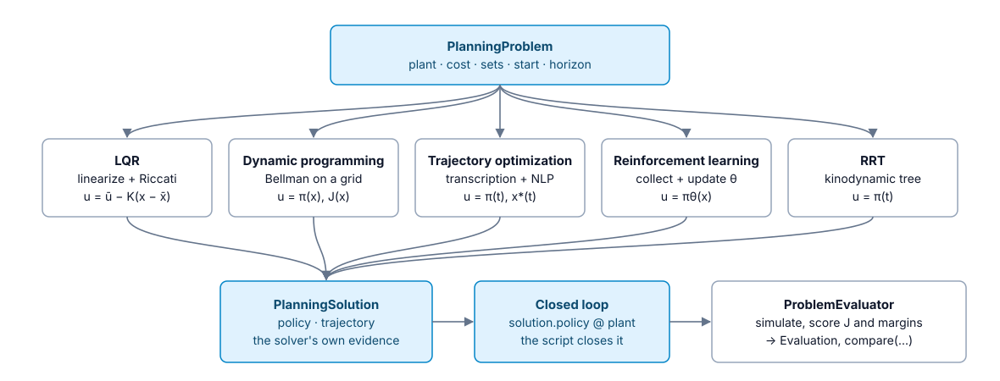
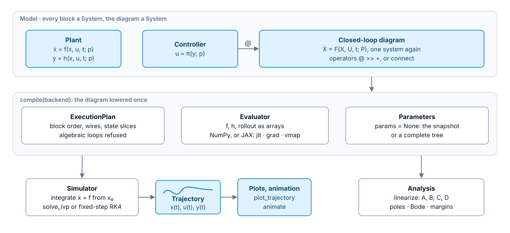
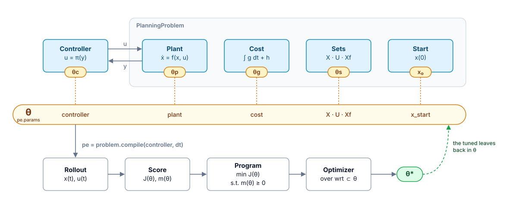
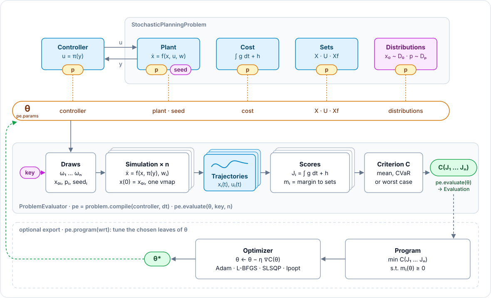
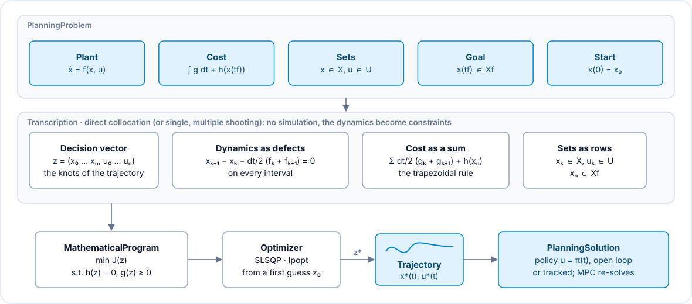
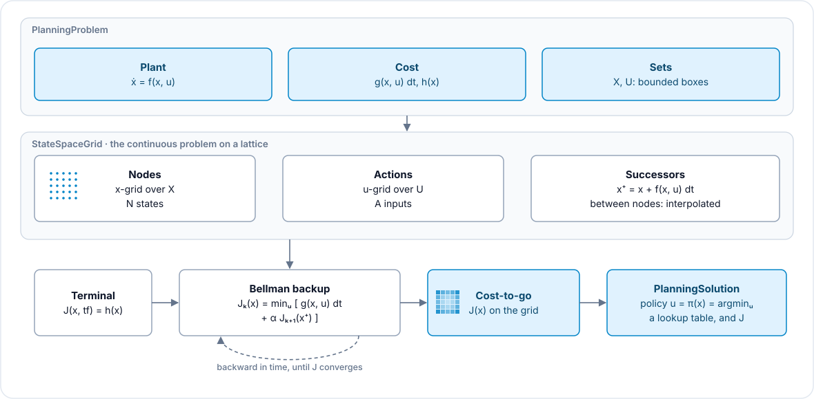
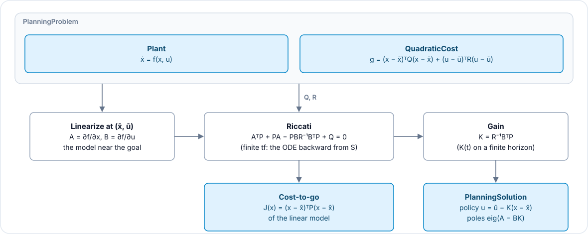
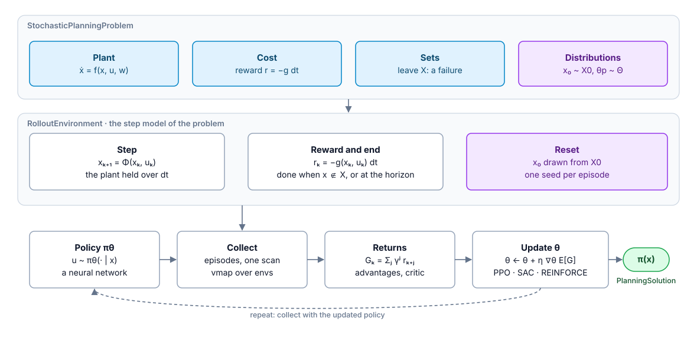

# Minilink's pipelines, in pictures

One figure per major pipeline, in one visual language: blue, the objects (systems, the
problem, trajectories, solutions); amber, parameters; purple, randomness; white, the steps;
green, the results. The figures are drawn by `docs/pipeline_figures.py`
(`python docs/pipeline_figures.py` rebuilds every `docs/_static/pipeline_*.svg`).

## The planners, one problem, one yardstick

Every planner takes the same `PlanningProblem` and returns the same kind of
`PlanningSolution`: a policy and the solver's own evidence. The script closes the loop
(`solution.policy @ plant`), and the problem evaluator scores every closed loop the same way,
so `compare` can put them side by side.

## Modeling and simulation

Every block is a `System` with its parameters, and a diagram of blocks is a `System` again.
`compile` lowers it once to arrays on NumPy or JAX; the simulator integrates it forward into a
`Trajectory`, and the analysis tools linearize it.

## Evaluation and tuning

The problem evaluator simulates the controller closed on the problem's plant, scores the
trajectory (the cost `J`, the margin `m` to the sets) and returns the objective. Every
parameter of every object sits in one tree `θ`; tuning is an optional export, a program over
the chosen leaves of `θ`. The contract is DESIGN §6.

On a stochastic problem the evaluator draws `n` realizations from one key, simulates them in
one `vmap`, and the criterion (mean, CVaR or worst case) reduces their costs.

## Trajectory optimization

No simulation inside: the transcription makes the trajectory itself the decision vector, the
dynamics become equality constraints (the defects between knots), the cost a sum and the sets
inequality rows. The optimizer solves that one program; the plan read back is a trajectory
and an open-loop policy, tracked or re-solved by an MPC.

## Dynamic programming

The problem is put on a lattice of states and actions, each pair with its successor. The
Bellman backup sweeps backward from the terminal cost until the cost-to-go converges; the
policy is the minimizing action at every node, a lookup table.

## The linear-quadratic regulator

The plant is linearized at the goal `(x̄, ū)` of the quadratic cost, the Riccati equation gives
`P`, and the gain `K` closes the loop; the solution carries the law, its cost-to-go and the
closed-loop poles.

## Reinforcement learning

The stochastic problem becomes a step environment (step, reward, end, reset). The learner
collects episodes with its current policy, computes the returns and updates the weights `θ`,
and repeats; the trained network is the policy of the solution.

## Not drawn yet

- **Model predictive control**: trajectory optimization repeated at every tick from the
  measured state, warm-started by the last plan; worth a figure with the sampled loop
  (`docs/plans/sampled-path.md` §8, a draft vision).
- **RRT**: a kinodynamic tree search; short enough for its overview card.
- **The hybrid loop** (`computer @ plant`): a tentative draft vision, drawn once it is decided.
