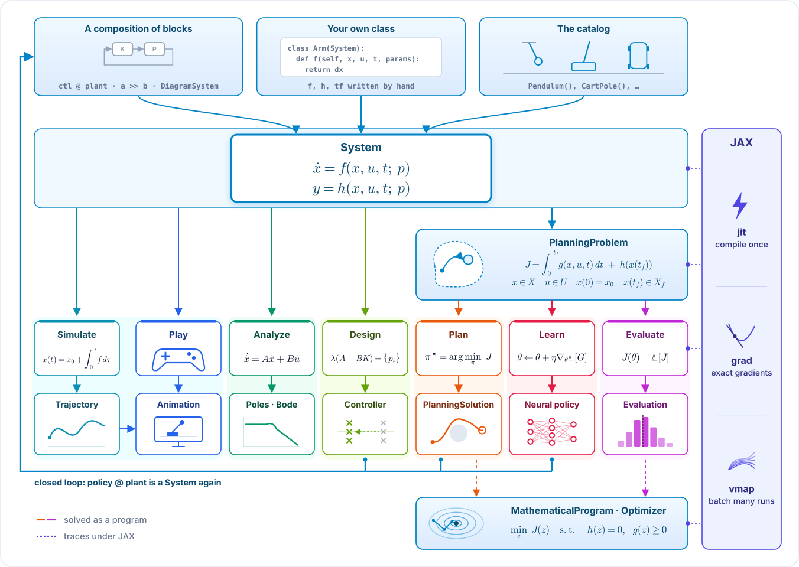

# Minilink's pipelines, in pictures

The library map, in one palette: blue, the three foundations and where a `System` comes
from; a colour per tool, cool for the tools that start from the system and warm for those
that start from the problem; indigo, JAX. `p` is one object's own parameters, the `p` of
`f(x, u, t; p)`. The figure is drawn by `docs/pipeline_figures.py` (`python
docs/pipeline_figures.py` rebuilds `docs/_static/pipeline_map.svg`; `python
docs/make_assets.py map` the README's PNG too).

## The library on one page

A `System` is made one of three ways: a composition of blocks (`ctl @ plant`, `a >> b`, a
`DiagramSystem`), a class of your own that writes `f` (and `h`, `tf`), or a plant from the
catalog (`Pendulum()`); the tools cannot tell them apart, and every controller a tool returns
closes on the plant into a composition again. Three foundations (CONSTITUTION §1.1):
the model, a `System`; the task, a `PlanningProblem` built on it; and the solver boundary, a `MathematicalProgram` and its `Optimizer`. Every tool
is a path from them: simulate, play, analyze and design straight from the system; plan, learn
and evaluate from the problem. Each tool's lane ends in what it gives back, drawn as a small
picture. Play is the live session (`sys.game()`, keyboard or joystick on the wall clock), and a
simulated trajectory replays as the same animation (`sys.animate(traj)`). The paths that solve a program (trajectory optimization, tuning) meet the optimizer,
and every controller a path returns is a `System` again, closed on the plant with `@`. The
JAX column says what the objects linked to it give: their equations trace under JAX, so the
tools built on them compile once (`jit`), give exact gradients (`grad`), and run many cases in
one call (`vmap`).

