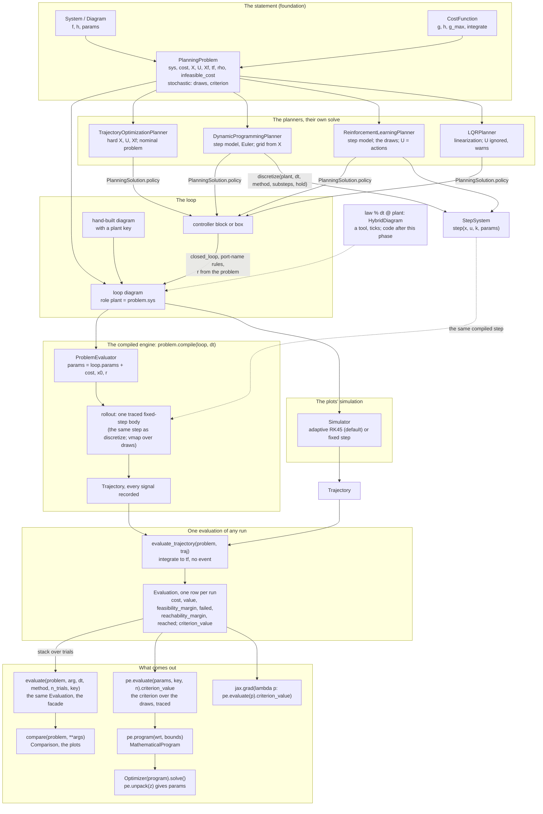

# The continuous core: architecture, API and pipelines

**Status:** the design of the next implementation phase, as ruled on 2026-10-22/23
([the rulings](../reviews/2026-10-22-rulings-session-1.md), R1–R29; the decision ledger with
the alternatives is [end-state-api.md](end-state-api.md)). This document is the *what*: the
shape of the architecture, every public name, and the pipelines a user writes. Nothing here is
built yet.
**Scope:** continuous-time plants and controllers. The sampled loop (digital controllers, MPC,
MPPI) is a later phase and appears only where its contract is fixed by this one.
**Lane:** maintainer-owned names; the detail of each piece lives in the plan it came from
([sampled-path.md](sampled-path.md), [differentiable-problem.md](differentiable-problem.md),
[cost-params.md](cost-params.md), [randomness.md](randomness.md)), aligned to this document on
2026-10-23. The steps, in order and with their gates, are [TODO.md](TODO.md) §4.
**What v0.3 builds of it:** the step model (S75), the deterministic path (V1's steps 1–6: one
run, `n_trials = 1`) and the cost parameters (A2). The draws on a `StochasticPlanningProblem`
(§4.5, the stochastic column of §5: `realize`, `n_trials > 1`, the Monte Carlo evaluator folded
into `evaluate`) are V1's step 7, a v0.4 row of the roadmap; until then `evaluate` refuses
`n_trials > 1` and points to `MonteCarloEvaluator`. Whether that fold moves into v0.3 is
raised in ROADMAP §6 (2026-10-23).

---

## 1. The architecture

**Three foundations, six tooling pillars.** The model (`System`, its algebra, the catalog
plants, compile and the rollout) is the primary foundation; the problem statement
(`PlanningProblem`, `PlanningSolution`) the second; the solver boundary (`MathematicalProgram`,
`Optimizer`) the third. On them, six pillars: classical and modern control, nonlinear control,
trajectory optimization and MPC, reinforcement learning, identification and imitation,
estimation. Every pillar is a tool on one path:

```
System ──compile──► rollout ──► Trajectory ──► evaluate_trajectory ──► MathematicalProgram ──► Optimizer
  p = (plant, controller, cost, x0, draws)                                             ∂value/∂p
```

**Two step paths, one compiled step.** The continuous path integrates the whole closed-loop
diagram, the controller's state inside `x`; the sampled path (later phase) integrates the plant
alone between samples of a held controller. Both use the same compiled step body, the one
`discretize` exposes. The adaptive ODE solver (`Simulator`) stays what the plots show and is
one keyword away everywhere.



Reading it: the statement at the top; the loop built for you or by hand; two simulations of
it (the compiled engine, the plots' solver); one scoring of any run; on the right what comes
out (the report, the comparison, the traced scalar, the program); on the left the planners,
whose policy re-enters as a controller; dashed, the sampled loop of the next phase.

---

## 2. The names, by level

| Level | Noun or verb | Returns |
| --- | --- | --- |
| model | `System`, `DynamicSystem`, `DiagramSystem`, `StepSystem` | — |
| model | `plant.compile(backend)` → the system evaluator: `f`, `h`, `step`, `rollout`, `rollout_batch`; `.jit.*`, `.frozen.*` | arrays |
| model | `discretize(plant, dt, *, method, substeps, hold)` | `StepSystem` |
| model | `sys.compute_trajectory(...)`, `sys.compute_forced(u, ..., method)` | `Trajectory` |
| cost | `CostFunction`: `params`, `g`, `h`, `g_max(X, U)`, `integrate(traj, discount_rate)`; `+`, `*` | arrays |
| cost | `traj.with_cost(cost, discount_rate)` | `Trajectory` with `cost_rate`, `cost` signals |
| problem | `PlanningProblem(sys, cost, X, U, Xf, tf, discount_rate, infeasible_cost)` | — |
| problem | `StochasticPlanningProblem(..., x0_distribution, params_distribution, disturbances, criterion)` | — |
| problem | `problem.realize(key, n)` | the draws |
| scoring | `evaluate_trajectory(problem, traj)` | `Evaluation` (one row) |
| engine | `problem.compile(loop_or_controller, dt, *, substeps, backend)` | `ProblemEvaluator` |
| engine | `pe.params`; `pe.trajectory(params, key)`; `pe.evaluate(params, key, n_trials)`; `pe.program(wrt, bounds, key, n_trials)`; `pe.pack` / `pe.unpack` | `Trajectory`, `Evaluation`, `MathematicalProgram` |
| facade | `evaluate(problem, arg, *, dt, method, n_trials, key)` | `Evaluation` |
| facade | `compare(problem, **args, dt, n_trials, key)` | `Comparison` |
| solver | `MathematicalProgram`, `Optimizer(program, method).solve()` | `OptimizationResult` |
| planners | `*Planner(problem, ...).solve()` | `PlanningSolution` |

Each verb is named by what it returns. Gone from the plan: `tune` / `optimize` facades, the
engine verbs `cost` / `value` / `margin`, `TrajectoryEvaluation`, `MonteCarloEvaluator` (one
facade line until removed, V1's step 7), `score_trajectory` (it becomes the problem-level
`evaluate_trajectory`), and four members of the cost: `discount_rate`, `evaluate_trajectory`,
`terminal_cost`, `total_cost`.

---

## 3. The objects

### 3.1 The compiled system: four traced bodies

```python
ev = plant.compile("jax")                   # or "numpy": the same names, no jit tier
ev.f(x, u, t, params)                       # the law; u=None is the nominal input
ev.h(x, u, t, params)                       # the outputs and, for a diagram, the internal signals
ev.step(x, u, t, params, *, dt, method="rk4", substeps=1, hold="zoh")   # x_{k+1}: the one step model
ev.rollout(x0, u_seq, t0, dt, params, **knobs)                          # scan of step: (t, xs, signals)
ev.rollout_batch(x0s, u_seqs, dt=, params=family)                       # vmap(rollout): any leaf with a leading B axis is mapped

ev.jit.step(...)       # jax.jit(ev.step), compiled once, cached; params still an argument
ev.frozen.step(...)    # jit(partial(ev.step, params=plant.params)), bound at first use, rebound when params change
```

Rules: the traced body is the only code, the two access forms are generated and cached once,
never rebuilt inside a loop; `method`, `substeps`, `hold` are static Python values, never
traced; `dt` and `params` are the only array arguments. For a `StepSystem` evaluator, `step` is
the system's own map with the integer tick in place of `t` (`step(x, u, k, params)`, R14), no
knobs; `discretize` is the one place that binds `t_k = t0 + k·dt`. Measured: no speed difference between the
frozen and the parametric forms once bound (`benchmarks/params_binding.py`).

### 3.2 The step model

```python
plant_k = discretize(plant, dt, *, method="rk4", substeps=1, hold="zoh")   # -> StepSystem
plant_k.step(x, u, k=0)                      # bound to plant.params
plant_k.step(x, u, k=0, params={"m": 1.2})   # the same body
```

The integer tick `k` is the step contract (`t_k = t0 + k·dt` is the loop's business). Every
sampled consumer calls this step: DP (`method="euler"` by default, byte-identical), RL and the
gym bridge (`substeps` exposed), later the hybrid loop, RRT, MPPI. `hold="zoh"` everywhere by
default; `compute_forced` and the fixed-step solvers use the same rollout.

### 3.3 The cost: a pure integrand

```python
class CostFunction:
    params                                        # Q, R, S, xbar, ubar … ; None for a user cost without parameters
    def g(self, x, u, t=0.0, params=None)         # running cost density
    def h(self, x, t=0.0, params=None)            # terminal cost
    def g_max(self, X, U, params=None)            # the scale of g over the allowed sets: infeasible_cost's default reads it
    def integrate(self, traj, *, discount_rate=0.0, params=None)   # J(t_k) = ∫₀^{t_k} e^{−ρt} g dt, trapezoid, on xp; no h
    __add__, __mul__                              # SumCost, ScaledCost; params nested by term id
```

`QuadraticCost`, `TimeCost` (minimum time: `g = 1` outside the goal), `SumCost`, `ScaledCost`;
later `field.as_cost()` and a `ClippedCost` when a saturating cost is needed. The cost knows
nothing about a horizon, a set, a price or a discount.

### 3.4 The problem: the functional's shape, one meaning per field

```python
problem = PlanningProblem(plant, cost=cost, X=plant.state.box, U=plant.input_box, Xf=goal_ball,
                          tf=10.0, discount_rate=0.0, infeasible_cost=None, x_start=None, x_goal=None)
noisy = StochasticPlanningProblem(..., x0_distribution=Gaussian(...), params_distribution={"m": ...},
                                  disturbances={"d": WhiteNoise(psd=1e-2)}, criterion="expectation")
```

| Field | Meaning, for every consumer |
| --- | --- |
| `X`, `U` | constraints along the run; enforced where a planner can (trajectory optimization, RRT, DP's grid, RL's action space), judged by the margin for any run; default unbounded, and a planner that needs a finite box **refuses** an unbounded one (`X=plant.state.box`, `U=plant.input_box` are the lines to write); LQR ignores `U` and warns once |
| `Xf` | the goal set; enforced by the open-loop planners, judged by `reached` for any run; `None` is no terminal constraint (any `x(tf)` is `reached`; the terminal cost `h` is the soft end) |
| `x_goal`, `x_start` | one point of `Xf` and of `X0`, for the tools that need a point: RRT's bias, trajopt's initial guess, the loop's reference `r`. The problem never reads the cost's target (`xbar` exists only on the quadratic and time costs); a loop whose controller reads `r` is refused when `x_goal` is `None` |
| `tf` | finite: the horizon, `h` charged at `tf`; `None`: infinite, no `h` (a nonzero `h` warns once, R9), simulated over an `episode_length` the tool names |
| `discount_rate` | ρ, applied to `g` and `h` by every consumer (RL's γ and DP's α read it here) |
| `infeasible_cost` | the one price; default `cost.g_max(X, U) · tf` (or `/ ρ`) |
| `criterion` | `"expectation"`, `("cvar", α)`, `"worst_case"`: how `criterion_value` reduces the runs |

### 3.5 One evaluation of any run

Every run is integrated to `tf`; no event, no mask, no stop. Then, in one pass:

```
feasibility_margin  = min over the run of X.margin(x_k, t_k), U.margin(u_k, x_k, t_k)     failed  = margin < 0
reachability_margin = Xf.margin(x(tf), tf)                                                   reached = margin ≥ 0   (Xf=None ⇒ reached, no terminal constraint)
cost                = ∫₀^{tf} e^{−ρt} g dt + e^{−ρ tf} h(x(tf))                              the plain integral
value               = cost + infeasible_cost · (failed or not reached)                      the per-run scalar
```

```python
Evaluation                                 # a frozen pytree record, one row per run; traceable inside a trace, plain outside
    .cost, .value, .feasibility_margin, .failed, .reachability_margin, .reached, .x0, .keys   # (n,) arrays
    .trajectories                          # one batched Trajectory (a leading run axis) when record=True, else None
    .criterion_value                       # the problem's criterion over the runs: the one scalar a program minimizes
    .mean, .std, .worst, .cvar(a)          # statistics of the per-run value
    .feasibility_rate, .reachability_rate, .success_rate   # mean(~failed), mean(reached), mean(reached & ~failed)
    print(report); report.plot_cost(); report.plot_trajectories()     # reporting, outside a trace
```

**Which trajectory.** Three objects, named once:

| | What it is | `x`, `u` | Who produces it |
| --- | --- | --- | --- |
| the loop's run | `pe.trajectory()`, `loop.compute_trajectory()` | the whole loop's state (plant and controller states), the loop's boundary input; every internal signal recorded (`plant:u`, `plant:y`, …) | the engine, the `Simulator`; what `report.trajectories` holds and the plots show |
| the plant's run | `traj.of("plant")` (today's `trajectory_of`) | the plant's state slice, the plant's command signal | a projection of the loop's run; what `X`, `U`, `Xf` and the cost are written over |
| the record | `evaluate_trajectory(problem, traj)` | — | scores the plant's run: a trajectory whose `x` has the plant's dimension and no roles is taken as the plant's; a loop trajectory carrying the `plant` role is projected first; anything else is refused |

**`of("plant")` traces because it only indexes.** The plant's state is a static slice of the
loop's state (`state_index`); each plant input port is, statically, a recorded block output
signal (`plan.output_slices`), a slice of the loop's boundary `u`, or a nominal constant for an
unconnected port. With the signals recorded by the rollout, the projection never recomputes a
block, so `jit`, `vmap` and `grad` pass through it and the record is traceable end to end.
Today's `trajectory_of` (a Python loop recomputing `get_local_input` per sample) survives only
as the fallback for a trajectory without recorded signals, on NumPy.

The two margins are the differentiable carriers (the program's constraint rows); the booleans
and `value`'s jump are reported facts. A diverging failed run is handled, if ever needed, by a
saturating cost wrapper, not by a mask.

### 3.6 The engine and its facade

```python
pe = problem.compile(loop_or_controller, dt, *, substeps=1, backend="auto")   # ProblemEvaluator
pe.params                                          # the loop's params by block path + "cost", "x0", the free boundary inputs
pe.trajectory(params=None, key=None)               # one run, every signal recorded; key=None the nominal draw
pe.evaluate(params=None, key=0, n_trials=1)        # one run or n draws, the Evaluation
pe.program(wrt, bounds=None, key=0, n_trials=1)    # MathematicalProgram, objective pe.evaluate(...).criterion_value, draws realized once
pe.pack(params, wrt) -> z;  pe.unpack(z, wrt) -> params

evaluate(problem, arg, *, dt=None, method="rk4", n_trials=1, key=0)   # == problem.compile(arg, dt).evaluate(key=, n_trials=)
#   method="scipy": the adaptive Simulator, one run per trial, the one-line escape
#   dt=None: the Simulator's automatic rule, a tenth of the declared smallest time constant; on a loop that
#   declares none that is 1e-4 s (the 1e-3 default), the open question raised in ROADMAP §6 (2026-10-23)
compare(problem, **args, dt=None, n_trials=1, key=0)                  # several Evaluations, one key, the table and the plots
```

**What the engine accepts.** A controller (a block, or a controller box with the standard
edge): the loop is built by `closed_loop` under the port-name rules, the plant's command
input by `command_port` (`u`, else its one input that is not `d` / `n`, else refused), the
measurement by port name or through an `Error` block, the reference `r` filled from `x_goal`
(refused when the controller reads `r` and `x_goal` is `None`), every other free input at its
nominal value; no command-port argument, ambiguity
refused. Or a built loop: a diagram whose reserved key `plant` is the problem's system or a box
containing it; roles are never inferred. Scoring reads the plant block's recorded `x` and `u`.
A stochastic problem requires `n_trials`; a deterministic one refuses `n_trials > 1`; a
sampled controller is refused in this phase.

**What this phase exports.** The program, nothing above it: a user runs `Optimizer` and writes
the leaves back with `pe.unpack`. No tuning facade, no solution object from it.

---

## 4. Pipelines, as code

### 4.1 Simulate and plot (unchanged)

```python
plant = Pendulum()
loop = Step(port="r") >> PID(Kp=20, Ki=10, Kd=2) @ plant
loop.compute_trajectory(tf=10); loop.plot_trajectory(); loop.plot_bode()
plant.compute_forced(lambda t: np.array([np.sin(t)]), tf=10, method="rk4")   # method="scipy" for the adaptive solver
```

### 4.2 Attach a cost to a run, no problem needed

```python
cost = QuadraticCost.from_system(plant)
traj = loop.compute_trajectory(tf=10).with_cost(cost, discount_rate=0.0)   # signals "cost_rate" and "cost"
plant.plot_cost(cost)
```

### 4.3 Evaluate a controller on a problem

```python
problem = PlanningProblem(plant, cost=cost, X=plant.state.box, U=plant.input_box, tf=10.0)
report = evaluate(problem, PID(Kp=20, Ki=10, Kd=2))        # one run; dt from the plant's time constant
print(report)                                               # cost, value, the margins, failed, reached
report = evaluate(problem, PID(20, 10, 2), method="scipy")  # the same, on the adaptive solver
```

### 4.4 Compare controllers

```python
cmp = compare(problem, PID=PID(20, 10, 2), LQR=StateFeedbackController(K), DP=sol_dp, dt=0.01)
print(cmp); cmp.plot_trajectory(); cmp.plot_cost(); cmp.plot_phase_plane(); cmp.plot_control_law(); cmp.plot_cost_to_go()
```

An entry is a controller, a `PlanningSolution` or an `Evaluation`; one key for all.

### 4.5 Monte Carlo on a stochastic problem

```python
noisy = StochasticPlanningProblem(plant, cost=cost, X=plant.state.box, U=plant.input_box, tf=10.0,
                                  x0_distribution=Gaussian(mean=plant.x0, cov=0.1 * np.eye(2)),
                                  disturbances={"d": WhiteNoise(psd=1e-2)}, criterion=("cvar", 0.1))
report = evaluate(noisy, PID(20, 10, 2), dt=0.01, n_trials=200, key=0)
report.criterion_value, report.mean, report.worst, report.success_rate
report = evaluate(noisy, PID(20, 10, 2), dt=0.01, n_trials=200, key=0, record=True); report.trajectories[3]
cmp = compare(noisy, PID=pid, LQR=lqr_law, dt=0.01, n_trials=200, key=0); cmp.difference("PID", "LQR")   # paired
```

### 4.6 Gradients and the program export

```python
pe = problem.compile(PID(Kp=20, Ki=10, Kd=2), dt=0.01)
dJ = jax.grad(lambda p: pe.evaluate(p).criterion_value)(pe.params)      # every leaf: gains, plant params, cost, x0, r
program = pe.program(wrt=["controller.Kp", "controller.Kd"], bounds={"controller.Kp": (0, None)})
result = Optimizer(program).solve()
params = pe.unpack(result.z, wrt=["controller.Kp", "controller.Kd"])
evaluate(problem, PID(**params["controller"]))                           # the tuned controller, judged by the same evaluate
```

Robust tuning and identification are the same lines on a stochastic problem, or with
`wrt=["plant.m", "plant.b"]` against a problem whose cost tracks logged data.

### 4.7 A hand-built loop: a cascade on a three-block plant

```python
plant = DiagramSystem()                                   # a box with the standard edge: u in, y and x out
plant.add_subsystem("motor", DCMotor()); plant.add_subsystem("arm", Arm()); plant.add_subsystem("encoder", Quantizer())
plant.connect("motor:torque", "arm:tau"); plant.connect("arm:q", "encoder:u")
plant.add_input_port("u", "motor:v"); plant.connect_new_output_port("y", "encoder:y"); plant.expose("x")
problem = PlanningProblem(plant, cost=cost, X=box_over_plant_x, U=ubox, tf=5.0)     # stated on the plant box

loop = DiagramSystem()
loop.add_subsystem("plant", plant)                        # the reserved key: this block is scored
loop.add_subsystem("speed_ctl", PI(2.0, 0.5)); loop.add_subsystem("pos_ctl", PD(10.0, 1.0)); loop.add_subsystem("filter", LowPassFilter(cutoff_hz=20))
loop.connect("plant:y", "filter:u"); loop.connect("filter:y", "pos_ctl:y"); loop.connect("pos_ctl:u", "speed_ctl:r")
loop.connect("plant:x", "speed_ctl:y", slice=velocity); loop.connect("speed_ctl:u", "plant:u")
loop.add_input_port("r", "pos_ctl:r")                     # left free: filled from the problem

pe = problem.compile(loop, dt=0.001)
pe.params        # {"plant": {"motor": …, "arm": …, "encoder": …}, "speed_ctl": …, "pos_ctl": …, "filter": …, "cost": …, "x0": …, "r": …}
pe.evaluate()
pe.program(wrt=["pos_ctl.Kp", "speed_ctl.Ki", "plant/motor.R"], bounds={"plant/motor.R": (0.1, 10)})
```

### 4.8 Score a trajectory you already hold

```python
traj = (PID(20, 10, 2) @ plant).compute_trajectory(tf=10)   # the loop's run, signals recorded
evaluate_trajectory(problem, traj)                           # projected to the plant's run by the plant role, then scored
evaluate_trajectory(problem, traj.of("plant"))               # the same, from the plant's run
evaluate_trajectory(problem, logged)                         # a logged run: x the plant's state, u its command
```

### 4.9 The planners, and the sampled plant they step

```python
sol_dp = DynamicProgrammingPlanner(problem, dt=0.05).solve()             # Euler through discretize(plant, dt, method="euler")
sol_to = TrajectoryOptimizationPlanner(problem, transcription="direct_collocation").solve()
sol_rl = ReinforcementLearningPlanner(noisy, dt=0.05, substeps=2, algorithm="ppo").solve()   # actions from U
compare(problem, DP=sol_dp, TO=sol_to, PPO=sol_rl, dt=0.05).plot_trajectory()                # each policy judged by the same evaluate
```

---

## 5. Deterministic and stochastic, step by step

The deterministic column is v0.3 (V1's steps 1–6); the stochastic column lands with V1's step 7
(v0.4 on the roadmap; the pull into v0.3 is raised in ROADMAP §6).

| Step | `PlanningProblem` | `StochasticPlanningProblem` |
| --- | --- | --- |
| the statement | `x_start` one point; no criterion | plus the three laws and `criterion`; `x_start` the start law's mean |
| `compile` | the loop wired once | identical; the disturbance ports are boundary inputs the draws fill |
| the draws, `realize(key, n)` | none: `n = 1`, nominal | `n` realizations from one key: start, parameter override, one seed per noise block |
| the run | one fixed-step rollout to `tf` | `vmap` of the same rollout (a loop on NumPy) |
| the record | one row | `n` rows |
| `criterion_value` | that run's `value` | mean, CVaR or worst of the per-run `value` |
| the program | objective: that run's `value` | objective: the criterion over draws realized once at `program(...)` |
| `compare` | one run per entry | one key for every entry: paired trials |
| the planners | solve as stated | open-loop planners and LQR take `problem.nominal()` with a warning; RL and tabular learning train on the draws |

---

## 6. Conventions this design relies on

- **One body, generated forms.** A traced parametric function is the only code; jitted and
  bound forms are generated and cached once. Never `jax.jit` or `partial` inside a loop.
- **Static knobs.** `method`, `substeps`, `hold` are Python values resolved at trace time.
- **Records are pytrees.** `Trajectory` and `Evaluation` carry arrays and nothing else; their
  reporting verbs are called outside a trace.
- **One meaning per field, one owner per rule.** The cost owns the integrand; the problem owns
  the shape; `evaluate_trajectory` owns the formula; `infeasible_cost` has one default.
- **Roles, never inference.** `plant` is a reserved key read by every tool; nothing is guessed
  from wiring.
- **Explicit sets.** A planner that needs a box refuses an unbounded one with the line to write.

---

## 7. Not in this phase

- **The sampled loop** (`law % dt @ plant`, `HybridDiagram`): a tool, ticks on its clock, one
  tick-scan kernel over the step model; its caches, controller memory and the dispatch of a
  sampled controller in `evaluate` are ruled in the hybrid phase.
- **The optimizer upgrade**: program classes hinting the solver, `method="auto"`, algorithm-named
  presets, the first-order backend. Today's `Optimizer` receives the program unchanged.
- **The v0.4 names**: the parametric MPC program (`ParametricProgram`, the key `plant`, live
  ports), `MPPIPlanner` and the three planner verbs the MPC block reads, the seeded stochastic
  policy block (`GaussianPolicy`).
- **The draws** (V1's step 7, with RN-4 / RN-5): `problem.realize`, `n_trials > 1`, the Monte
  Carlo evaluator folded into `evaluate`, and its re-pin: its numbers change once when the held
  static law becomes the real loop and the cut at exit the integral to `tf` (D21). The single-run
  scorer changes to the integral to `tf` in v0.3 already (V1's step 2).
