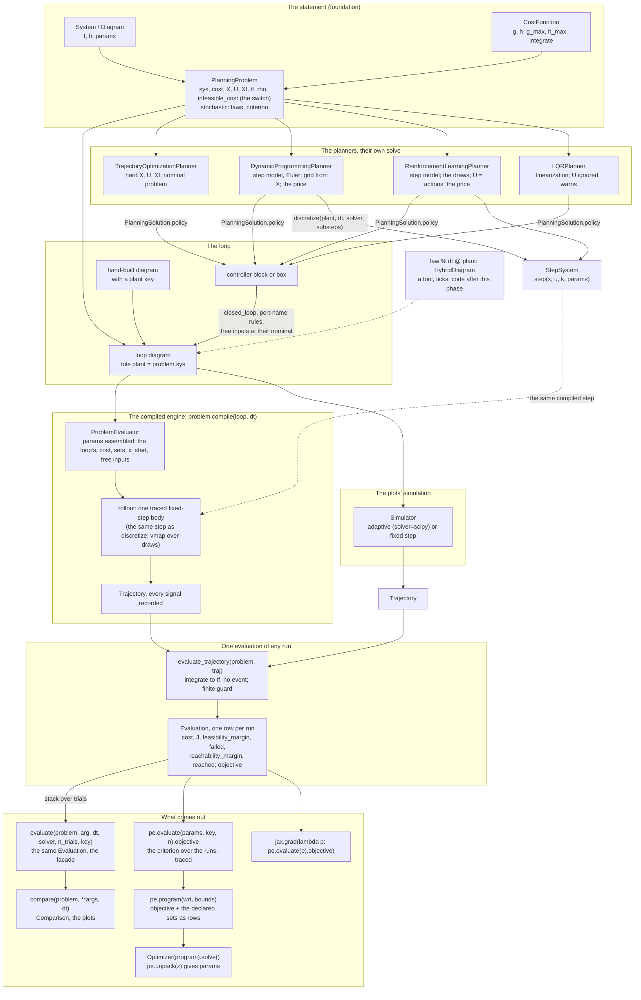

# The continuous core: architecture, API and pipelines

**Status:** the design of the next implementation phase, as ruled on 2026-10-22/23
([the rulings](../reviews/2026-10-22-rulings-session-1.md), R1–R47, the evening's session 3
included; the decision ledger with the alternatives is [end-state-api.md](end-state-api.md)).
This document is the *what*: the shape of the architecture, every public name, and the
pipelines a user writes. Nothing here is built yet.
**Scope:** continuous-time plants and controllers. The sampled loop (digital controllers, MPC,
MPPI) is a later phase and appears only where its contract is fixed by this one.
**Lane:** maintainer-owned names; the detail of each piece lives in the plan it came from
([sampled-path.md](sampled-path.md), [differentiable-problem.md](differentiable-problem.md),
[cost-params.md](cost-params.md), [randomness.md](randomness.md)), aligned to this document on
2026-10-23. The steps, in order and with their gates, are [TODO.md](TODO.md) §4.
**What v0.3 builds of it:** the step model (S75), the differentiable path (V1's steps 1–6) and,
right after the engine exists, the Monte Carlo fold (V1's step 7a, R44): `evaluate` and
`compare` take `n_trials` and `key` over the start and parameter laws, and `MonteCarloEvaluator`
goes. The cost parameters (A2) close the phase. What waits for v0.4 is RN-4's per-block noise
seeds (a disturbance block's draws), which join under the same verb. v0.3 stays on `dev` until
every notebook has moved to the new interface (R47).

---

## 1. The architecture

**Three foundations, six tooling pillars.** The model (`System`, its algebra, the catalog
plants, compile and the rollout) is the primary foundation; the problem statement
(`PlanningProblem`, `PlanningSolution`) the second; the solver boundary (`MathematicalProgram`,
`Optimizer`) the third. On them, six pillars: classical and modern control, nonlinear control,
trajectory optimization and MPC, reinforcement learning, identification and imitation,
estimation. Every pillar is a tool on one path:

```
System ──compile──► rollout ──► Trajectory ──► evaluate_trajectory ──► MathematicalProgram ──► Optimizer
  p = (plant, controller, cost, x0, draws)                                         ∂objective/∂p
```

**Two step paths, one compiled step.** The continuous path integrates the whole closed-loop
diagram, the controller's state inside `x`; the sampled path (later phase) integrates the plant
alone between samples of a held controller. Both use the same compiled step body, the one
`discretize` exposes. The adaptive ODE solver (`Simulator`) stays what the plots show and is
one keyword away everywhere (`solver="scipy"`).



Reading it: the statement at the top; the loop built for you or by hand; two simulations of
it (the compiled engine, the plots' solver); one scoring of any run; on the right what comes
out (the report, the comparison, the traced scalar, the program); on the left the planners,
whose policy re-enters as a controller; dashed, the sampled loop of the next phase.

---

## 2. The names, by level

| Level | Noun or verb | Returns |
| --- | --- | --- |
| model | `System`, `DynamicSystem`, `DiagramSystem`, `StepSystem` | — |
| model | `plant.compile(backend)` → the system evaluator: `f`, `h`, `step`, `rollout`, `rollout_batch`; `.jit.*`, `.frozen.*` | arrays |
| model | `discretize(plant, dt, *, solver="rk4", substeps=1)` | `StepSystem` |
| model | `sys.compute_trajectory(..., solver)`, `sys.compute_forced(u, ..., solver, hold)` | `Trajectory` |
| model | `plant.state.box`, `plant.input_box` | `BoxSet`, `BoxInputSet` |
| cost | `CostFunction`: `params`, `g`, `h`, `g_max(X, U)`, `h_max(X)`, `integrate(traj, discount_rate)`; `+`, `*` | arrays |
| cost | `traj.with_cost(cost, discount_rate)` | `Trajectory` with `cost_rate`, `cost` signals |
| problem | `PlanningProblem(sys, cost, X, U, Xf, tf, discount_rate, infeasible_cost, x_start, x_goal)` | — |
| problem | `StochasticPlanningProblem(..., x0_distribution, params_distribution, disturbances, criterion)` | — |
| problem | `problem.cost_bound()` (R71) | an upper bound on any feasible run's cost, always finite: the price of a failure |
| problem | `problem.realize(key, n)` | the draws |
| scoring | `evaluate_trajectory(problem, traj)` | `Evaluation` (one row) |
| engine | `problem.compile(loop_or_controller, dt, *, substeps, solver, backend)` | `ProblemEvaluator` |
| engine | `pe.params`; `pe.trajectory(params, key)`; `pe.evaluate(params, key, n_trials)`; `pe.program(wrt, bounds, key, n_trials)`; `pe.pack` / `pe.unpack` | `Trajectory`, `Evaluation`, `MathematicalProgram` |
| facade | `evaluate(problem, arg, *, dt, solver, n_trials, key)` | `Evaluation` |
| facade | `compare(problem, **args, dt, n_trials, key)` | `Comparison` |
| solver | `MathematicalProgram`, `Optimizer(program, method).solve()` | `OptimizationResult` |
| planners | `*Planner(problem, ...).solve()` | `PlanningSolution` |

Each verb is named by what it returns. Gone from the plan: `tune` / `optimize` facades, the
engine verbs `cost` / `value` / `margin`, `TrajectoryEvaluation`, `MonteCarloEvaluator` (one
facade line, then removed, V1's step 7a), `score_trajectory` (it becomes the problem-level
`evaluate_trajectory`), `ProblemParameters` (each object owns its parameters, R41), the
`integrator=` keyword (`solver=`, R42), and four members of the cost: `discount_rate`,
`evaluate_trajectory`, `terminal_cost`, `total_cost`.

---

## 3. The objects

### 3.1 The compiled system: four traced bodies

```python
ev = plant.compile("jax")                   # or "numpy": the same names, no jit tier
ev.f(x, u, t, params)                       # the law; u=None is the nominal input
ev.h(x, u, t, params)                       # the outputs and, for a diagram, the internal signals
ev.step(x, u, t, params, *, dt, solver="rk4", substeps=1)          # x_{k+1}, u held: the one step model
ev.rollout(x0, u_seq, t0, dt, params, *, solver="rk4", substeps=1, hold="zoh")   # scan of step: (t, xs, signals)
ev.rollout_batch(x0s, u_seqs, dt=, params=family)                  # vmap(rollout): any leaf with a leading B axis is mapped

ev.jit.step(...)       # jax.jit(ev.step), compiled once, cached; params still an argument
ev.frozen.step(...)    # jit(partial(ev.step, params=plant.params)), bound at first use, rebound when params change
```

Rules: the traced body is the only code, the two access forms are generated and cached once,
never rebuilt inside a loop; `solver`, `substeps`, `hold` are static Python values, never
traced; `dt` and `params` are the only array arguments. A step map holds its input over the
step by definition, so `step` has no `hold`; `hold="zoh" | "foh"` lives on `rollout`, which
holds a sequence (`"foh"` is the linear input shooting uses between knots; R40). For a
`StepSystem` evaluator, `step` is the system's own map with the integer tick in place of `t`
(`step(x, u, k, params)`, R14), no knobs; `discretize` is the one place that binds
`t_k = t0 + k·dt`. Measured: no speed difference between the frozen and the parametric forms
once bound (`benchmarks/params_binding.py`).

### 3.2 The step model

```python
plant_k = discretize(plant, dt, *, solver="rk4", substeps=1)   # -> StepSystem; solver "rk4" | "euler" | "exact"
plant_k.step(x, u, k=0)                      # bound to plant.params
plant_k.step(x, u, k=0, params={"m": 1.2})   # the same body
```

The integer tick `k` is the step contract; `discretize` binds `t_k = t0 + k·dt`. Every sampled
consumer calls this step: DP (`solver="euler"` by default, byte-identical), RL and the gym
bridge (`substeps` exposed), later the hybrid loop, RRT, MPPI. `compute_forced` and the
`Simulator`'s fixed-step solvers use the same rollout: a sampled input matrix is held
(`hold="zoh"` by default, R18), a callable `u(t)` is evaluated at the RK4 stage times (R40).

### 3.3 The cost: a pure integrand and its bound

```python
class CostFunction:
    params                                        # Q, R, S, xbar, ubar … ; None for a user cost without parameters
    def g(self, x, u, t=0.0, params=None)         # running cost density
    def h(self, x, t=0.0, params=None)            # terminal cost
    def g_max(self, X, U, params=None)            # an upper bound of g over the boxes: exact for a quadratic on a box, sampled otherwise
    def h_max(self, X, params=None)               # an upper bound of h over X (0 when h = 0)
    def integrate(self, traj, *, discount_rate=0.0, params=None)   # the running cost (e^{−ρt_k} g_k) and ∫₀^{t_k} e^{−ρt} g dt, both (N,), trapezoid, on xp; no h
    __add__, __mul__                              # SumCost, ScaledCost; params nested by term id
```

`QuadraticCost`, `TimeCost` (minimum time: `g = 1` outside the goal), `SumCost`, `ScaledCost`;
later `field.as_cost()`, `X.as_cost()` (a smooth penalty on a set's margin) and a `ClippedCost`
when a saturating cost is needed. The cost knows nothing about a horizon, a set, a price or a
discount; `g_max` and `h_max` are its upper-bound hint, always defined, which any algorithm that
needs a price reads through the problem (§3.4, R32).

### 3.4 The problem: the functional's shape, one meaning per field

```python
problem = PlanningProblem(plant, cost=cost, X=plant.state.box, U=plant.input_box, Xf=goal_ball,
                          tf=10.0, discount_rate=0.0, infeasible_cost=None, x_start=None, x_goal=None)
noisy = StochasticPlanningProblem(..., x0_distribution=Gaussian(...), params_distribution={"m": ...},
                                  disturbances={"d": WhiteNoise(psd=1e-2)}, criterion="expectation")
```

| Field | Meaning, for every consumer |
| --- | --- |
| `X`, `U` | constraints along the run; enforced where a planner can (trajectory optimization, RRT, DP's grid, RL's action space), judged by the margin for any run; default unbounded, and a planner that needs a finite box **refuses** an unbounded one (`X=plant.state.box`, `U=plant.input_box` are the lines to write; R21, R37); LQR ignores `U` and warns once |
| `Xf` | the goal set; enforced by the open-loop planners, judged by `reached` for any run; `None` is no terminal constraint (any `x(tf)` is `reached`; the terminal cost `h` is the soft end); never created from `x_goal` (R33): trajectory optimization's exact terminal state is `Xf=SingletonSet(x_goal)`, written |
| `x_goal`, `x_start` | one point, for the tools that need a point: RRT's bias, trajectory optimization's initial guess. The problem never reads the cost's target and never fills the loop's `r` (R38) |
| `tf` | finite: the horizon, `h` charged at `tf`; `None`: infinite, no `h` (a nonzero `h` warns once, R9), simulated over an `episode_length` the tool names |
| `discount_rate` | ρ, applied to `g` and `h` by every consumer (RL's γ and DP's α read it here) |
| `infeasible_cost` | **the price switch** (R32): `None` (default) no price in the evaluation; `True` the price from the cost's hint, `problem.cost_bound()`; a number, that price. DP, RL and later MPPI read it when set, else the bound |
| `criterion` | `"expectation"`, `("cvar", α)`, `"worst_case"`: how `objective` reduces the runs' `J` (R34) |

`problem.cost_bound()` is `cost.g_max(X_b, U_b) · tf + cost.h_max(X_b)` (`/ ρ` on an
infinite horizon), `X_b`, `U_b` the declared boxes, else the plant's own boxes, else `1e6` with
one warning naming `infeasible_cost=`; always finite. **One home per number** (R41): the plant's,
the cost's and a set's parameters live on those objects; the problem holds no parameter bundle
(`ProblemParameters` is retired). `problem.params` is their live nested view, as a diagram's
(R87): `{"plant", "cost", "X", "U", "X0", "Xf"}` by role plus the problem's own leaves
`"x_start"` and `"discount_rate"` (R88; `tf` stays a field, it sets the number of steps); its
setter routes each entry to its part, and `params=None` reads the problem's own.

### 3.5 One evaluation of any run

Every run is integrated to `tf`; no event, no mask, no stop. Then, in one pass:

```
finite              = every x_k and u_k finite                                                (R31)
feasibility_margin  = min over the run of X.margin(x_k, t_k), U.margin(u_k, x_k, t_k)
failed              = ~finite or feasibility_margin < 0
reachability_margin = Xf.margin(x(tf), tf)                 reached = margin ≥ 0   (Xf=None ⇒ reached)
cost                = ∫₀^{tf} e^{−ρt} g dt + e^{−ρ tf} h(x(tf))    the plain integral; +inf when not finite
J                   = cost                                         infeasible_cost = None
                    = cost + price · (failed or not reached)       infeasible_cost on (a non-finite run's cost counted as 0 first)
objective           = the problem's criterion over the runs' J
```

The price is applied with `where`, never a product with a boolean, and a non-finite run's
gradient is zeroed by a safe `where`, so a diverging trial never poisons the mean, the CVaR or a
gradient once the price is on; with the price off its `J` is `+inf`, the honest number, and the
rates say why.

```python
Evaluation                                 # a frozen pytree record, one row per run; traceable inside a trace, plain outside
    .cost, .J, .feasibility_margin, .failed, .reachability_margin, .reached, .x0, .keys   # (n,) arrays
    .trajectories                          # one batched Trajectory (a leading run axis) when record=True, else None
    .objective                             # the problem's criterion over J: the one scalar a program minimizes, jax.grad's target
    .mean, .std, .worst, .cvar(a)          # statistics of the per-run J
    .feasibility_rate, .reachability_rate, .success_rate   # mean(~failed), mean(reached), mean(reached & ~failed)
    print(report); report.plot_cost(); report.plot_trajectories()     # reporting, outside a trace
```

The mean over successful runs, the plain cost's mean and the rates are statistics of the
report, never criteria (R34): `report.cost[~report.failed].mean()` is one line.

**Which trajectory.** Three objects, named once:

| | What it is | `x`, `u` | Who produces it |
| --- | --- | --- | --- |
| the loop's run | `pe.trajectory()`, `loop.compute_trajectory()` | the whole loop's state (plant and controller states), the loop's boundary input; every internal signal recorded (`plant:u`, `plant:y`, …); its roles kept (a static layout, persisted by save and load) | the engine, the `Simulator`; what `report.trajectories` holds and the plots show |
| the plant's run | `traj.of("plant")` (today's `trajectory_of`) | the plant's state slice, the plant's command signal | a projection of the loop's run; what `X`, `U`, `Xf` and the cost are written over |
| the record | `evaluate_trajectory(problem, traj)` | — | scores the plant's run: a loop trajectory is projected by its `plant` role; a trajectory without roles is the plant's only when `x` has the plant's `n`, `u` its `m`, and it carries no recorded signals (a logged run); signals without roles are refused (R39) |

**`of("plant")` traces because it only indexes.** The plant's state is a static slice of the
loop's state (`state_index`); each plant input port is, statically, a recorded block output
signal (`plan.output_slices`), a slice of the loop's boundary `u`, or a nominal constant for an
unconnected port. With the signals recorded by the rollout, the projection never recomputes a
block, so `jit`, `vmap` and `grad` pass through it and the record is traceable end to end.
Today's `trajectory_of` (a Python loop recomputing `get_local_input` per sample) survives only
as the fallback for a trajectory without recorded signals, on NumPy.

The two margins are the differentiable carriers (the program's constraint rows); the booleans
and the price's jump in `J` are reported facts.

### 3.6 The engine and its facade

```python
pe = problem.compile(loop_or_controller, dt, *, substeps=1, solver="rk4", backend="auto")   # ProblemEvaluator
pe.params                                          # assembled from the objects: the loop's params by block path, "cost", the sets by role, "x_start", "discount_rate", the free inputs (R87, R88)
pe.trajectory(params=None, key=None)               # one run, every signal recorded; key=None the nominal draw
pe.evaluate(params=None, key=0, n_trials=1, *, record=False)    # one run or n draws, the Evaluation; params an override tree
pe.program(wrt, bounds=None, key=0, n_trials=1)    # MathematicalProgram: objective pe.evaluate(...).objective, the declared X, U, Xf as rows
pe.pack(params, wrt) -> z;  pe.unpack(z, wrt) -> params

evaluate(problem, arg, *, dt, solver="rk4", n_trials=1, key=0, record=False)   # == problem.compile(arg, dt, solver=).evaluate(key=, n_trials=)
#   dt is required (R36); with an adaptive solver ("scipy", "scipy_stiff", …) it is the reporting grid
compare(problem, **args, dt, n_trials=1, key=0)                    # several Evaluations, one key, the table and the plots
```

**What the engine accepts.** A controller (a block, or a controller box with the standard
edge): the loop is built by `closed_loop` under the port-name rules, the plant's command
input by `command_port` (`u`, else its one input that is not `d` / `n`, else refused), the
measurement by port name or through an `Error` block, every free input of the loop at its
port's nominal value (R38: the setpoint is the controller's, `pid.inputs["r"].set_nominal_value`
or a source block); no command-port argument, ambiguity refused. Or a built loop: a diagram
whose reserved key `plant` is the problem's system or a box containing it; roles are never
inferred. Scoring reads the plant block's recorded `x` and `u`. A stochastic problem requires
`n_trials`; a deterministic one refuses `n_trials > 1`; a sampled controller is refused in this
phase.

**What this phase exports.** The program, nothing above it: a user runs `Optimizer` and writes
the leaves back with `pe.unpack`. No tuning facade, no solution object from it, no hook for a
term on the parameters (R46: a `jax.grad` user adds it to `pe.evaluate(p).objective`). The
program reads the same `J` as the report; its docstring states the three caveats of the price
switch (the price is a step with no gradient; with sets declared it counts beside their rows;
with the switch off, one diverging trial makes the objective `+inf` and the line search fails,
so a search that may cross into unstable gains sets `infeasible_cost=True`; the program warns
once when its objective comes out non-finite, R72) and the smooth alternative for gradient tuning, `cost + w · X.as_cost()` with `X` left
undeclared.

---

## 4. Pipelines, as code

### 4.1 Simulate and plot (unchanged)

```python
plant = Pendulum()
loop = Step(port="r") >> PID(Kp=20, Ki=10, Kd=2) @ plant
loop.compute_trajectory(tf=10); loop.plot_trajectory(); loop.plot_bode()
plant.compute_forced(lambda t: np.array([np.sin(t)]), tf=10, solver="rk4")   # u at the stage times; solver="scipy" adaptive
```

### 4.2 Attach a cost to a run, no problem needed

```python
cost = QuadraticCost.from_system(plant)
traj = loop.compute_trajectory(tf=10).with_cost(cost, discount_rate=0.0)   # signals "cost_rate" and "cost"
plant.plot_cost(cost)
```

### 4.3 Evaluate a controller on a problem

```python
problem = PlanningProblem(plant, cost=cost, X=plant.state.box, U=plant.input_box, tf=10.0)
pid = PID(Kp=20, Ki=10, Kd=2)
pid.inputs["r"].set_nominal_value([np.pi])                  # the setpoint is the controller's
report = evaluate(problem, pid, dt=0.01)                    # one run on the fixed-step engine
print(report)                                               # cost, J, the margins, failed, reached, the rates
report = evaluate(problem, pid, dt=0.01, solver="scipy")    # the same, on the adaptive solver
```

### 4.4 Compare controllers

```python
cmp = compare(problem, PID=pid, LQR=StateFeedback(K), DP=sol_dp, dt=0.01)
print(cmp); cmp.plot_trajectory(); cmp.plot_cost(); cmp.plot_phase_plane(); cmp.plot_control_law(); cmp.plot_cost_to_go()
```

An entry is a controller, a `PlanningSolution` or an `Evaluation`; one key for all.

### 4.5 Monte Carlo on a stochastic problem

```python
noisy = StochasticPlanningProblem(plant, cost=cost, X=plant.state.box, U=plant.input_box, tf=10.0,
                                  x0_distribution=Gaussian(mean=plant.x0, cov=0.1 * np.eye(2)),
                                  params_distribution={"m": Uniform(0.9, 1.1)},
                                  criterion=("cvar", 0.1), infeasible_cost=True)   # priced: failures count
report = evaluate(noisy, pid, dt=0.01, n_trials=200, key=0)
report.objective, report.mean, report.worst, report.success_rate
report = evaluate(noisy, pid, dt=0.01, n_trials=200, key=0, record=True); report.trajectories[3]
cmp = compare(noisy, PID=pid, LQR=lqr_law, dt=0.01, n_trials=200, key=0); cmp.difference("PID", "LQR")   # paired
```

A disturbance block's draws (`disturbances={"d": WhiteNoise(psd=1e-2)}`, one seed per noise
block) join the same verb with RN-4 in v0.4.

### 4.6 Gradients and the program export

```python
pe = problem.compile(pid, dt=0.01)
dJ = jax.grad(lambda p: pe.evaluate(p).objective)(pe.params)          # every leaf: gains, plant params, cost, x_start, r
program = pe.program(wrt=["controller.Kp", "controller.Kd"], bounds={"controller.Kp": (0, None)})
result = Optimizer(program).solve()                                   # objective over J, the declared X, U as rows
params = pe.unpack(result.z, wrt=["controller.Kp", "controller.Kd"])
evaluate(problem, PID(**params["controller"]), dt=0.01)               # the tuned controller, judged by the same evaluate
```

Robust tuning and identification are the same lines on a stochastic problem, or with
`wrt=["plant.m", "plant.b"]` against a problem whose cost tracks logged data. Unconstrained
gradient tuning states the penalty as a cost term and leaves `X` undeclared:
`PlanningProblem(plant, cost=cost + 10 * box.as_cost(), tf=5.0)`.

### 4.7 A hand-built loop: a cascade on a three-block plant

```python
plant = DiagramSystem()                                   # a box with the standard edge: u in, y and x out
plant.add_subsystem(DCMotor(), "motor"); plant.add_subsystem(Arm(), "arm"); plant.add_subsystem(Quantizer(), "encoder")
plant.connect("motor", "torque", "arm", "tau"); plant.connect("arm", "q", "encoder", "u")
plant.expose_input("u", [("motor", "v")]); plant.connect_new_output_port("encoder", "y", "y"); plant.connect_new_output_port("arm", "x", "x")
problem = PlanningProblem(plant, cost=cost, X=box_over_plant_x, U=ubox, tf=5.0)     # stated on the plant box

loop = DiagramSystem()
loop.add_subsystem(plant, "plant")                        # the reserved key: this block is scored
loop.add_subsystem(PI(2.0, 0.5), "speed_ctl"); loop.add_subsystem(PD(10.0, 1.0), "pos_ctl")
loop.add_subsystem(LowPassFilter(cutoff_hz=20), "filter"); loop.add_subsystem(Demux((1, 1), port="x"), "split")
loop.connect("plant", "y", "filter", "u"); loop.connect("filter", "y", "pos_ctl", "y"); loop.connect("pos_ctl", "u", "speed_ctl", "r")
loop.connect("plant", "x", "split", "x"); loop.connect("split", "x[1]", "speed_ctl", "y"); loop.connect("speed_ctl", "u", "plant", "u")
loop.expose_input("r", [("pos_ctl", "r")])               # left free: held at its nominal value, a leaf of pe.params

pe = problem.compile(loop, dt=0.001)
pe.params        # {"plant": {"motor": …, "arm": …, "encoder": …}, "speed_ctl": …, "pos_ctl": …, "filter": …, "cost": …, "X": …, "x_start": …, "discount_rate": …, "r": …}
pe.evaluate()
pe.program(wrt=["pos_ctl.Kp", "speed_ctl.Ki", "plant/motor.R"], bounds={"plant/motor.R": (0.1, 10)})
```

### 4.8 Score a trajectory you already hold

```python
traj = (pid @ plant).compute_trajectory(tf=10)               # the loop's run, signals and roles recorded
evaluate_trajectory(problem, traj)                           # projected to the plant's run by the plant role, then scored
evaluate_trajectory(problem, traj.of("plant"))               # the same, from the plant's run
evaluate_trajectory(problem, Trajectory(t, x_log, u_log))    # a logged run: n and m the plant's, no signals
```

### 4.9 The planners, and the sampled plant they step

```python
sol_dp = DynamicProgrammingPlanner(problem, dt=0.05).solve()             # Euler through discretize(plant, dt, solver="euler"); its price: infeasible_cost, else the bound
sol_to = TrajectoryOptimizationPlanner(problem, transcription="direct_collocation").solve()
sol_rl = ReinforcementLearningPlanner(noisy, dt=0.05, substeps=2, solver="rk4", algorithm="ppo").solve()   # actions from U; the episode a training setting
compare(problem, DP=sol_dp, TO=sol_to, PPO=sol_rl, dt=0.05).plot_trajectory()                # each policy judged by the same evaluate
```

The RL episode is a training setting (R43): `RolloutEnvironment` reads the problem's fields as
hints (`X` the exit, the price, `discount_rate` its γ, `tf` or `episode_length`, `U` the action
box) and keeps its own rules (termination at an exit, truncation at the training zone, the
left-Riemann reward); the learned law is scored by `evaluate` like any other.

---

## 5. Deterministic and stochastic, step by step

Both columns are v0.3 (V1's steps 1–6 and 7a); a disturbance block's per-block seeds join the
stochastic column with RN-4 in v0.4.

| Step | `PlanningProblem` | `StochasticPlanningProblem` |
| --- | --- | --- |
| the statement | `x_start` one point; no criterion | plus the three laws and `criterion`; `x_start` the start law's mean |
| `compile` | the loop wired once | identical; the disturbance ports are boundary inputs the draws fill |
| the draws, `realize(key, n)` | none: `n = 1`, nominal | `n` realizations from one key: start, parameter override (v0.3), one seed per noise block (v0.4) |
| the run | one fixed-step rollout to `tf` | `vmap` of the same rollout (a loop on NumPy) |
| the record | one row | `n` rows |
| `objective` | that run's `J` | mean, CVaR or worst of the per-run `J` |
| the program | objective: that run's `J`, the declared sets as rows | objective: the criterion over draws realized once at `program(...)`; rows at every trial |
| `compare` | one run per entry | one key for every entry: paired trials |
| the planners | solve as stated | open-loop planners and LQR take `problem.nominal()` with a warning; RL and tabular learning train on the draws |

---

## 6. Conventions this design relies on

- **Who decides what** (R35). The problem says *what* is optimal (the sets, the horizon, the
  discount, the price switch, the laws, the criterion); the engine says *how a run is computed*
  (`dt`, `substeps`, `solver`, `backend`); the program says *how it is lowered* (`wrt`, `bounds`,
  the sample set).
- **One keyword per kind of choice** (R42). `method=` is a verb's own numerical method (the
  derivative of `linearize` / `lqr` / `bode`, the `Optimizer`'s algorithm, an interpolation, a
  certificate family); `solver=` is the time integration on every tool that integrates
  (`Simulator`, `compute_trajectory`, `compute_forced`, `evaluate`, `compare`, `problem.compile`,
  `discretize`, the RL planners, `RolloutEnvironment`, `Sys2Gym`); `integrator=` is retired (it
  clashes with the `Integrator` block). Values: `"rk4"`, `"euler"`, `"exact"` for a step; `"rk4"`
  accepted for `"rk4_fixedsteps"`; the `"scipy*"` family adaptive.
- **One body, generated forms.** A traced parametric function is the only code; jitted and
  bound forms are generated and cached once. Never `jax.jit` or `partial` inside a loop.
- **Static knobs.** `solver`, `substeps`, `hold` are Python values resolved at trace time.
- **Records are pytrees.** `Trajectory` and `Evaluation` carry arrays and nothing else (a
  trajectory's roles are static aux data); their reporting verbs are called outside a trace.
- **One meaning per field, one owner per rule, one home per number.** The cost owns the integrand
  and its bound; the problem owns the shape and the price switch; `evaluate_trajectory` owns the
  formula; every parameter lives on the object it belongs to.
- **Roles, never inference.** `plant` is a reserved key read by every tool; nothing is guessed
  from wiring, and the problem never writes into the loop (no reference filling).
- **Explicit sets.** A planner that needs a box refuses an unbounded one with the line to write.

---

## 7. Not in this phase

- **The sampled loop** (`law % dt @ plant`, `HybridDiagram`): a tool, ticks on its clock, one
  tick-scan kernel over the step model; its caches, controller memory and the dispatch of a
  sampled controller in `evaluate` are ruled in the hybrid phase, v0.4, after the continuous path (R86).
- **A disturbance block's draws** (RN-4, v0.4): one seed per noise block in `realize`, joining
  `evaluate(..., n_trials, key)` under the same verb.
- **The optimizer upgrade** (S74): program classes hinting the solver, `method="auto"`,
  algorithm-named presets, the first-order backend. Right after the program export, still in v0.3
  (R74); until it lands, today's `Optimizer` receives the program unchanged.
- **The v0.4 names**: the parametric MPC program (`ParametricProgram`, the key `plant`, live
  ports), `MPPIPlanner` and the three planner verbs the MPC block reads, the seeded stochastic
  policy block (`GaussianPolicy`).
