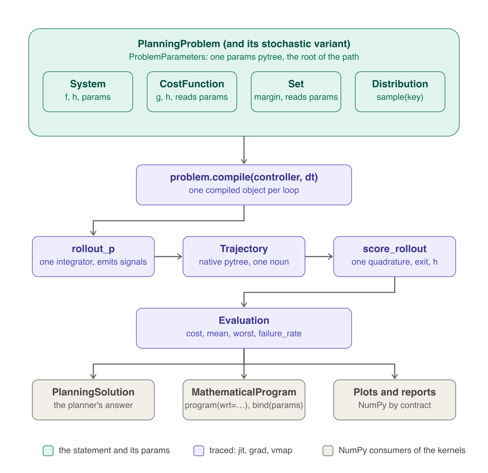
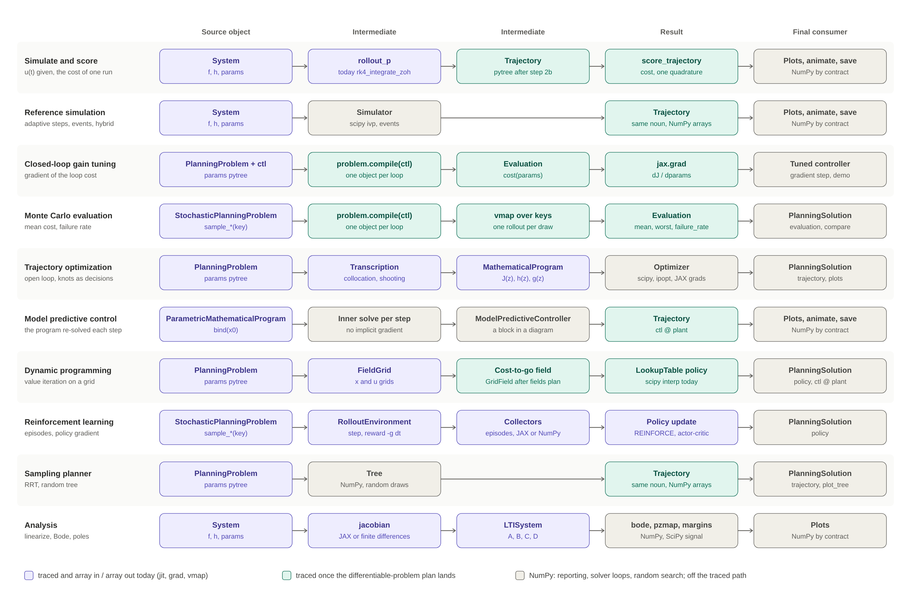

# The differentiable planning problem: one path from any parameter to any metric

**Status:** aligned 2026-10-23 to [continuous-core.md](continuous-core.md) (the design of
record); this doc holds the detail of V1: the target, the implementation rules, the
guardrails, the steps. The API (the names, the records, the pipelines as code) is
continuous-core.md's, as ruled on 2026-10-22/23
([the rulings](../reviews/2026-10-22-rulings-session-1.md), R1–R47, session 3's of the evening included; the alternatives in
[end-state-api.md](end-state-api.md)). How the plan of 2026-10-18 was consolidated from seven
designs is in [the consolidation record](../reviews/2026-10-18-differentiable-problem-consolidation.md).
Nothing is built yet.
**Rung:** v0.3, the continuous core: steps 1–6 (the path to the cost, beside the step model of
[sampled-path.md](sampled-path.md)) and step 7a (the Monte Carlo fold on the start and
parameter laws, R44); v0.4, step 7 (a disturbance block's per-block seeds, RN-4 of
[randomness.md](randomness.md)) and step 8; step 7b with the hybrid phase; traceable analysis
(S73) any time. The gates are the rows of [TODO.md](TODO.md) §4 and §5.
**Lane:** `evaluate`, `compare`, `evaluate_trajectory` on the teaching surface by the demo
rule; `problem.compile`, `ProblemEvaluator` and `program` provisional on the planning facade
until a course has run them (R28).

## 1. The target

**Any performance metric that is a traceable function of a run or of a linearization can be
optimized through the native `Optimizer`, with respect to any parameter the problem holds.**
The library provides the metric, JAX the gradient, the optimizer the descent loop; no demo
writes a scan, a cost formula or a descent loop of its own.

The parameters are the columns, the metrics the rows; each cell names the step of §8 that makes
the pair one line (`—` where the pair has no meaning). On a run, every metric is a field of the
one record `pe.evaluate(params)` returns ([continuous-core.md](continuous-core.md) §3.5); its
scalar is `objective`, the problem's criterion over the runs' `J` (R45).

| Metric | controller params | open-loop input sequence | plant params | cost and set params | `x0` |
| --- | --- | --- | --- | --- | --- |
| The run's `cost` and `J` (`Evaluation.cost`, `.J`, `.objective`) | step 4 (a hand scan today) | step 8 (a source policy's leaves) | step 4 (a hand scan today) | step 6 (cost), step 8 (sets) | step 4 |
| The whole run (`pe.trajectory(params)`) | step 4 | step 8 | step 4 | — | step 4 |
| The criterion over the problem's draws (mean, CVaR, worst) | step 7a | step 8 | step 7a | step 7a | step 7a |
| The feasibility and reachability margins (`Evaluation.feasibility_margin`, `.reachability_margin`) | step 4 | step 8 | step 4 | step 6 / 8 | step 4 |
| Closed-loop poles, damping ratios, natural frequencies | S73 | — | S73 | — | — (linearized at `x̄`) |
| Gain and phase margins, Bode values, the sensitivity peaks `M_s`, `M_t` | S73 | — | S73 | — | — |

Every cell has the same consumer: the program export (§4.4, step 5) builds a
`MathematicalProgram` whose objective is the problem's `objective` (the criterion over `J`,
priced only when the problem's switch is on, R32) and whose constraints `g ≥ 0` are the margins
of the declared sets, and today's `Optimizer` solves it. The worked examples
the table implies, each one demo once it lands: gain tuning on the closed-loop cost (today's
`pid_autotuning_jax` hand loop); an open-loop input sequence by single shooting (today's
`cartpole_rollout_gradients` and the showcase cell); robust tuning on the mean over a
plant-parameter family; parameter identification from logged data (today's
`params_gradient` and the showcase cell, C4); the plant-parameter sensitivity of poles and
margins (S73).

## 2. What exists, and what the prototype of 2026-10-18 showed

Three nouns carry the path: the `Trajectory` (the run), the `ProblemEvaluator` (the problem
compiled against a loop) and the `MathematicalProgram` (unchanged in shape, one more
producer). The core-objects review counted the duplication one layer above the laws: five
scoring rules with four quadratures, two signal reconstructions, two trajectory nouns,
hand-written scans in four demos and three notebook cells
([the record](../reviews/2026-10-18-core-objects-review.md)). The nouns are right; the verbs
are duplicated; this plan gives each verb one traced body the NumPy consumers call too.



*The statement (green), the traced path (purple: one integrator body that emits the internal
signals, a native `Trajectory`, one scoring body, an `Evaluation`), the NumPy consumers
(grey). The picture predates the 2026-10-23 names: its `score_trajectory` is
`evaluate_trajectory`; the current diagram is `pipeline.mmd`.*



*One lane per workflow: the source, the solver-ready form, the result, the consumer. Purple
traces today, green once this plan lands, grey is NumPy by contract. Model predictive control
and the sampling planner stay grey in the middle on purpose (no implicit gradient of the inner
solve; random search). The picture predates the 2026-10-23 names.*

**In place, and probed on 2026-10-18** (the consolidation record has the numbers):

- The loop `ctl @ plant` compiles to a `lax.scan` with `params` threaded
  (`rk4_integrate_zoh_trace_p`, `rollout_batch` with a params family); the controller's state
  is inside `x`, so a PID with an integrator traces from the first commit.
- The plant's command along the traced run is a slice of the port-signal buffer the diagram
  evaluator already fills at every step and throws away.
- With a trapezoid kernel on that run, `jax.grad` with respect to a gain, a damping gain and
  the plant's mass matched central differences to better than 10⁻⁹ relative, through the real
  `Pendulum`, `ImpedanceIntegralController` and `QuadraticCost`.
- The chosen leaves ravelled to `z`, a `MathematicalProgram` with `backend="jax"` and the
  existing `Optimizer` reached a stationary point (`‖∇J‖ = 2·10⁻⁸`) in 49 SLSQP iterations and
  two seconds, where 400 steps of the demo's hand-written gradient loop stopped at twice the
  cost. So today's `Optimizer` is enough for this phase (R25).
- `ProblemParameters(system, cost, sets, scene)` is read by the transcriptions, DP, the
  evaluators and the RL environment (46 places); the library costs and sets receive `params` and
  ignore it (cost-params.md, A5). It is retired: each object owns its parameters (R41).
- `sample_x0(key)`, `sample_params(key)` and `sample_disturbances(key)` trace;
  `System.realize(key)` casts to `int` and does not.
- Every library set's `margin` traces; `contains` is NumPy. `Trajectory` casts to `float` and
  copies, so nothing traced survives it today.

## 3. The objects, today and after

The "after" column is continuous-core.md §2–§3; this table says only what changes in the code.

| Object | Today | After (step) |
| --- | --- | --- |
| `Trajectory` | a NumPy reporting object: `float` casts, copies | a JAX pytree, the reporting verbs NumPy by contract (§4.1; step 1); `traj.of("plant")` by static indexing (step 3); `traj.with_cost(cost, discount_rate)` (step 1) |
| `StepRollout` | the step twin of `Trajectory` | a constructor of `Trajectory` with `t = k·dt` (step 1, last commit) |
| `CostFunction` | `g`, `h` trace; `evaluate_trajectory` / `total_cost` a NumPy loop with `float()` casts; owns `discount_rate` | `params`, `g`, `h`, `g_max(X, U)`, `h_max(X)` (the upper-bound hint, R32), `integrate(traj, *, discount_rate, params)` on `xp`, the algebra; `discount_rate`, `evaluate_trajectory`, `terminal_cost`, `total_cost` leave it (D16b; steps 1–2); `params` nested (A2, step 6) |
| `Set` | `margin` traces; `contains` is NumPy | `contains` derived from `margin` on `xp`, one exit test for the scorer and the RL environment (step 1); reads `params` with A5 (step 8) |
| `PlanningProblem` | `sys`, `cost`, `X`, `U`, `X0`, `Xf`, `tf`, `infeasible_cost`, `params`; eight consumers read the fields eight ways ([inventory](../reviews/2026-10-23-planning-problem-field-inventory.md)) | one meaning per field (continuous-core.md §3.4): gains `discount_rate`; `X` / `U` explicit with refusals and `plant.input_box` (R37); `infeasible_cost` the price switch (`None`, `True`, a number) and `cost_bound()` (R32); `x_goal` never creating `Xf` (R33); no `params` bundle (R41) (step 2); `compile(arg, dt)` (step 4) |
| `StochasticPlanningProblem` | the three laws, `criterion`, the three `sample_*(key)`; every planner reads `nominal()` | `realize(key, n)` and `criterion` read by `objective` (step 7a; the per-block noise seeds step 7) |
| `score_trajectory` | NumPy, the reference; cuts the run at the first exit | gone: `evaluate_trajectory(problem, traj) -> Evaluation`, the integral to `tf` with no cut (§4.2; step 2) |
| `Evaluation` | a NumPy record: `J`, `failed`, `x0`, `trajectories`, `mean`, `worst`, `failure_rate`, `value(criterion)` | the one pytree record, one row per run: `cost`, `J`, `objective`, the three rates (continuous-core.md §3.5; step 2); `failure_rate` → `feasibility_rate`, `value(criterion)` → `objective` |
| `MonteCarloEvaluator` | a held static law in a hand scan on three backends, an inline copy of the scoring rule | returns the new record from its current runs (step 2); folded into `evaluate(..., n_trials=)` and deleted (step 7a, v0.3) |
| `TrajectorySource` | an open-loop plan as a block; its table an attribute, `h` a NumPy interpolation | the table in `params["values"]`, `h` traceable, so an open-loop plan is a policy and its samples are leaves (step 8) |
| `ProblemEvaluator` | does not exist | **new** (step 4): `params`, `trajectory`, `evaluate`, `program`, `pack` / `unpack` |
| `evaluate`, `compare` | `compare(*solutions)` replays with the adaptive `Simulator` | the student's facades on the engine (step 4); `compare(*solutions)` keeps working |
| `RolloutEnvironment` | the problem as a step function for the RL collectors | on `discretize` (SM-3); the RL episode, a training setting reading the problem's fields as hints (R43); its exit test the one `Set.contains`, its reward the same `g`, its γ from `problem.discount_rate`; it stops serving the Monte Carlo trials |
| `PlanningSolution` | `problem`, `policy`, `solver`, `trajectory`, `evaluation`, `cost_to_go` | unchanged; `trajectory` and `evaluation` of a feedback planner come from `evaluate` |
| `MathematicalProgram`, `Optimizer` | `J(z)`, `h`, `g`, bounds; three constrained-NLP presets | unchanged; one more producer, `pe.program(wrt, bounds)` (step 5); the upgrade deferred (S74, §4.5) |

## 4. Implementation rules

The API is continuous-core.md §3.4–§3.6; this section holds what an implementer needs beyond it.

### 4.1 The native `Trajectory` (decided 2026-10-18)

`Trajectory` keeps the arrays it is given through the array module: no `float` cast, no copy of
a traced value; `t`, `x`, `u` and the signal arrays are pytree leaves; the shape checks stay
(shapes are static under tracing), the monotonic-time check runs on NumPy only (a tracer has
no concrete values); the reporting verbs (`t0`, `tf`, `resample`, `save`, the plots) stay
NumPy by contract and are never called on the traced path (`traj.t[-1]`, not `traj.tf`,
inside a kernel). Two rules the probe of 2026-10-18 found necessary:

- **Unflatten bypasses validation.** JAX rebuilds a pytree with batched leaves (`vmap` adds an
  axis: `x` becomes `(B, n, N)`) and with `None` or sentinel leaves (`tree_map`, the zeros of a
  gradient). A registration whose unflatten goes through `__post_init__` fails on both (`vmap`
  of a function returning a `Trajectory` raised in the probe); the registered unflatten builds
  the object from its leaves without checks (`object.__new__` and the frozen setattr), and the
  public constructor keeps every check.
- **`signals` flatten in a fixed key order** (sorted; a `MappingProxyType` is not a pytree
  node), so two trajectories with the same signal names share one treedef and `vmap`,
  `lax.scan` and `jit` accept them.

`StepRollout` becomes a constructor of the same noun with `t = k·dt`, the last commit of step 1.

### 4.2 One evaluation of a run, on `xp`

The formula is continuous-core.md §3.5 (R19, R31, R32): every run integrated to `tf`, then the
discounted integral plus the discounted `h`, the two margins, `failed` (a non-finite run
included), `reached`, and `J = cost`, plus the price when the problem's switch is on. One body,
`evaluate_trajectory(problem, traj)`, on `xp = array_module(traj.x)`, reading
`cost.integrate`'s last value (D16b). What the implementation must keep:

- **The running sum keeps the NumPy numbers.** `cost.integrate` is a running trapezoid written
  with `xp.cumsum`: the probe reproduced today's sliced quadrature bit for bit on 300 random
  trajectories, where a masked `xp.sum` did not (70 of 300; NumPy's `sum` is pairwise). The
  NumPy consumers see a byte-identical quadrature (RULES 7.7); JAX agrees to `3·10⁻¹⁵`
  relative and gets the backends' shared tolerance (`rtol = 1e-6`).
- **The one intended change.** The cut at the first exit goes: a run that leaves `X` is
  integrated to `tf`, judged failed, and priced once only when the switch is on. Every caller of today's
  `score_trajectory` (`Evaluation.of_trajectory`, `compare`, `PlanningSolution.cost`, the
  `compute_cost` facade) moves once, with a baseline and a ledger line (D21). On a run that
  never leaves `X`, the numbers are unchanged.
- **The transcriptions take the problem's discount and keep their quadrature body.**
  `trajectory_cost` applies no discount today; it reads the problem's rate and the cost's
  integrand and keeps its own `xp.sum` trapezoid, because the running sum would change its
  bits (a pairwise sum and a sequential one differ in the last place on about half of random
  grids). No trajectory-optimization baseline declares a rate, so every baseline stays
  bit-identical (`e⁰ = 1`); DESIGN §6 states the quadrature once and the transcriptions cite it.
- **No scoring modes** (D20). A tool that wants the unconstrained integral scores the problem
  without the constraint (`dataclasses.replace(problem, X=None)`); a penalty is `Set.as_cost`
  added to the cost (step 8).
- **The RL reward stays the documented exception** (the episode is a training setting, R43): `r_k = −g_k dt`, the learner's
  left-Riemann contract, the discount through `γ = e^{−ρ dt}` read from the problem, derived
  from the same `g`; its exit test the same `Set.contains`.
- **The margins on the plant's run.** The record scores `traj.of("plant")`: `X.margin(x_k, t_k)`
  and `U.margin(u_k, x_k, t_k)` at every sample, on the plant's state and command (AC-7 by
  construction; which trajectory is the plant's, R39).

### 4.3 The whole run out of the scan

`rk4_integrate_zoh_trace_p` and `rollout_batch` return the state history `(N+1, n)` and drop the
boundary `y` and the internal signals, above all the plant's command; the diagram evaluator
fills its port-signal buffer at every step (`_compute_port_signals_p`) and throws it away. On
SM-1's surface ([sampled-path.md](sampled-path.md) §3.6) the one rollout carries it out:

```python
t, xs, signals = ev.rollout(x0, u_seq, t0, dt, params, solver="rk4", substeps=1, hold="zoh")
```

the scan emitting the buffer of the step's first stage beside `x_next`, one signal per sample
at the grid state, as `reconstruct_internal_signals` reads it today, so the plots and the
record see the same `u`. `traj.of("plant")` then slices: the plant's state by
`plan.state_index`, each plant input by `plan.output_slices`, a slice of the boundary `u` or a
nominal constant (continuous-core.md §3.5); no block is recomputed, so `jit`, `vmap` and `grad`
pass through. Today's recompute loop (`trajectory_of`) stays only as the NumPy fallback for a
trajectory without recorded signals. A pinned test keeps the `Simulator`'s `rk4_fixedsteps` on
one diagram and the compiled rollout at round-off on the same grid, so the engine cannot drift
from what `solver="scipy"` and the plots show (R11).

### 4.4 The engine, the facades and the program export

The surface is continuous-core.md §3.6 (R15, R16, R22, R23, R26, R27, and session 3's R32, R36,
R38, R41, R42, R45, R46). Implementation detail:

- **One body, the run its one varying piece** (R11). `closed_loop_of(problem, arg)`,
  `problem.realize(key, n)`, the rollout, `evaluate_trajectory` and `Evaluation` are each one
  function; `pe.evaluate` is their composition on the compiled scan, the facade `evaluate` the
  same composition with `solver="scipy"` (any adaptive `solver`) swapping the run for the
  `Simulator` before anything is traced; `dt` is required on both (R36).
- **The loop** (D16c): a controller is wired by `closed_loop` under the automation-by-convention
  rules, every free input at its port's nominal value (R38: the problem never fills `r`; the
  setpoint is the controller's or a source block's); a built loop needs the reserved `plant` key on the
  problem's system or a box containing it; roles are never inferred; a sampled controller is
  refused with a message naming the hybrid phase.
- **`pe.params`** is assembled from the objects that own the numbers (R41): the loop's own
  `params` dict (nested by block name, `plant/motor` two levels deep), `"cost"` from
  `cost.params`, `"x0"`, and one leaf per free boundary input at its nominal (`"r"`, `"d"`);
  `pe.evaluate(p)` takes an override tree; a
  block id that collides with a reserved leaf name is refused at compile; partial
  dictionaries follow the diagram rule.
- **`backend="auto"`** is JAX when the loop, the sets and the cost trace on it, NumPy otherwise,
  the fallback announced; an explicit `"jax"` on a NumPy-only law raises and says so;
  `"numpy"` is the same object on the NumPy evaluator, one trial at a time (a lookup-table law,
  a laptop without JAX). A model predictive controller is a sampled controller and waits for
  the hybrid phase.
- **`pe.program(wrt, bounds)`** (R23): `wrt` names leaves of `pe.params` by path, never a block
  (every library controller keeps its saturation and integral limits at ±inf, which a
  whole-block selection would ravel into `z`); `x0`, a boundary input's sequence and a source
  policy's `"controller.values"` are ordinary leaves. The objective is
  `pe.evaluate(unpack(z), key, n_trials).objective` with the draws realized once at
  `program(...)`, so two solves share one sample average. `g(z)` stacks every sample's margins
  of `X` (and of `U` on the plant's command where `U` has a finite face) at every trial, as the
  transcriptions lower theirs (RULES 4.3): smooth per entry, the natural form for SQP;
  `Evaluation.feasibility_margin` stays the reported minimum, with no smooth-min option. A
  declared `Xf` lowers to its terminal margin (a singleton to `h(z) = 0`); since `x_goal` never
  creates one (R33), a feedback law's program carries a terminal row only when the user wrote a
  goal set, a ball for a law that approaches it asymptotically. `z` is scaled by each leaf's nominal
  magnitude (`|p0|` or 1), since SLSQP's tolerances and a quasi-Newton's initial Hessian are
  absolute and gains, masses and weights span decades; the gradient is probed once at `z0` and
  a vanishing one warns. `MathematicalProgram` stays flat on `z`, its `metadata` data-only
  (`wrt`, the keys); `Optimizer` never sees a pytree (CONSTITUTION §1.4).
- **The price in the program.** The objective reads the same `J` as the report, so with the
  switch off it is the smooth plain cost and the sets are only rows. The docstring states the two
  caveats of the switch on (the price is a step with no gradient; with sets declared it counts
  beside their rows) and the smooth alternative for gradient tuning, `cost + w · X.as_cost()`
  with `X` left undeclared (R32).
- **No facade above the program** in this phase, and no hook for a term on the parameters
  (R46): the user runs `Optimizer` and writes the leaves back with `pe.unpack`; a `jax.grad` user
  adds a regularizer to `pe.evaluate(p).objective` in one line. A facade comes later on this
  export if a lesson needs one.
- **Identification is the same export**: a tracking cost with the logged run as its target, the
  logged input as a source leaf, `wrt=["plant.m", …]` (C4, v0.4); equation-error
  identification stays a direct program on `vmap(f)`. `ParametricMathematicalProgram.bind(x0)`
  is the case "no decision leaves, `x0` bound" of the same export, widened by S76 to every
  problem parameter ([parametric-program.md](parametric-program.md)).

### 4.5 The optimizer upgrade (S74): deferred by R25, its design kept for when it comes

The program would know its class from its fields, `Optimizer` would refuse a method the class
does not admit and `method="auto"` pick by class; one first-order backend
(`optimization/optimizers/first_order.py`: `gd`, `adam` with projection on the box and a
global gradient clip, the RL package's pytree `Adam` moved there unchanged and imported back);
two free SciPy presets and one global derivative-free preset the user picks knowingly. The
default stays `scipy_slsqp` until the V3 freeze.

| Class | Admits | `"auto"` |
| --- | --- | --- |
| `unconstrained` | `gd`, `adam`, `scipy_bfgs`, `scipy_lbfgsb`, `scipy_slsqp`, `scipy_trust_constr`, `ipopt` | `scipy_lbfgsb` |
| `bounded` | `gd`, `adam` (projected), `scipy_lbfgsb`, `scipy_slsqp`, `scipy_trust_constr`, `ipopt`, `scipy_differential_evolution` | `scipy_lbfgsb` |
| `constrained` | `scipy_slsqp`, `scipy_trust_constr`, `ipopt` | `scipy_slsqp` |
| `stochastic` | `gd`, `adam`; `scipy_differential_evolution` when bounded | `adam` |

Open with it (end-state-api.md D23): presets named by algorithm with the `scipy_*` keys as
aliases, or the prefix kept; OPW-1–OPW-5 of [parametric-program.md](parametric-program.md)
join the same backend table.

### 4.6 Traceable linear analysis (S73, independent of the evaluator)

`poles`, `frequency_response` and `margins` through the array module, so the sensitivity of
closed-loop poles, damping ratios, Bode values and margins to any plant or controller param is
`jax.grad` of the existing verbs on `jacobian("f", "params")`. The math lines stay the
textbook ones: `C (jωI − A)⁻¹ B + D` as one batched solve; eigenvalues through
`xp.linalg.eigvals`, whose derivative is the classical `vᴴ (∂A/∂p) u / (vᴴ u)`; Brent's method
on the crossovers replaced by a fixed number of Newton steps from the grid bracket, so the
crossover frequency carries the implicit-function derivative. Beside the crossover margins,
the sensitivity peaks `M_s = max_ω |S(jω)|` and `M_t = max_ω |T(jω)|` (and a `logsumexp`
surrogate over the grid) as traceable metrics: a bound `M_s ≤ 1.5` guarantees a gain margin
above `M_s / (M_s − 1)` and a phase margin above `2 asin(1 / 2M_s)` with no crossover to jump,
the smooth constraint for loop shaping through the export. Zeros stay NumPy (a generalized
eigenproblem JAX lacks); root-locus branch matching stays NumPy (plotting). Documented
non-differentiable spots: repeated poles, the switch of the minimum margin between crossovers;
the nonsymmetric eigensolver is CPU-only.

## 5. Guardrails: the sharp edges and the rule each takes

- **The facts jump; the margins carry the gradient.** With the integral to `tf` and no cut
  (R19), the gradient of `cost` no longer vanishes after an exit: a run that leaves `X` keeps
  its whole integral, so `jax.grad` still says how the gains move it. What does not
  differentiate is `failed`, `reached` and, when the switch is on, the price's jump in `J`: those are
  reported facts. The margins (`feasibility_margin`, `reachability_margin`) are the
  differentiable carriers, and the program export lowers them as constraint rows. Two rules:
  declare `X` only where it is meant (it is unconstrained unless declared;
  `X = plant.state.box` is a safety constraint, not a plotting domain), and tune through the
  export, or read the margins beside `objective` in a hand-written loop. A run whose state stops
  being finite is failed (R31): its raw `cost` is `+inf`, its gradient zeroed by a safe `where`,
  and its `J` the price when the switch is on, so one diverging trial never poisons a mean or a
  gradient of a priced problem.
- **The setpoint is the controller's** (R38). A loop built by `@` reads its reference at the
  port's nominal value, zero by default; a cost whose target is the goal then scores a loop that
  regulates to zero, honestly. The problem never fills `r`: the student sets it on the controller
  (`pid.inputs["r"].set_nominal_value([np.pi])`) or with a source block, and the free input is a
  leaf of `pe.params`, so a setpoint can be tuned like a gain.
- **A block is not a leaf list.** `wrt="controller"` would ravel ±inf limits into `z`; the
  export takes leaves by path.
- **`Xf` is written, never implied** (R33). A closed loop approaches the goal asymptotically, so
  a point goal is never reached; `x_goal` creates no `Xf`, and a goal set is a ball the user
  writes. `reached` reports it, `reachability_margin` carries it, and the export lowers it as a
  terminal row only when declared.
- **`U` is information, not saturation.** No backend clips a law (DESIGN §6); a linear law
  without a `Saturation` block can command outside `U`. The feasibility margin includes
  `U.margin` on the plant's command, so the export enforces it; a `Saturation` block in the
  loop is the modelling answer.
- **Single shooting is not collocation.** The export with a source policy's leaves is single
  shooting with a held input, the showcase's hand loop as one line; through an unstable plant
  over a long horizon its gradients explode or vanish and the landscape is nonconvex, where
  collocation's defect constraints break the chain and expose sparsity. `ShootingTranscription`
  and `direct_collocation` stay the trajectory-optimization path; the export's shooting is an
  evaluation and tuning tool.
- **Backpropagation through the dynamics and policy gradients are complementary.** The engine
  differentiates *through* `f` and the reparameterized draws; REINFORCE, PPO and SAC
  differentiate the log-policy score and never `f`. Short smooth horizons favour the former by
  orders of magnitude; long horizons, saturations and stiff dynamics the latter. One demo puts
  `problem.compile(policy)` and `ReinforcementLearningPlanner` side by side on one problem and
  one `NeuralPolicyController` (step 9).
- **The program stays flat.** `MathematicalProgram` is `J(z)`, `h(z) = 0`, `g(z) ≥ 0` and a box
  on `z ∈ ℝⁿ`; ravelling lives in `pe.pack` / `pe.unpack`, so SLSQP, Ipopt and later L-BFGS-B
  and Adam solve one object interchangeably.
- **Crossover margins jump; sensitivity peaks do not.** A gain or phase margin is defined at a
  crossover that can appear, vanish or switch during a descent, and `eig` has no derivative at
  a repeated pole; `M_s`, `M_t` are the smooth robustness bounds for an NLP, the margins the
  numbers a course reports (§4.6).

## 6. What this plan changes in the other plans

| Plan | Change |
| --- | --- |
| [continuous-core.md](continuous-core.md) | the design of record: the API here is its; this doc holds the detail |
| [sampled-path.md](sampled-path.md) (S75) | the engine runs the whole continuous loop with SM-1's compiled step and `ev.rollout` (`(t, xs, signals)`); no second integrator; step 3 needs SM-1 |
| [cost-params.md](cost-params.md) (A2) | the cost's surface (`integrate`, `g_max`, `h_max`, `with_cost`) lands in steps 1–2; its `params` nesting is step 6; the `CostIntegrator` block stays a demo idea (§9) |
| [randomness.md](randomness.md) (RN-4, RN-5) | RN-5 is step 7a here (v0.3, R44), one path: `realize(key, n)` on the start and parameter laws, the loop as a diagram on the compiled scan (R15, not the adaptive `Simulator`), the record and the criterion of continuous-core.md; RN-4's per-block seeds slot under `realize` in step 7 (v0.4) |
| [automation-by-convention.md](automation-by-convention.md) (AC-7) | the engine scores the plant by construction (the `plant` role); AC-7 extends the rule to the design tools |
| TODO A5 (the later nouns) | `Set.as_cost(weight=, shaping=)` in step 8 with its first consumer, after `shaping.py` moves to `core/`; sets reading `params` in step 8 |
| [mppi.md](mppi.md) (S72) | `rollout_batch` with `signals` and `realize` are what MP-1 and MP-3 roll out on; `evaluate_trajectory` is their scoring rule |
| [fields.md](fields.md) (A1) | the planned `Field` absorbs the six field-like classes of `planning/spatial`; `shaping` moves to core with it or in step 8 |
| [parametric-program.md](parametric-program.md) (OPW, S76) | the shared backend factory is where S74's presets register; `ParametricProgram` and the key `plant` are the ruled names (D19) |
| TODO C4 (identification) | the program export with a data-mismatch cost (§4.4) |
| the core-objects review's two consolidation findings | the evaluator grid trimmed to four traced bodies is S75's SM-6; `StepRollout` folded into `Trajectory` closes step 1 |
| the sampled loop (S31, R13, R14) | the engine is the continuous loop as a diagram and stays so for continuous laws; step 7b (hybrid phase) dispatches a sampled controller to the hybrid kernel's JAX face |

## 7. Ruled

All in [the rulings record](../reviews/2026-10-22-rulings-session-1.md); the alternatives in
[end-state-api.md](end-state-api.md).

- `Trajectory` array-native and a pytree, the reporting verbs NumPy (decided 2026-10-18).
- One evaluator, one engine: the fixed-step compiled rollout is the judge and the engine,
  `evaluate` its facade, the adaptive solver the one escape (`solver="scipy"` since R42; R15, superseding R10's "the ODE
  solver is the judge"; R11).
- `compare` on `evaluate` (R16); `compute_forced` on the same rollout (R17, R18).
- One evaluation of a run: the integral to `tf`, no event, no mask, no stop; the cost owns
  `g` and `h`, the problem the rest, `discount_rate` included (R19, R20, superseding R9's cut).
- The sets explicit (R21); the loop the pipeline reads (R22); the program the phase's export,
  no `tune` (R23); the criterion on the problem (R24); the optimizer upgrade deferred (R25).
- The names (R26), one record and two engine verbs with three positive rates (R27); the
  evaluator's numbers change once and the lane (R28); `x_goal`, `Xf=None` and which trajectory
  is scored (R29).
- Costs read `params`, nested like a diagram's (decided 2026-09-13, cost-params.md).
- Session 3 (2026-10-23, evening): a non-finite run failed (R31); the price a switch,
  `infeasible_cost` `None` / `True` / a number, with the cost's bound hint and one `J` read by
  every pipeline (R32, R34); `x_goal` never creates `Xf` (R33); `dt` required (R36); `U` unbounded
  and `plant.input_box` (R37); the problem never fills `r` (R38); which role-less trajectory is the
  plant's (R39); the hold on sequences only (R40); one home per number (R41); `solver=` for time
  integration (R42); the RL episode a training setting (R43); the Monte Carlo fold in v0.3 (R44);
  the names `cost`, `J`, `objective` (R45); no hook for a term on the parameters (R46).

## 8. The steps, bottom-up

One commit per step or sub-step; each records a seeded baseline of every branch it touches
before any edit, runs it twice and `cmp`s, and ends byte-identical unless the step names its
one intended change, which gets its own test and a ledger line. Every math line reads next to
`planning/policy_synthesis/dp.py` before it lands. **The gates are the TODO rows** (§4 for
steps 1–6, §5 for 7–9); this list is the content.

0. **The names.** Done (R26–R28, R45, 2026-10-23).
1. **The native `Trajectory` and the cost's quadrature.** `core/trajectory.py` per §4.1 (the
   pytree registration, the validation-free unflatten, the sorted signals; `StepRollout` folded
   as `t = k·dt`, last commit); `Set.contains` and `InputSet.contains` derived from `margin` on
   `xp`; the cost's surface of D16b: `integrate(traj, *, discount_rate, params)` on `xp`
   (the running trapezoid of §4.2), `g_max(X, U)` and `h_max(X)`, `traj.with_cost(cost,
   discount_rate=0.0)`; the trajectory's roles as static aux data, kept by save and load (R39).
   Byte-identical.
2. **The one evaluation and the problem's fields.** `evaluate_trajectory(problem, traj) ->
   Evaluation` (one row), `Evaluation` the pytree record with `cost`, `J`, `objective` and the
   three rates, the finite guard (continuous-core.md §3.5; R31, R45); `score_trajectory` and the
   cost's `evaluate_trajectory` / `terminal_cost` / `total_cost` / `discount_rate` go; the
   problem's fields of continuous-core.md §3.4 (`discount_rate` on the problem, read by RL's γ,
   DP's α and the gym bridge; `X`, `U` explicit, `plant.input_box` added, DP and RL refusing an
   unbounded set with the line to write, LQR warning once, the lessons gaining the line in the
   same commit; `Xf=None` reached; `x_goal` never creating `Xf`, trajopt's terminal equality
   written; the price switch `infeasible_cost` and `cost_bound()`, read by DP and RL
   when unset; `ProblemParameters` retired, its readers migrating); the transcriptions take the
   problem's discount (bit-identical). The intended changes: the integral to `tf` replaces the
   cut wherever `score_trajectory` scored; trajopt's numbers where `U` or `Xf` came from a
   default. `MonteCarloEvaluator` returns the new record from its current runs until step 7a
   (`failure_rate` → `feasibility_rate`; the course notebooks migrated in the same commit).
3. **The whole run out of the scan.** `ev.rollout` returning `(t, xs, signals)` on SM-1's
   surface; `rollout_batch` with signals; `traj.of("plant")` by static indexing, the recompute
   loop the NumPy fallback; the pinned `Simulator` against scan test (§4.3). Needs SM-1.
4. **The engine and its facades.** `closed_loop_of(problem, arg)` (the free inputs at their
   nominal, R38); `problem.compile(arg, dt, *, substeps, solver, backend) -> ProblemEvaluator`
   with `params` (assembled, R41), `trajectory`, `evaluate` (`n_trials=1`); `evaluate(problem,
   arg, *, dt, solver, …)` and `compare(problem, **entries, dt) -> Comparison`, `dt` required
   (R36); `Planner.evaluate`, `solve(evaluate=True)` and `compare(*solutions)` on it; the
   refusals (a sampled controller; a stochastic problem with `n_trials > 1` until step 7a lands
   right after); the NumPy backend; the `pid_autotuning_jax` demo on
   `jax.grad(lambda p: pe.evaluate(p).objective)`, its gain regularizer dropped (R46).
5. **The program export.** `pe.program(wrt, bounds)` minimizing `objective`, `pack` / `unpack`,
   the leaf scaling, the per-sample margins of the declared sets as `g` rows and the two caveats
   in the docstring (§4.4); today's `Optimizer` unchanged; the autotuning demo ends in
   `Optimizer(program).solve()`.
6. **Cost parameters** (A2, [cost-params.md](cost-params.md)): nested like a diagram's;
   `pe.params["cost"]` live; `jax.grad` reaches `Q` through the engine and through a trajopt
   objective.
7a. **The Monte Carlo fold** (v0.3, right after step 4, R44; RN-5 and AC-7's deterministic
   half): `problem.realize(key, n)` on the start and parameter laws; `evaluate(..., n_trials,
   key)` and `pe.evaluate` on a stochastic problem, `vmap` over the realizations (a loop on
   NumPy), `record=True` for the batched trajectories, the per-trial `keys` for replay;
   `objective` over the draws (mean, CVaR, worst); `pe.program` over `n_trials` with the draws
   realized once; `MonteCarloEvaluator` folded (one facade line, then removed), the RL lessons
   and tutorial 11 migrated once; the evaluator's numbers change once (D21); the deterministic
   twin (randomness.md RD-D23).
7. **A disturbance block's draws** (v0.4, RN-4): one seed per noise block in `realize`, joining
   the same verb; a noise block inside `sys` and on a `disturbances` port realized per trial.
7b. **The sampled face** (the hybrid phase, after S31's kernel): `compile` dispatches a sampled
   controller (a digital PID, a held neural policy, MPPI, the RL policies) to the kernel's JAX
   face; the refusal goes; a continuous law's numbers unchanged.
8. **Sets as costs, the lowerings, the metrics as constraints** (v0.4). `shaping.py` to
   `core/`, `Set.as_cost(weight=, shaping=)`; sets reading `params`; `TrajectorySource`
   traceable with its table in `params`, so `x0` and `"controller.values"` are decision leaves
   with `Xf` lowered; the robust-tuning and identification demos on the export; the metric
   objective and the margin-floor example once S73 lands.
9. **Material and contracts.** Each step updates DESIGN when it lands (§4 `Trajectory` and
   parameters, §5 the rollout, §6 the evaluation and the export) and ROADMAP §3's ledger;
   step 9 rewrites tutorial 11's last cell and the showcase cells on the engine, and K4 merges
   the compile demos (one per feature).

**In parallel, any time:** S73 (§4.6), self-contained for a cloud agent.

## 9. Open

Each with the proposed answer. Taking one: the ruling goes to §4 or §8 here, to the dated
record, and leaves ROADMAP §6.

1. **Which tutorial keeps a hand-written loop**, if any: proposed, tutorial 07 keeps a six-line
   `jax.value_and_grad` loop so the student sees there is no magic, followed by the one-line
   `Optimizer` call every other demo uses.
2. **S73**: proposed, left as the self-contained row it is, scheduled when a course asks for a
   margin-constrained tuning.
3. **The `CostIntegrator` block** (cost-params.md's research step): proposed, closed as a demo
   idea; `cost.integrate` on samples is the contract.
4. **The name `cost_bound()`** (R32): proposed as written; a property
   (`problem.price`) or a cost-side verb (`cost.upper_bound(X, U, tf)`) are the alternatives.
