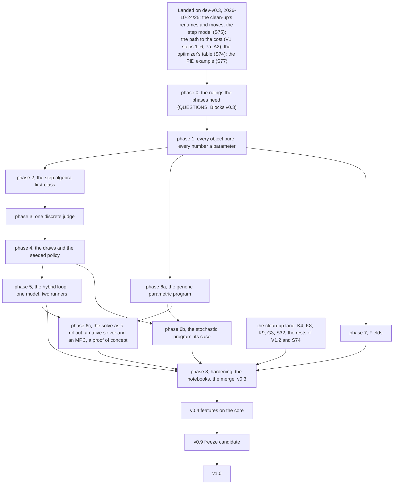

# The plan simplified: a short mainstream plan, the archive, the coverage check (2026-10-26)

**Audience:** Prof. Alexandre Girard (Maintainer)
**Context:** the same day, the core consolidation
([record](2026-10-26-core-consolidation.md)) had gathered the v0.3 core around its pillars, and
three independent reviews read the result for the first time:
- [A, the vision and the architecture](2026-10-26-independent-review-a-vision-architecture.md);
- [B, the API and naming](2026-10-26-independent-review-b-api-naming.md);
- [C, the plan and the roadmap](2026-10-26-independent-review-c-plan-roadmap.md).

All three found the plan harder to follow than the code. **This record rules nothing:** the
reviewers' design proposals became QUESTIONS entries.

## 1. The request (2026-10-26, in session)

> Okay, can you plan to do a consolidation and simplification pass incorporating the reviewer
> critic that are saying the system is too complex for nothing? So archive old plan to be sure
> no information is lost, but promote some restricted subset of the document to be the
> mainstream plan now, and make those one much more simplified, consolidated, and straight to
> the point, so it's less confusing to follow. And then if we in the second pass are sure that
> the new consolidated simpler plan is not losing any ID, we can retire the archive complex
> version.

## 2. What was done

1. **Archived.** Verbatim copies of AGENTS, ROADMAP, QUESTIONS, KNOWN_ISSUES and every doc under
   `docs/plans/`, taken at `9fb1ad77`, went to `docs/reviews/archive/2026-10-26-pre-simplification/`
   (commit `cf481e28`).
2. **Promoted a mainstream set,** read in this order: ROADMAP §1 and §5 →
   [core-architecture.md](../plans/core-architecture.md) → TODO §1 → QUESTIONS.
   - **core-architecture.md** is rewritten as the one design home of v0.3. It has one section
     per workstream, each in five short blocks: goal, status, today, open, rows. It also holds
     the target in one screen, the order (three lanes), the proposed definition of done, and
     the core against the features.
   - **TODO §1** has one subsection per workstream, numbered as core-architecture, with a bold
     plain title first in each row.
   - **QUESTIONS** is re-bucketed by what each entry gates:
     - A, the merge into `dev`;
     - B, the critical path;
     - C, later core work;
     - D, the clean-up lane.

     Each entry gains a "Reviewers" line, and the head of the file lists where all three agree.
   - **ROADMAP §5:** its intro and §5.3 shrink to a table, the lanes and pointers.
3. **Made the reference plan docs rung-free.** Each header says where the doc sits and links its
   TODO row. The stale "v0.4" body text left by the direction was fixed in:
   - differentiable-problem;
   - native-optimizers;
   - parametric-program;
   - randomness;
   - future-policies;
   - sampled-path;
   - automation-by-convention;
   - mppi.

   The `ParametricProgram` citation (R26 against D19) is stated as unresolved, and the docs'
   `method="scipy"` became `solver="scipy"`, the code's keyword.
4. **Indexes:** the plans README has one short line per doc and the id rule. The AGENTS doc map
   gives the reading order and a temporary archive row.

## 3. The reviews, point by point: applied or asked

| Review point | Where it landed |
| --- | --- |
| One design home for the v0.3 pillars; no status restated (A §2.2) | applied: core-architecture; the plan docs link it |
| One number per pillar across the docs (B §4) | applied: core-architecture §N = TODO §1.N = QUESTIONS tag §N |
| Phase numbers collide with workboard ids; the order is a graph (A §4, B P8, C §4) | applied: the phases became three named lanes (core-architecture §10) |
| The order contradicts the plan docs (C §2.3) | applied: the score after the sampled loop, the fold in the loop lane |
| The step algebra's vision has no row (C §2.3) | applied: TODO §1.2 "Step evaluators trace and batch" |
| Rows that are one piece of work (C §2.4) | applied: S31 with the two-runner row, D13 and AC-8b; V1 step 7 with RN-4, RN-5 and AC-7 |
| V1 carries three notations (A §4, C §4) | applied: V1 closed; its open steps are rows under their workstreams ("was V1 step N") |
| Rungs behind disclaimers in plan docs (B P6, C §2.7) | applied: banners replaced, bodies fixed |
| `method="scipy"` in the plan docs (B P3) | applied |
| The `R1` example, the `D` decision series, the mermaid `V4`/`V9`/`V10` (B §4, C §4) | applied: the README example fixed, the D ids anchors only, the mermaid removed |
| "Foundation" and "pillar" each mean two things (A §4) | applied in core-architecture ("invariants", "toolbox chapters"); ROADMAP §1 still says "foundations" (ask-first) |
| "Judge" is not textbook vocabulary (A §4, C §4) | applied in prose: "one score" |
| No definition of done (A §3.5, C §2.1) | proposed: core-architecture §11; asked in QUESTIONS A |
| Merge the landed core now, then per workstream (A, B, C) | asked: QUESTIONS A |
| `origin/v0.3.0` and a smaller v0.3.0 (C §2.2, §3.3) | asked: QUESTIONS A |
| Re-pin per change, not once (C §2.5) | asked: QUESTIONS A |
| Decisions are the bottleneck (C §2.6) | applied: the buckets and the consensus list |
| One parameter-tree module (A §2.6) | a new TODO row, §1.1, agent-managed |
| The CONSTITUTION's disturbance sentence (A §2.3) | asked: QUESTIONS B |
| One `MathematicalProgram(..., params=None)` (A §4, B O1) | folded into the parametric-family entry |
| No new problem noun / internal first (A §3.2, B O2, C §3.4) | folded into the one-score entry |
| One keyword rule (B P3) | asked: QUESTIONS B |
| One `realize` shape (B P4) | asked: QUESTIONS B |
| `bind` overloaded (B P2, C §4) | asked: QUESTIONS C |
| `SampledDataSystem` (A, B, C) | folded into the `computer @ plant` entry |
| `as_set` names (B O5) | folded into the `as_cost` entry |
| The noise-input alternative to the seeded policy (A §3.4) | folded into the seeded-policy entry |
| The stochastic program's v0.3 scope (A §2.8, C §3.2) | folded into the programs-and-randomness entry |
| Fields 4.1–4.3 in v0.3, 4.4–4.6 in v0.4 (C §3.2) | asked: QUESTIONS C |
| `log_prob` on the policy, not on `Distribution`; drop "stochastic" as a category (A §2.7) | noted on A5 and in the seeded-policy entry; the category question stays in "Blocks v0.4" |
| Hybrid layouts and the deployment generator trimmed (A §2.4) | noted in core-architecture §5 as the reviewer's recommendation; the vision text is the maintainer's draft and is unchanged |
| The `NoisyPendulum()` label (B §5) | noted in the demo-style entry (QUESTIONS D) |
| Two time grids in one `Trajectory`; the error family early (A §3.6) | in the default-runner and borderline entries |
| `program.params_at(z)`, `parameter_ports=` (B O4, §4) | in the parametric-family entry |
| "Evaluator" names 14 classes (B P1) | not yet asked: a v0.9 name-pass point (V3); the score adds no public class either way |

## 4. The id map

**The old phases** (core-architecture §4 of the consolidation) against the new workstreams:

| Old | New |
| --- | --- |
| phase 0, the rulings | QUESTIONS A–C; the clean-up lane beside (TODO §2) |
| phase 1 | §1, the objects-and-draws lane |
| phase 2 | §2, the loop lane |
| phase 3, the judge | §6, join 1 |
| phase 4, the draws and the seeded policy | §3 and §4, the objects-and-draws lane |
| phase 5, the hybrid loop | §5, the loop lane |
| phase 6a, 6b | §7, the program lane; the stochastic program in join 2 |
| phase 6c | §8, the program lane (kernel) and join 2 (the MPC) |
| phase 7, Fields | §9, last |
| phase 8 | §10 (TODO §1.10), last |

**TODO §1 renumbered:**

| Old | New |
| --- | --- |
| 1.1 | 1.1 |
| 1.2 | 1.2 |
| 1.3 the judge | 1.6 one score |
| 1.4 the draws and the seeded policy | 1.3 the draws, 1.4 the seeded policy |
| 1.5 | 1.5 |
| 1.6 | 1.7 |
| 1.7 | 1.8 |
| 1.8 | 1.9 |
| 1.9 | 1.10 |

**core-architecture renumbered:**

| Old | New |
| --- | --- |
| §1 | §0 |
| §2.1 | §1 |
| §2.2 | §2 |
| §3 | §6 |
| §4 | §10 |
| §5 | §3 |
| §5.3 | §4 |
| §6 | §5 |
| §7 | §7 |
| §8 | §8 |
| §9 | §9 |
| §10 | §12 |
| §11 | this record, §6 |

**Rows merged or renamed** (every id still named in the surviving row):

| Before | After |
| --- | --- |
| V1 step 7, RN-4, the rest of RN-5, the rest of AC-7 | "Per-block seeds and disturbance signals" (TODO §1.3) |
| S31, the two-runner row, D13, AC-8b | "The sampled loop, one model, two runners" (§1.5) |
| V1 step 7b | "The sampled face" (§1.5) |
| V1 step 8 | "Sets as costs, the lowerings, the metrics as constraints" (§1.1) |
| V1 step 9 | "Material and contracts" (§1.10) |
| V1.1, the rest | "`StepRollout` folded into `Trajectory`" (§1.2) |

**Retired labels:** the mermaid nodes `F0`–`F8`, `L`, `K`, `V4`, `V9` and `V10` of ROADMAP §5
(the graph is below, in §5).

## 5. Moved here verbatim

**The phase table of the consolidation's proposed order** (core-architecture §4, 2026-10-26):

| Phase | What | Needs | Why here |
| --- | --- | --- | --- |
| 0 | The rulings the phases need (QUESTIONS.md, "Blocks v0.3"), and the clean-up lane beside the core (TODO §2: K4, K8, K9, G3, S32, V1.2's and S74's rests) | — | No foundation code before the ruling that shapes it (the rule of the 2026-10-22 sessions) |
| 1 | Every object pure, every number a parameter (§2.1) | phase 0 | The draws, the hybrid tick and the programs all read leaves of `params` |
| 2 | The step algebra first-class (§2.2) | phase 1 | The judge and the hybrid kernel are step loops |
| 3 | One discrete judge (§3) | phase 2 | One kernel before the draws and the sampled loop plug into it |
| 4 | The draws and the seeded policy (§5) | phase 3 | One change site for the realization; the computer's noise blocks need RN-4's seeds by name |
| 5 | The hybrid loop: one model, two runners (§6) | phases 2–4 | A sampled loop is one more step loop for the judge |
| 6a | The generic parametric program (§7) | phase 1 (cost and set leaves) | Collocation uses the continuous `f`, not the step model (parametric-program.md §4) |
| 6b | The stochastic program, its case (§7) | phase 4 (the seed leaf), phase 6a | |
| 6c | The solve as a rollout, the MPC capstone (§8) | phase 5, phase 6a | The MPC's closed loop runs through the sampled face |
| 7 | Fields (§9) | phase 1 (`Set.as_cost`'s signature) | Additive to the path |
| 8 | Hardening (S66), the notebooks migrated (R47), the merge (R79) | all | |

**ROADMAP §5's graph of those phases:**

**ROADMAP §5.3, the history of how v0.3 got here:**

**How v0.3 got here** (the history, kept): reorganized 2026-10-21
([record](../reviews/2026-10-21-roadmap-reorganization.md)), then the rulings and the run.
**Rulings first**, in two sessions ordered by what each unblocks: the shape, the convergence
and the step model, then the sampled loop, the compiled problem and the names. No foundation
code before the session that rules it. **Both sessions ruled on
2026-10-22/23** (R1–R29, [record](../reviews/2026-10-22-rulings-session-1.md)); the phase they designed
landed 2026-10-24 (DESIGN §4–§6), and the decisions still open for v0.4 were
`end-state-api.md` (retired 2026-10-26, its entries in the plan docs they shape). **Done 2026-10-23:**
the plan docs aligned to it and its steps written as workboard rows with gates (TODO §4); the
points that pass and an independent second opinion raised were ruled the same evening (R30–R74,
the same record).
**Done 2026-10-23, night:** a final review checked
the plan against the code, and session 4 ruled its points (R78–R85): the order is the agent's
and the course calendar does not drive the work (R78); the work happens on `dev-v0.3`, merged into
`dev` after the maintainer's review (R79); number changes are checked by closeness on the same
problem and cost (R80); `rtol 1e-6` where a computation is restructured (R81); no alias or shim,
one sweep (R82); the Euler solvers stay (R83); one way to compare controllers (R84); a closing
PID-tuning example (S77, R85). Session 5 (R86–R89) kept v0.3 continuous and ruled the problem's parameters.
**Done 2026-10-24, overnight, on `dev-v0.3` (pending the maintainer's review, R79):** the
clean-up's renames and moves, the step model, the path to the cost (the problem evaluator
`problem.compile`, `evaluate`, `compare`, the program export), the optimizer's method table and
the closing PID example, every decision taken without the maintainer in
[the run's log](../reviews/2026-10-24-v03-run-decisions.md). **Done 2026-10-24, the same day:**
K3b (every public name tested), R12 finished (one body per evaluator method, compiled once on
JAX) and the package folders restructured (one evaluator class per system kind, the discrete-time
pieces in their own folders, the composition, engine and facade modules split by job), §8–§11 of
the same log; S32 postponed by the maintainer on three open questions (TODO §4 then, §2 now). **Done
2026-10-25:** the open questions settled without reading code (R91–R120 in
[the 2026-10-25 record](../reviews/2026-10-25-open-questions-rulings.md): per-trial loop noise seeds,
compiled diagram parameter snapshots, diverged runs scored at `cost_bound + price`, the tabular
learner on its grid's solver, the Gym bridge stopping at `tf`, duplicate cost sum refusal,
`closed_loop` and `feedback` on `minilink.control`, full `>>` chain names, numeric-only `params`,
and sixteen overnight decisions accepted).

**The audit, done 2026-10-23** (G1): the GMC714 syllabus read and every lab's ingredients
checked on the teaching surface (§4.3); no gap; the maintainer ruled that GMC714 needs no new
feature (R48).

## 6. Where `end-state-api.md`'s entries went (core-architecture §11 of the consolidation, verbatim)

`end-state-api.md` held the decisions that fixed a v0.4 name or contract. Its earlier entries
(D1–D12, D16–D24, D31) were ruled 2026-10-22/23 and landed 2026-10-24 (D23, the optimizer's
method keys, with S74, OD-15 of the run's log); their history is the rulings records and git. Its
remaining entries moved verbatim on 2026-10-26, each to the plan doc it shapes:

| Entry | Status | New home |
| --- | --- | --- |
| D13 the run-state caches | open | [sampled-path.md](sampled-path.md) §8.6 |
| D14 controller memory and draws on the tick | ruled, R104 | [sampled-path.md](sampled-path.md) §8.6 |
| D15 the compiled problem dispatches on the policy's kind | ruled, R105 | [sampled-path.md](sampled-path.md) §8.6 |
| D25 the parametric program's two asks | open | [parametric-program.md](parametric-program.md) §2.1 |
| D26 MPPI's name | ruled, R106 | [mppi.md](mppi.md) §10 |
| D27 the MPC block's planner contract | open | [mppi.md](mppi.md) §10 |
| D28 MPPI's stochastic default | ruled, R107 | [mppi.md](mppi.md) §10 |
| D29 the standard stochastic policy as a seeded block | open | [future-policies.md](future-policies.md) §5.1 |
| D30 where `RolloutEnvironment` lives | ruled, R108 | [mppi.md](mppi.md) §10 |
| The CONSTITUTION §1 sentence | landed, R119 | CONSTITUTION §1.1 |

## 7. The coverage check

Filled in by the second pass (below).
